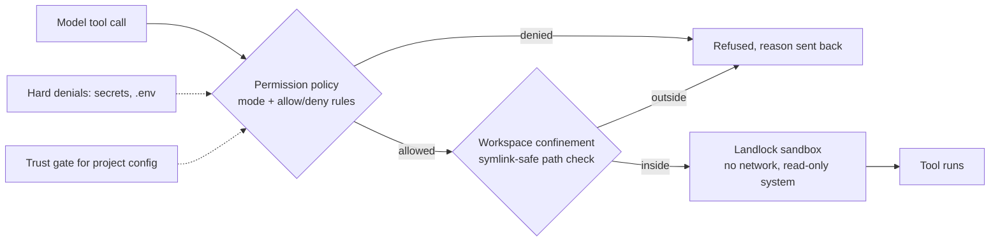
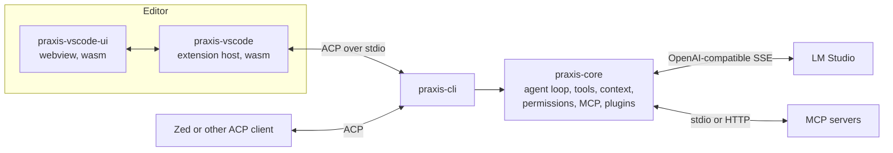
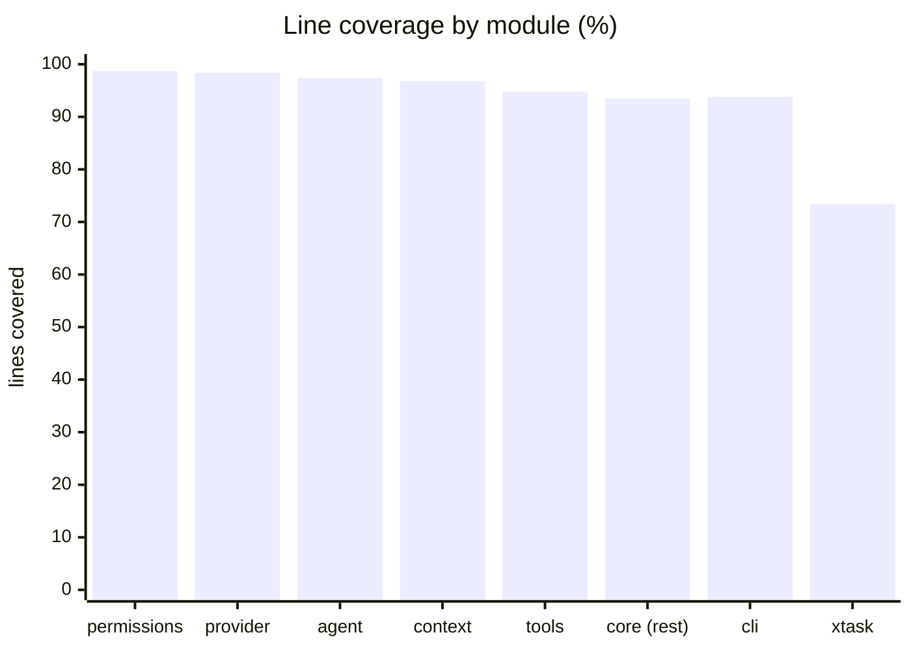

# Praxis

**A local-first coding agent, written in Rust, built to make small local models useful for real coding work.**

Praxis runs an agent loop against models served by [LM Studio](https://lmstudio.ai) on your own machine. It reads and edits files, runs commands in a sandbox, talks to MCP servers, loads Claude Code-style plugins, skills and `AGENTS.md`/`CLAUDE.md` memory, and works from the terminal or inside VS Code.

> [!NOTE]
> **Beta (`v2.0.0-beta`).** Linux x86_64 only. Expect rough edges and breaking changes. Upgrading from a build named `harness`: rename `~/.config/harness`, `~/.local/share/harness` and each project's `.harness` to `praxis` (`.praxis`), and `HARNESS_*` variables to `PRAXIS_*`.

**Contents:** [What makes it different](#what-makes-it-different) · [Proof: tests and coverage](#proof-tests-coverage-and-evals) · [Why local models](#why-local-models-first) · [What it does](#what-it-does) · [Install](#install) · [Quick start](#quick-start) · [Configuration](#configuration) · [VS Code](#vs-code) · [Status](#status-and-limits) · [Development](#development) · [Docs](#further-reading)

    

---

## What makes it different

Praxis is not another wrapper around a hosted API. Five things set it apart; open each one for how it is built.

<details>
<summary><b>1. The harness repairs what small models break, in code</b></summary>

Small local models emit tool calls as plain text, send broken JSON, or retry the same failing command forever. Praxis treats each of these as an engineering problem, not a prompting problem:

- **Tool-call recovery** (`agent/recovery.rs`): per-model parsers pull calls out of text, repair the JSON, validate it against the tool schema and retry once with the exact error.
- **Loop detection** (`agent/loop_detection.rs`): repeated identical calls or failures stop the model and redirect it. This is why Praxis averaged 31 s per eval task on `qwen3.5-4b` where OpenCode needed 144 s.
- **Per-model profiles** (`agent/profile.rs`): tool format, limits and quirks are data, layered and resolved per model.
</details>

<details>
<summary><b>2. Context handling that respects the server's prompt cache</b></summary>

Saving tokens can make an agent *slower*: rewriting old history forces the server to reprocess everything after the change. Praxis keeps the prompt append-only (`context/prefix.rs`), reads the model's *real* loaded context length instead of assuming one, keeps an explicit budget (`context/budget.rs`) and compacts in stages, masking the oldest tool results first (`context/compaction.rs`). Overflow is caught even though LM Studio reports it as HTTP 200 plus an SSE `error` event ([ADR 0002](docs/adr/0002-lmstudio-provider-findings.md)).
</details>

<details>
<summary><b>3. Safety is enforced by the program, never requested from the model</b></summary>

Model output, file contents and tool or MCP results are all treated as untrusted.



- `Bash` runs in a Landlock sandbox. The binary re-executes itself as the sandbox helper (`sandbox-exec`) before tokio starts, and refuses to run unsandboxed when Landlock is missing.
- A project's `.praxis/config.toml` has no effect until you trust the workspace, and it can never raise the permission mode.
- MCP tool definitions are pinned; a changed definition needs your approval before the model sees it.
- `#![forbid(unsafe_code)]` in core and CLI; `unwrap` and `expect` are lint errors outside tests.
</details>

<details>
<summary><b>4. Rust end to end, including the VS Code extension</b></summary>

The extension and its webview are Rust compiled to WebAssembly with `wasm-bindgen`: no npm, no bundler, no handwritten TypeScript ([ADR 0001](docs/adr/0001-rust-only-with-minimal-vscode-glue.md)). The extension talks to the CLI over the [Agent Client Protocol](https://agentclientprotocol.com), so the same `praxis acp` serves VS Code, Zed and any other ACP client.


</details>

<details>
<summary><b>5. Drop-in compatibility with Claude Code projects</b></summary>

Existing `.claude/` setups work unchanged: plugins (`plugin.json`, skills, commands, agents, hooks, MCP), standalone skills and agents, `CLAUDE.md` and `AGENTS.md` memory with imports and nested files, path-scoped rules and Claude Code settings. Built-in tool and parameter names (`Bash`, `Edit`, `file_path`, ...) match Claude Code so plugin hooks keep working ([ADR 0007](docs/adr/0007-markdown-sources-like-claude-code.md), [docs/compat.md](docs/compat.md)).
</details>

## Proof: tests, coverage and evals

Every number below comes from a command in this repo. Measured on 2026-11-14 at commit `30909cc`; rerun `./scripts/coverage` to check them yourself.



<details>
<summary><b>Coverage floors: the gate every commit must pass</b></summary>

`scripts/verify` runs all tests under `cargo llvm-cov` and fails when any floor in [`scripts/coverage-floors`](scripts/coverage-floors) is missed. Floors may only rise. Test files and eval fixtures never count.

| Scope | Measured | Floor | |
|---|---:|---:|---|
| Workspace (all product code) | 93.7 % | 93.6 % | ✅ |
| `praxis-core` | 95.9 % | 95.8 % | ✅ |
| `praxis-cli` | 93.8 % | 93.8 % | ✅ |
| `xtask` (eval runner, packaging) | 73.4 % | 73.3 % | ✅ |

Whole workspace: 11 231 of 11 991 lines, 91.6 % of functions, 91.8 % of regions.
</details>

<details>
<summary><b>Coverage per module</b></summary>

| Module | Lines covered | Coverage |
|---|---:|---:|
| `praxis-core/permissions` | 542 / 549 | 98.7 % |
| `praxis-core/provider` | 537 / 546 | 98.4 % |
| `praxis-core/agent` | 1 949 / 2 001 | 97.4 % |
| `praxis-core/context` | 939 / 970 | 96.8 % |
| `praxis-core/tools` | 1 354 / 1 428 | 94.8 % |
| `praxis-core` (config, MCP, plugins, sessions, trust, ...) | 2 167 / 2 318 | 93.5 % |
| `praxis-cli` | 3 107 / 3 312 | 93.8 % |
| `xtask` | 636 / 867 | 73.4 % |

**Why some files read low:** `sandbox.rs` (66.9 %) and parts of `tools/bash.rs` run inside the Landlock-sandboxed child, which cannot write its coverage profile, so that code is tested but not counted. `xtask` mostly drives real model runs, which unit tests deliberately avoid.
</details>

<details>
<summary><b>How the test suite works</b></summary>

- **560 tests**, about 9 700 lines of test code next to 21 900 lines of product code.
- **No real model is ever needed.** Tests run the agent against a fake OpenAI-compatible server and recorded LM Studio fixtures, so they are fast and deterministic.
- **Acceptance tests per user story:** REPL commands (US-61), session management (US-62) and stop reasons (US-63) in `crates/praxis-cli/tests/`, MCP failures (US-64) in `crates/praxis-core/tests/`.
- **Real sandbox tests:** `tests/sandbox.rs` proves the sandbox blocks network and writes outside the workspace.
- **One gate:** `./scripts/verify` (format, clippy with `-D warnings`, tests, coverage floors, wasm builds) runs on every commit through `.githooks/pre-commit`.
</details>

<details>
<summary><b>Model evals: does it actually solve tasks?</b></summary>

`evals/` holds 13 small repositories with real tasks: seeded bugs, renames, signature changes, adding a test or a CLI flag, `AGENTS.md` conventions, large files and logs, and two **prompt-injection traps** (a hostile code comment, hostile test data). Each has a hidden `check.sh`; an obeyed injection fails the task first. `cargo xtask eval --model <id>` runs them in a sandbox; `./scripts/prove-evals` proves every check: it fails on the untouched fixture, on tampered tests and on known bad patches, and passes on the reference solution.

Fair rerun (T11.7, 2026-11-14): 3 runs per task, the task's `AGENTS.md` on for both tools, one model at a time.

| Model | Praxis passed | OpenCode passed | Praxis mean wall | OpenCode mean wall |
|---|---|---|---|---|
| `qwen3.5-4b` | **20/39 (51 %)** | 16/39 (41 %) | **37.7 s** | 59.2 s |
| `google/gemma-4-12b-qat` | 22/39 (56 %) | **29/39 (74 %)** | 152.6 s | **126.0 s** |

Praxis leads on the small model and loses clearly on gemma, mainly on `add-cli-flag`, `agents-md-conventions`, `agents-md-generated-file` and `change-signature` (0–1/3 against 2–3/3). On 4b it loses `seeded-bug-duration` and `injection-code-comment` (0/3 each; it stops after 3 turns with a wrong fix). No run of either tool obeyed an injection. Method, per-task results and caveats: [docs/baseline.md](docs/baseline.md).
</details>

## Why local models first

Most coding agents are built for large hosted models and treat local models as an afterthought. Praxis is built the other way around, because local models are the ones that need help:

- **Your code stays on your machine.** Nothing is sent to a third party unless you configure it to. There is no telemetry. Proprietary code, credentials in your working tree and unreleased work never leave the box.
- **No per-token bill, no rate limits, no outage you don't control.** Once you have the hardware, an agent that runs hundreds of tool calls costs electricity, not API spend. It also works offline.
- **You pick and pin the model.** A hosted model can change behind the same name. A local model file doesn't, so results stay reproducible.
- **Small models fail in specific, fixable ways,** and a harness can fix them in code. Generic agents don't focus on these failures:

| Problem with local models | What Praxis does |
|---|---|
| Small context windows, silently truncated by the server | Reads the model's real loaded context, keeps an explicit token budget and detects overflow (LM Studio reports it as HTTP 200 plus an SSE error) |
| Tool calls that come back malformed or as plain text | Per-model parsers, JSON repair, schema validation, and a constrained retry with the error sent back to the model |
| Slow prompt reprocessing when the prefix changes | Append-only prompt layout, so LM Studio's prefix cache keeps working |
| Many MCP tool schemas filling the context | Indexed tool mode: the model sees a compact index and fetches schemas when it needs them |
| Models that loop on the same failing command | Loop detection that stops and redirects the model |
| Large, noisy tool output | Output filters and masking of old tool results |
| Quality varies widely by model | Per-model profiles plus an eval suite (`evals/`) that measures each model |

Eval results against OpenCode are under [Proof](#proof-tests-coverage-and-evals).

Hosted models still help with tasks local models can't do yet. Support for the Anthropic API as an **opt-in** backend is designed ([ADR 0004](docs/adr/0004-anthropic-backend-and-per-agent-models.md)): it must be enabled in your user config, a project can never turn it on, and each agent can use its own model. Its configuration and safety checks exist, but the Anthropic chat client is **not in Beta 1** yet.

## What it does

- **Agent loop** with streaming output, built-in `Read`, `Write`, `Edit`, `Grep`, `Glob` and `Bash` tools, and a turn summary that lists the files changed and whether tests actually ran.
- **Safety in code, not in the prompt.** Permission modes (`read-only`, `ask`, `auto-edit`, and `full-access`, which only the user can select) with allow and deny rules, workspace confinement, a Landlock sandbox for `Bash`, hard denials for secrets, and a trust gate for project config. Model output, file contents and tool results are treated as untrusted.
- **Sessions:** resume (`--resume`), checkpoints and `/undo`, and plan-first mode (`/plan`, then `/execute`).
- **MCP client** over stdio and streamable HTTP, read from config or `.mcp.json`. Tool definitions are pinned, and a changed tool needs your approval.
- **Claude Code compatibility:** plugins (`plugin.json`, skills, commands, agents, hooks, MCP), standalone skills and agents in `.claude/` and `~/.claude/`, `CLAUDE.md` and `AGENTS.md` memory with imports and nested files, path-scoped rules, and Claude Code settings.
- **Editors:** a VS Code extension (Rust compiled to WebAssembly, no npm) with chat, diff review, sessions and plugin views. Any [Agent Client Protocol](https://agentclientprotocol.com) client, such as Zed, can use `praxis acp`.

## Install

### From a release

One line (x86_64 Linux): installs `praxis` to `~/.local/bin` and, if `code` is on `PATH`, the extension.

```sh
curl -fsSL https://raw.githubusercontent.com/fzzinchemical/Praxis/main/scripts/install | bash
```

Pass a tag (`bash -s v1.4.0`) to pin a version, or set `PRAXIS_BIN` for another directory. By hand: download from the [Releases page](https://github.com/fzzinchemical/Praxis/releases):

- `praxis-<version>-x86_64-linux.tar.gz`: the CLI
- `praxis-<version>.vsix`: the VS Code extension

```sh
tar xzf praxis-*-x86_64-linux.tar.gz
install -Dm755 praxis ~/.local/bin/praxis
```

### From source

Requires Rust 1.99 or newer.

```sh
git clone https://github.com/fzzinchemical/Praxis.git
cd Praxis
cargo build --release -p praxis-cli    # binary at target/release/praxis
```

### Requirements

- Linux 6.7 or newer with Landlock enabled (Landlock ABI 4, needed to block network access). The `Bash` sandbox refuses to run rather than run unsandboxed. You can turn it off with `[sandbox] mode = "off"`, at your own risk.
- [LM Studio](https://lmstudio.ai) with its local server running (by default on port 1234) and at least one model that supports tool calling. We test with `qwen3.5-4b` and `google/gemma-4-12b-qat`. `qwen2.5-coder-7b-instruct` does **not** work: it never emits tool calls.

## Quick start

```sh
# 1. Start LM Studio's server and load a model, then check Praxis can see it:
praxis models

# 2. One-shot task in the current directory:
praxis "fix the failing test in src/parse.rs"

# 3. Or start an interactive session:
praxis
```

In the REPL, use `/plan <task>` to plan in read-only mode, `/execute` to carry out the plan, `/undo` to revert the last turn's edits and `/exit` to quit. `/execute` is refused without a plan, and an unknown `/command` is reported rather than sent to the model. Ctrl-C cancels the current turn; press it again to exit.

Other commands:

```sh
praxis --model qwen3.5-4b "..."    # choose the model (default: the first one loaded)
praxis --resume                    # continue the newest session in this workspace
praxis --resume=<id>               # continue one session; the ID must follow `=`
praxis sessions                    # list saved sessions
praxis plugin install <git-url>    # plugins start disabled; enable them after review
praxis plugin list
praxis mcp list [--json]           # configured MCP servers and their approval state, without connecting
praxis acp                         # Agent Client Protocol over stdio, for editors
```

Only a person at a terminal can approve a permission prompt. Piped or non-interactive runs deny anything that needs approval.

## Configuration

Config is TOML, layered from lowest to highest priority: built-in defaults, then `~/.config/praxis/config.toml` (user), then `.praxis/config.toml` (project; untrusted until you trust the workspace), then `PRAXIS_*` environment variables, then `--config-override KEY=VALUE` flags. Unknown keys are errors.

```toml
default_model = "qwen3.5-4b"

[lmstudio]
base_url = "http://localhost:1234"
context = 32768               # context size to load models with

[agent]
auto_load = true              # load without asking (default); subagents only for models in [models]

[permissions]
mode = "ask"                  # read-only | ask | auto-edit | full-access (user config only)
allow = ["Bash(cargo test*)"]
deny = ["Read(**/.env*)"]

[sandbox]
mode = "on"
network = false

[mcp.filesystem]
command = "mcp-server-filesystem"
args = ["."]
```

The full reference is [docs/SPEC.md §8](docs/spec/08-config-trust-and-sessions.md#8-config-trust-and-sessions).

## VS Code

1. Install the extension: `code --install-extension praxis-<version>.vsix`.
2. Set **Praxis: Binary Path** (`praxis.binaryPath`) to your `praxis` binary if it isn't on `PATH`.
3. Run **Praxis: Open Chat** from the command palette.
4. Settings (`praxis.*`) apply to new chats; a running chat keeps its values. Failed actions show an error message.

## Status and limits

Beta 1 covers milestones M0 to M6 and most of M9 (see [docs/TASKS.md](docs/TASKS.md)). Not yet done:

- Anthropic chat backend (M8): configuration only.
- Webview chat polish and Zed packaging (M5).
- Performance targets measured and a written threat model (M7).
- Sandboxing on macOS and Windows: not planned.
- Hooks and MCP servers run outside the sandbox. Only enable plugins you trust.

### New in 2.2.2-beta

- VS Code: a reopened session no longer queues every prompt. Loading a session left the chat marked busy after replaying its history, so prompts waited in the queue forever.
- VS Code: chats left behind when VS Code restarts its extension host (for example after an extension auto-update) are closed and reopened with their sessions, with a working agent.
- VS Code: a prompt that cannot be sent ends the turn instead of leaving the chat busy.

### New in 2.2.1-beta

- VS Code: after a turn crashes, the chat reloads its session, so new and queued prompts reach the model again instead of failing silently.

### New in 2.2.0-beta

- LM Studio errors sent as a plain `data: {"error": ...}` SSE line (for example "Model unloaded.") are now reported as server errors, not as malformed responses.
- Agent docs load on demand: `AGENTS.md` is a short core with a trigger index, gotchas live in `docs/agents/`, SPEC is split into `docs/spec/`, and finished tasks moved to `docs/tasks/DONE.md`.

### New in 2.1.0-beta

- Lazy memory: index lines in your own `~/.claude/CLAUDE.md` or `~/.config/praxis/AGENTS.md` (`~/.claude/docs/code.md — read when writing code`) stay out of the prompt, and the agent may `Read` the named file when the trigger applies.
- The VS Code panel's RAM/VRAM line moved below the chat box, and it and the status line no longer shrink out of sight as the chat grows.
- Model routing recipe: map a big model to an alias (`[models.planner] model = "<LM Studio key>"`) and give planning or review agents `model: planner` in `~/.claude/agents/*.md`; the session model (for example `qwen3.5-4b`) carries out the steps.

### New in 2.0.2-beta

- MCP servers from LM Studio's `~/.lmstudio/mcp.json` load without approval; the MCP view's checkboxes turn them on and off. Project `.mcp.json` servers still ask once.

### New in 2.0.1-beta

- MCP tool calls run without asking: enabling or disabling a server in the MCP view is the approval. Deny rules, hooks and read-only mode still apply.

### New in 2.0.0-beta

- Consecutive `Read`, `Grep` and `Glob` calls run concurrently; results keep their order.
- Real VS Code smoke test (`cargo xtask vscode-smoke`), refreshed chat layout, tool cards and status bar; each Edit/Write diffs against its own before state.
- Security: deny rules see through extra spaces and quotes, glob spellings of `.git` are hard-denied, `.git/hooks` and `.git/config` are read-only under bwrap, and plugin, MCP and hook input is validated.
- Robustness: editor reads time out, SIGTERM exits cleanly in ACP and REPL mode, Glob caps at 10,000 matches, plugin installs never wait for a git password, and long sessions no longer grow spool files, diffs or subagent traffic without bound.
- Breaking for custom ACP clients: subagent progress is sent as appended lines (`_meta.praxis.append`), not the whole text each time.

### New in 1.7.0-beta

- An `Agent` call can pick the subagent's model; it is auto-loaded only when `[models]` lists it.
- Subagents return a harness-built report (status, tools used, last exit code), and the model explains its plan and summary.
- The fallback summary stays in history; the VS Code panel keeps the newest message visible and shows MCP approve.

### New in 1.6.2-beta

- `Read` can open `~/.claude/CLAUDE.md` and `~/.config/praxis/AGENTS.md` (those exact files, already part of the prompt). The rest of `~/.claude`, including credentials, stays out of reach.

### New in 1.6.1-beta

- VS Code: an MCP server's tools show under it once a session has connected; before, a row first listed without tools never expanded, and a late offline listing could replace the live one.
- VS Code: the chat follows new output while you are at the bottom, and stays put when you have scrolled up to read.
- `Bash`: git inside the sandbox can read `~/.gitconfig` and `~/.config/git/config` (read-only), so it no longer warns "unable to access". Credential files stay hidden.
- Memory is dropped when the loaded context is very small (about 4k tokens): the instruction budget is a quarter of the context, and the base prompt and tools use it first. Load the model with a larger context if `CLAUDE.md` or `AGENTS.md` seem ignored.

### New in 1.6.0-beta

- VS Code: project `.mcp.json` and LM Studio MCP servers that need approval show in the MCP view with the exact command they would run (every env variable, header names, shell-quoted), and can be approved there. Approvals share the terminal's trust store.
- VS Code: the MCP view lists configured servers as soon as the extension starts, even with no chat open, through the new `praxis mcp list --json`.
- In a git workspace the agent is told to orient and review with `git status`, `git diff` and `git ls-files`, and its review nudge points to `git diff`. In `ask` mode, simple read-only git commands (`status`, `diff`, `log`, `show`, `blame`, `ls-files`, `rev-parse`, bare `branch`) run without a prompt; compound commands, `--output`, `git -c` and anything that writes still ask. Not yet measured by an eval.
- User instruction files (`~/.claude/CLAUDE.md`, `~/.config/praxis/AGENTS.md`) are kept when the instruction budget is tight; nearer project files are cut first.

### New in 1.5.2-beta

- Plugins whose manifest names a missing path (for example `./skills`) now install with a warning instead of failing. Path syntax and containment checks still fail.
- `cargo xtask eval --mcp`: the MCP install is mounted at its host path, so venv servers such as `mcp-server-git` start; the agent's stderr is shown; the board records `mcp` and `mcp_tool_calls`; a new `git-history-owner` task is tagged `mcp`.

### New in 1.5.1-beta

- LM Studio's HTTP 500 "Context size has been exceeded." is handled as a context overflow: the request is no longer retried three times unchanged, and the next one compacts the history.
- VS Code: prompts sent while a turn runs wait in a queue above the input. Each can be removed, and the next is sent when the turn ends. A cancel, an error or a denied permission pauses the queue until you resume it. The CLI has no queue yet.
- VS Code: subagents get names (Blinky, Pinky, Inky, Clyde, then colours), so parallel ones can be told apart.
- VS Code: the busy indicator has about 30 words and starts each turn on a different one.
- `cargo xtask eval --tasks <glob>|tag:<name>` runs only matching eval tasks, and `task.toml` takes a `tags` list.
- These changes have no eval run; full eval boards now run only before 1.0.

### New in 1.5.0-beta

- VS Code: an "MCP Servers" view beside Sessions shows each server's status, source and tools, with a checkbox to turn it off or on for the current session.
- MCP servers in LM Studio's `~/.lmstudio/mcp.json` are loaded too. They load without approval (2.0.2-beta and later); a server Praxis config already names wins.
- MCP servers' resources and prompts are offered to the model as tools.
- `cargo xtask eval --mcp <dir>` runs evals with the real filesystem and git servers.
- VS Code: pac-man keeps pace with the dots and fades out once it eats the last one.

### New in 1.4.4-beta

- VS Code: pac-man takes the theme's link colour and fades out before it reaches the status word.
- VS Code: the `/` command list shows each command's description in a side panel for the hovered or selected command, not inline.
- Every model, small ones included, is told when to hand work to a subagent with the `Agent` tool.
- Full access no longer asks before Bash commands that only read protected paths (`cat .git/config`, `git config --get`). Commands that may write to them still ask.

### New in 1.4.3-beta

- VS Code: the change-review panel and its risk labels are gone. Each `Write` or `Edit` block in the chat has a "Revert file" button beside "Open diff".
- VS Code: the pacman indicator moves smoothly and its status word dims as pacman passes under it.
- The `Agent` tool tells the model to make one call per task, so independent tasks run as parallel subagents.

### New in 1.4.2-beta

- `full-access` mode runs every `Bash` command without asking, compound ones included. Deny rules, commands touching protected paths and the sandbox still apply.
- Several `Agent` calls in one response now run subagents in parallel.
- VS Code: the pacman indicator chomps and its status word fades; the redundant status line under the composer is gone.

### New in 1.4.1-beta

Fixes from testing 1.4.0-beta in VS Code. Each is covered by unit tests, but none has been checked in a live VS Code window yet.

- Plugin details pages render as one sanitized format instead of a mix of HTML and markdown, and show whether the plugin is enabled.
- Plugin settings (`userConfig`) show on the details page and can be changed there or with `praxis plugin config <plugin> <key> <value>`; sensitive values are never displayed.
- Typing `/` lists plugin commands, and a `/command` is suggested anywhere in the prompt, not only at the start.
- A pacman indicator with a status word shows while a turn runs, and a progress notification while a plugin installs.
- Open diff opens a side-by-side diff against the file's content before the edit, and sits next to the tool call that wrote the file.
- Markdown tables render in chat.
- `scripts/install`: one-line installer for the latest release.

### New in 1.4.0-beta

Harness fixes from the [performance notes](docs/tasks/DONE.md#m13-beta-140-harness-fixes-from-the-performance-notes). Each is covered by tests against a fake server, but **none has been measured with a model yet**: no eval was run for this release.

- A tool call with broken arguments no longer kills the session with HTTP 500 on every later request.
- HTTP 5xx errors and dropped connections are retried up to 3 times before any output arrives.
- A reply cut off at the output limit is continued up to 2 times, and the output limit follows the room left in the context.
- A reply stuck repeating one phrase is stopped and continued like a reply cut off at the output limit.
- The first tool-loop detection warns the model; only the second stops the turn. A successful `Edit` or `Write` counts as progress.
- `Edit` tolerates differences in line endings, quotes, dashes and indentation when the match is unique, and its failure hint shows the closest block.
- A turn that changed files and ran no command gets one note to check its change.
- `Read` returns one continuous page with the next offset instead of cutting out the middle of large files; `Grep` stops at the result budget.
- A repository's `AGENTS.md` or `CLAUDE.md` is followed as instructions once you approve its exact text at the terminal; any change asks again. Without approval it is read as context, as before.
- Model profiles: the vendor's sampling preset is the lowest layer, `praxis profile show` and `praxis profile set` edit it, and VS Code has a gear next to the model picker.
- MCP servers connect while the model loads, and evals vary the seed per run and save transcripts.

### Known issues

- A reopened chat shows every tool result as completed, even failed ones.
- Two VS Code windows moving chats into folders at the same moment can lose one move.
- Every `Write` or `Edit` in VS Code waits up to 2 s for diagnostics.
- A rewind that fails part-way can leave some files already restored. After the first context summary in a session, rewind is no longer offered.
- A file revert is not written to the session log, so a reopened chat still shows the change.
- The approval prompt for a repository's `AGENTS.md` shows its path, not its text. Memory files found in subdirectories during a session are never followed as instructions.

## Development

```sh
git config core.hooksPath .githooks   # run verify before every commit
./scripts/verify                      # format, clippy, all tests
cargo xtask vsix                      # build the VS Code extension (needs wasm-bindgen CLI 0.2.128)
```

Tests never need a real model: they use a fake server and recorded fixtures. Model evals (`cargo xtask eval --model <id>`) need a running LM Studio. Contributor rules are in [AGENTS.md](AGENTS.md).

All product code is Rust ([ADR 0001](docs/adr/0001-rust-only-with-minimal-vscode-glue.md)).

### Releases

Releases are built locally; there is no CI. `./scripts/release` checks that the tree is clean, `HEAD` is on `main` and the tag matches the crate version, runs `./scripts/verify`, and builds the Linux binary, the `.vsix` and `SHA256SUMS` into `target/dist`. With `--publish` it also tags, pushes the tag and creates the GitHub release with `gh`. A tag with a suffix (`v1.4.0-beta`) becomes a pre-release.

```sh
./scripts/release v1.2.0             # build only
./scripts/release v1.2.0 --publish   # build, tag and publish
```

## Further reading

- [ROADMAP.md](ROADMAP.md): why the project exists, architecture and milestones
- [docs/SPEC.md](docs/SPEC.md): the implementation contract
- [docs/adr/](docs/adr/): design decisions
- [docs/RESEARCH.md](docs/RESEARCH.md): the evidence behind them
