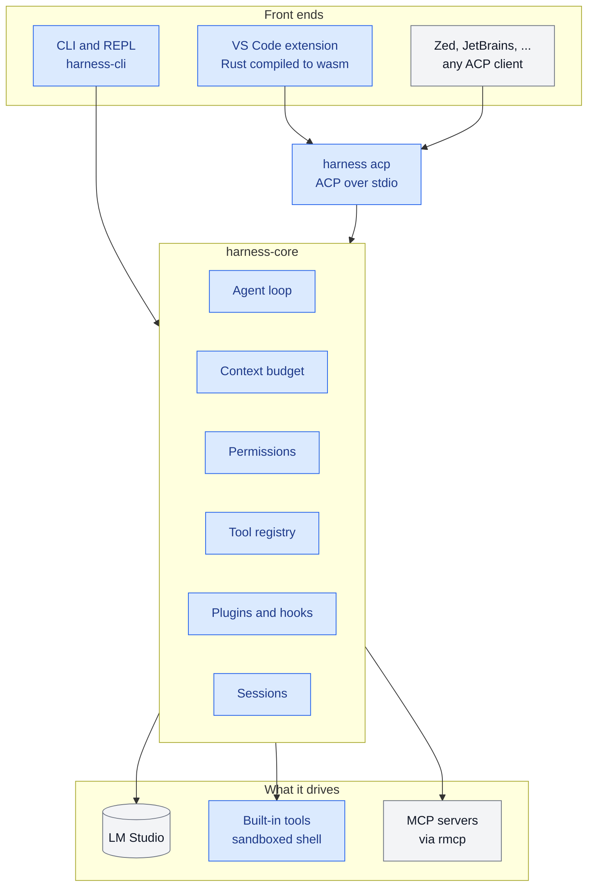
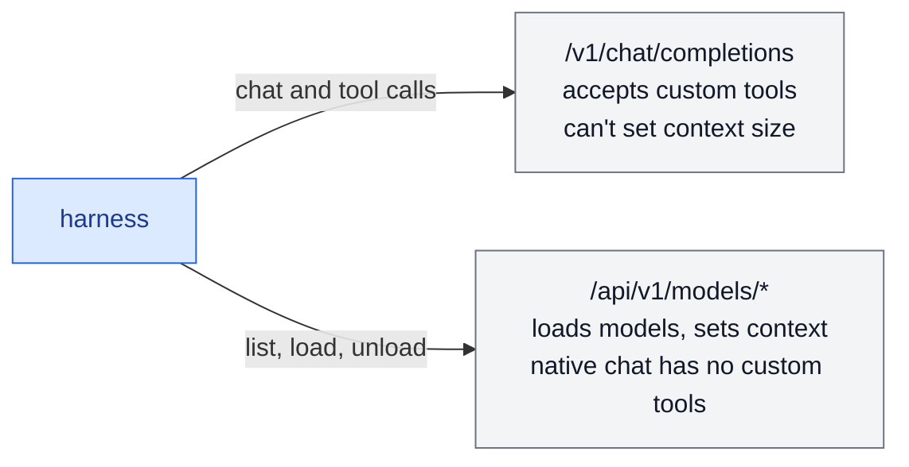
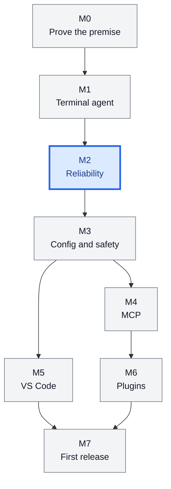

# Roadmap: local-first AI coding harness

**A Rust agent harness for local models served by LM Studio, with tools, MCP, plugins, VS Code integration and layered config.** Nothing leaves the machine unless the user configures it to.

> [!NOTE]
> **Status: planning, nothing implemented.** `harness` is a placeholder name.
> Build detail is in [docs/SPEC.md](docs/SPEC.md); status and task order are in [docs/TASKS.md](docs/TASKS.md); priorities are in [docs/USER_STORIES.md](docs/USER_STORIES.md); the evidence behind decisions is in [docs/RESEARCH.md](docs/RESEARCH.md).

**Contents:** [Why build this](#why-build-this) · [Architecture](#architecture) · [Milestones](#milestones) · [Deliberately left out](#deliberately-left-out) · [Risks](#risks) · [Sources](#sources)

---

## Why build this

OpenCode, Goose and Cline already cover "agent + local model + MCP". A generic clone isn't worth building. The reason to build is that local models fail in ways those tools don't centre on:

| Local problem | What the harness does about it |
|---|---|
| Small context windows, silently truncated by the server | Explicit token budget per model; the harness sets the window and detects truncation |
| Tool calls that come back malformed or as plain text | Per-model parsers, JSON repair, schema validation, and errors returned to the model for retry |
| Slow prompt reprocessing when the prefix changes | Stable, append-only prompt prefix, so the server's prefix cache keeps working |
| Dozens of MCP tool schemas eating the context | Lazy tool loading: the model gets a compact index and fetches schemas on demand |
| Quality varies widely by model | Per-model profiles, plus an eval suite that measures them |

> [!IMPORTANT]
> M0 tests this claim. If an existing tool already handles these well, contributing to it (Goose is also Rust) beats building a new one.

---

## Architecture

Crates: `harness-core`, `harness-cli`, and two wasm crates for the VS Code extension and its webview. The layout is in [docs/SPEC.md](docs/SPEC.md) §3.

### Decisions

| Decision | Choice | Why |
|---|---|---|
| **Language** | Rust only | Project requirement. VS Code forces a few small non-Rust files; [ADR 0001](docs/adr/0001-rust-only-with-minimal-vscode-glue.md) lists them. |
| **Front-end protocol** | Agent Client Protocol (ACP) | A standard with a Rust crate; Zed and JetBrains come almost free. VS Code has no native support, so we ship a thin extension either way. Falls back to our own JSON-RPC if the M0 spike finds it too unstable. |
| **MCP** | `rmcp`, the official SDK | Don't hand-roll a protocol that changes this often. |
| **Plugin format** | Claude Code's layout (`plugin.json`, `skills/`, `commands/`, `agents/`, `hooks/`, `.mcp.json`) | Existing plugins and skills become reusable, and it is plain files. |
| **Plugin code** | External processes only | No dynamic Rust loading or WASM: hooks and MCP servers already cover extension. |
| **Config** | TOML, layered | Defaults < user < project < env < CLI flags. |
| **Model backend** | LM Studio only | A single backend to get right, with no provider abstraction to maintain. |
| **Model hosting** | Out of scope | We connect to servers; we never run models. |

### LM Studio facts that shape the design

No single LM Studio endpoint gives both custom tools and context control, so the harness uses two:

---

## Milestones

Each one ends in something usable. Sizes are relative, not dates. Task-level status is tracked only in [docs/TASKS.md](docs/TASKS.md).

| | Milestone | Size | Outcome |
|---|---|---|---|
| **M0** | [Prove the premise](#m0-prove-the-premise-and-answer-the-unknowns) | S | Build-or-contribute decision, answered unknowns |
| **M1** | [Terminal agent](#m1-a-working-agent-in-the-terminal) | M | Fixes a seeded bug end to end |
| **M2** | [Reliability](#m2-make-local-models-reliable) | **L** | **The core of the project:** measurably beats the baseline |
| **M3** | [Config and safety](#m3-configuration-sessions-safety) | M | A hostile repo can't do anything without approval |
| **M4** | [MCP client](#m4-mcp-client) | M | Real MCP servers work on small windows |
| **M5** | [VS Code](#m5-vs-code-integration) | L | Fix, review and accept without leaving the editor |
| **M6** | [Plugins](#m6-plugins) | M | An unmodified Claude Code plugin works |
| **M7** | [First release](#m7-first-release) | S | Packaged, documented, measured |

### M0: Prove the premise and answer the unknowns

- Install LM Studio (not on this machine yet) and choose 2-3 coding models that fit the hardware
- Run OpenCode and Goose on the same models and tasks; record what actually breaks
- **Go/no-go:** build, or contribute upstream, based on those failures
- Spike: do streaming and tools work together on each endpoint? Which model families emit broken calls?
- Spike: how reliably does loading set the context size, and how can truncation be detected?
- Spike: measure prefix-cache gains on real prompts
- Spike: minimal ACP agent, tested in-process
- Spike: Rust-only VS Code extension through `wasm-bindgen`, packaged with no npm
- Set up the repo: git, `AGENTS.md`, `scripts/verify`, a fake LM Studio server for deterministic tests
- Write 10-15 eval tasks (fix a seeded bug, multi-file rename, add a test) on fixture repos

✅ **Done when:** spike results are recorded as ADRs and the go/no-go is decided.

### M1: A working agent in the terminal

- LM Studio streaming client, cancellation, clear errors when the server is down or no model is loaded
- Agent loop that emits typed events, so front ends never touch its internals
- Tools: read, write, edit, grep, glob, shell
- Permissions from day one: reads are allowed, writes and shell prompt. Paths are confined to the workspace, symlinks included
- `harness "fix the failing test"` plus an interactive REPL

✅ **Done when:** it fixes a seeded bug end to end on LM Studio with a real model.

### M2: Make local models reliable

- Model profiles: context size, tool-call format, sampling, stop tokens; autodetected where possible, overridable in config
- Tool-call recovery: text-embedded calls, JSON repair, schema validation, errors fed back to the model
- Context budget: per-category token accounting, truncated tool output with a way to fetch the rest
- Tiered compaction that preserves the prompt prefix: mask old tool output in rare batches, and summarise only if needed. Truncation detection
- Rule-based output filters and cheap repeat reads, kept only if evals support them
- Loop detection: repeated identical calls and no-progress cycles stop and report to the user
- Repo map (tree-sitter symbols) in place of reading whole files
- Eval runner and per-model scoreboard: success rate, turns, parse failures, time, tokens reprocessed, re-fetches, injection results

✅ **Done when:** the eval success rate clearly beats the M1 baseline and the M0 tools on the same models. Evals stay out of `scripts/verify` because real models aren't deterministic.

### M3: Configuration, sessions, safety

- Layered TOML config, with schema validation and errors that name the file and key
- `AGENTS.md` loading, within the context budget
- Permission rules (allow/ask/deny by tool and pattern) and modes (read-only, ask, auto-edit)
- Shell sandbox: Landlock on Linux, no network unless allowed
- **Project config is untrusted:** a cloned repo can't add hooks, MCP servers or permissions until the user approves them, and re-approval is required when they change
- Session persistence and resume; checkpoint and undo for file edits

✅ **Done when:** a hostile fixture repo can't execute anything or escape the workspace without an approval.

### M4: MCP client

- stdio and streamable HTTP via `rmcp`; tools first, then resources and prompts
- Config format compatible with `.mcp.json`, namespaced tool names, permission rules per tool
- Lazy tool loading so large servers fit in small windows
- MCP output counts as untrusted: budgeted, truncated, and never able to grant permissions
- Tool definitions are pinned, so a changed tool needs approval again
- Survive server crashes and timeouts without killing the session

✅ **Done when:** real filesystem, git and browser MCP servers work on a model with a small window, with eval scores no worse than without them.

### M5: VS Code integration

> [!TIP]
> M4 and M5 are independent; swap them if the editor matters more.

- `harness acp` mode over stdio
- Extension: chat panel, streaming, status line, collapsed tool activity, permission prompts, model picker, stop button
- Diffs shown in the native diff editor, with accept and reject
- Plan-first flow, turn summaries from the tool log, and change-set review from overview to chunk
- Context from the active file, selection and diagnostics
- Keyboard accessible, labelled controls, Workspace Trust respected
- Packaged as a `.vsix`, usable offline, compatible with VSCodium

✅ **Done when:** a full fix-review-accept cycle happens without leaving VS Code. Working in Zed with no extra code is a bonus, not a requirement.

### M6: Plugins

- Discovery and manifest parsing (supported subset in [docs/SPEC.md](docs/SPEC.md) §12)
- Skills, with descriptions in the prompt and bodies loaded on demand
- Slash commands and agent definitions
- Hooks: pre/post tool use, session start, stop; external process with JSON over stdin/stdout
- Plugin-bundled MCP servers; `${CLAUDE_PLUGIN_ROOT}` supported for compatibility
- `harness plugin install <path|git-url>`, pinned to a commit, with a list of what the plugin can run shown before enabling

✅ **Done when:** an unmodified existing Claude Code plugin with a skill, a hook and an MCP server works.

### M7: First release

- Installer and packaged binaries, docs, config reference, a tested-models table from the scoreboard
- Threat model written down
- Rich TUI (ratatui), only if the REPL proves insufficient in daily use

---

## Deliberately left out

Add these only when real use demands them:

| Left out | Why |
|---|---|
| **Parallel subagents** | One GPU means they contend or force model swaps. Sequential delegation can come after M6. |
| **Plugin marketplace** | Git URLs are enough. |
| **Embeddings/RAG index** | Try the repo map and grep first. |
| **Prompt compression, minification, helper models** | [Research](docs/RESEARCH.md#token-reduction) shows they harm results on code or need a second model the GPU can't spare. |
| **Proactive suggestions** | They keep inference running on the only GPU. |
| **Other model backends** | Ollama, other OpenAI-compatible servers and cloud providers. LM Studio is the only backend. |
| **Model routing** (small model for summaries, big for coding) | Attractive, but swapping costs load time. Measure in M2 before building. |
| **Windows and macOS sandboxing** | Linux first. |
| **Telemetry** | None, ever. |

---

## Risks

| Risk | Mitigation |
|---|---|
| Local models are too weak for agent loops whatever the harness does | M0 and the M2 eval measure this early; narrow the supported tasks if needed |
| Prompt injection through files, web pages or MCP output, made worse by weaker models | Permissions and the sandbox are enforced in code, never by the model |
| Malicious repo or plugin config | Approval gate in M3; pinned plugins and shown capabilities in M6 |
| ACP is still changing and VS Code has no native support | M0 spike; keep ACP behind the event layer so it can be swapped |
| Rust-only VS Code extension proves impractical | M0 spike before any UI work; ask the project owner if it needs more than the glue ADR 0001 allows |
| Server APIs drift (LM Studio's API has already changed versions) | Keep backend layers thin; contract tests against recorded responses |
| Relying on a single closed-source server | Chat uses LM Studio's OpenAI-compatible route, so moving later would mostly mean replacing the thin model-management layer |
| Large scope for one project | Each milestone is usable alone; M2 is the priority if time runs short |

---

## Sources

- [LM Studio REST API](https://lmstudio.ai/docs/developer/rest)
- [rmcp 3.9.0](https://docs.rs/crate/rmcp/3.9.0/source/README.md)
- [ACP](https://zed.dev/acp) · [ACP Rust SDK](https://github.com/agentclientprotocol/rust-sdk)
- [Open source CLI agents comparison](https://pinggy.io/blog/best_open_source_cli_coding_agents/)
- [Claude Code plugin manifest](https://code.claude.com/docs/en/plugins-reference) · [hooks](https://code.claude.com/docs/en/hooks)
