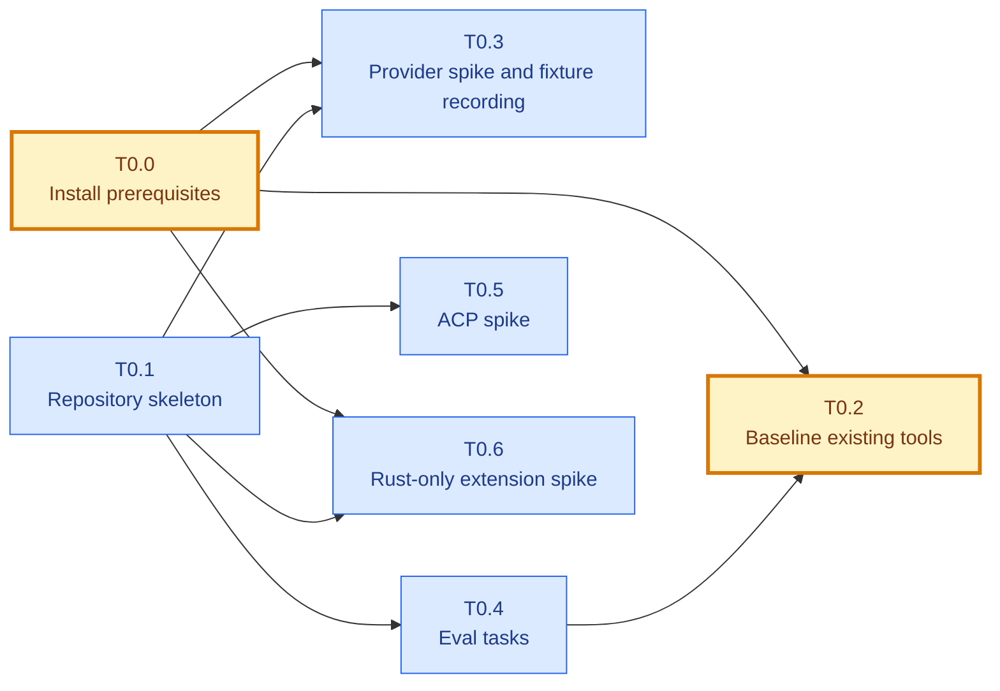
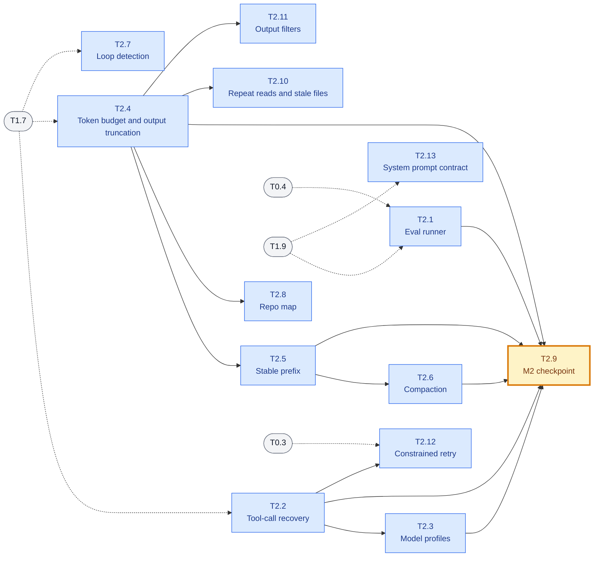
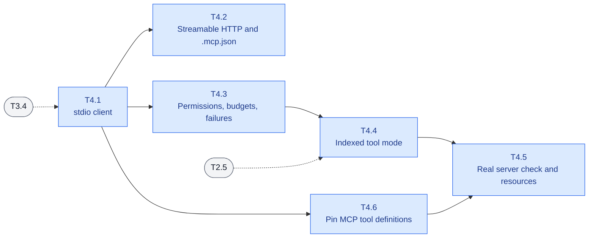
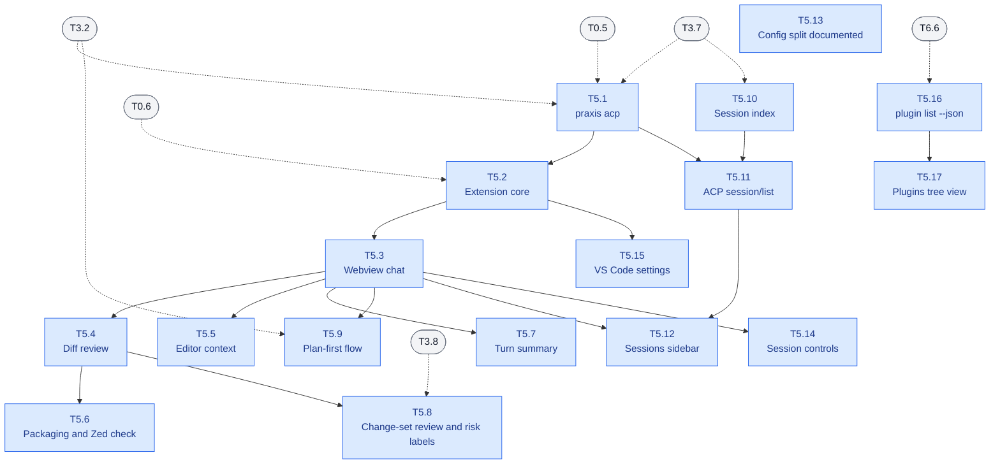
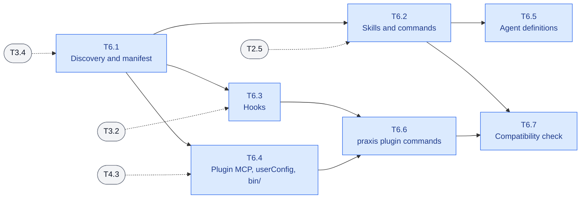
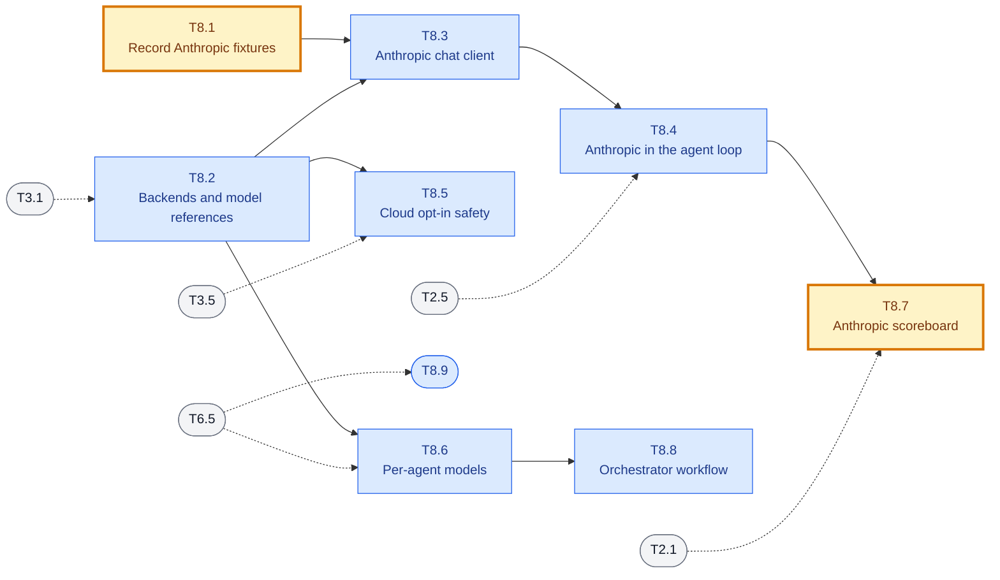
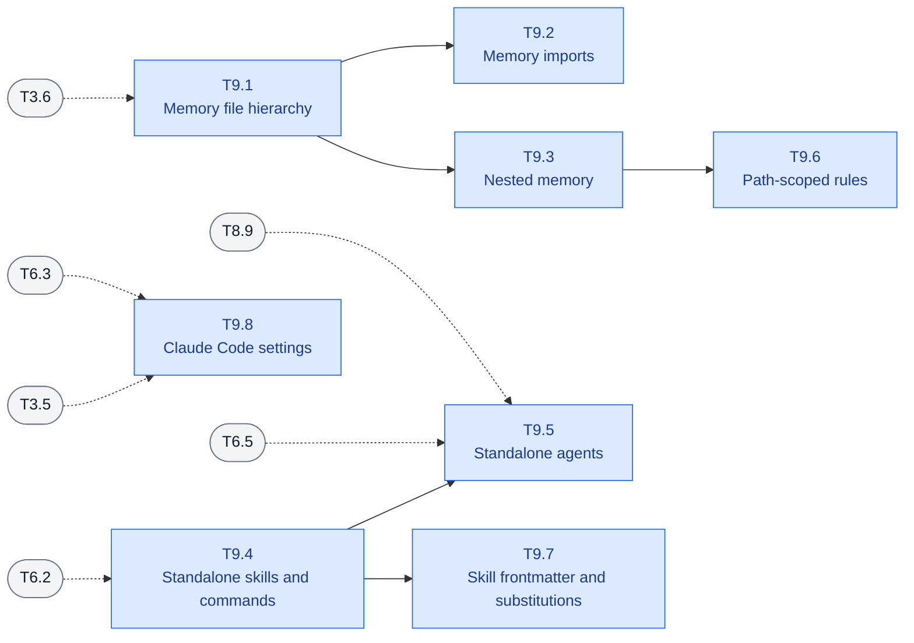
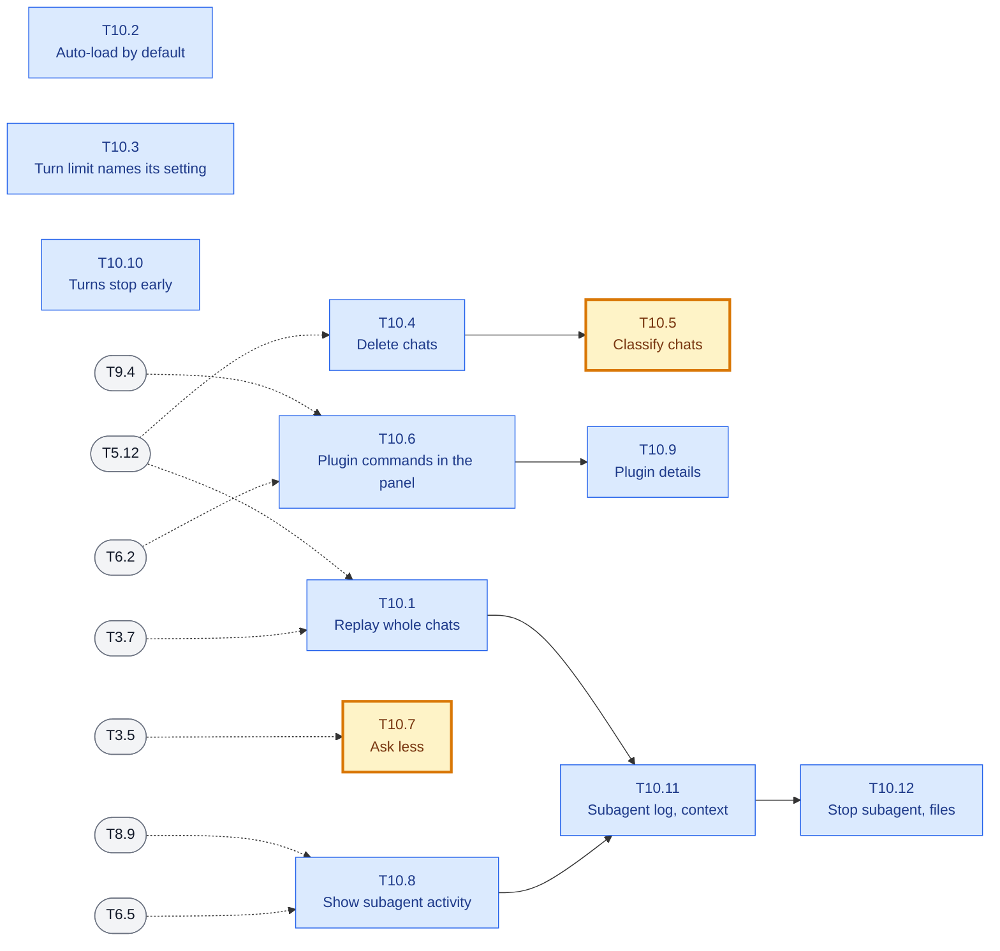
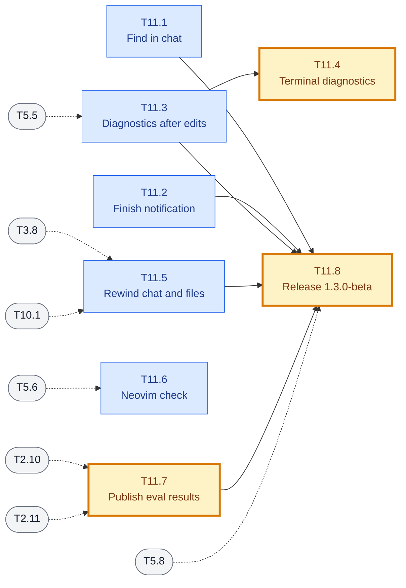
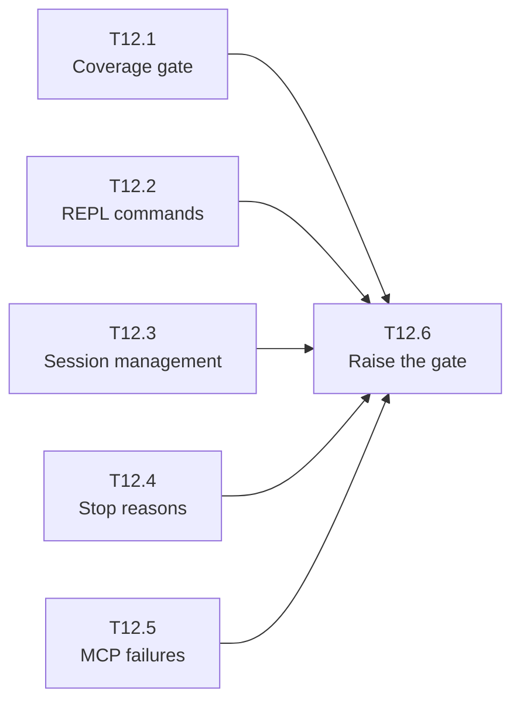

# Tasks

The ordered work list and the source of truth for status. Workflow is in [AGENTS.md](../AGENTS.md); `§` refers to [SPEC.md](SPEC.md).

> [!IMPORTANT]
> Take the first unchecked task whose dependencies are done. Each task is one branch of about 400 lines, merged locally; split it if it grows. "Done when" names the check that proves it, so write that check first. `HUMAN` means stop and get a person's input or decision. Tasks marked *Should* or *Could* can be cut if the owner chooses ([priorities](USER_STORIES.md)); unmarked tasks are Must or enabling work.

| | Milestone | Tasks | Goal |
|---|---|---|---|
| **M0** | [Prove the premise, answer the unknowns](#m0-prove-the-premise-answer-the-unknowns) | 7 | Prove the premise and answer the unknowns before any real code. |
| **M1** | [A working terminal agent](#m1-a-working-terminal-agent) | 8 | A terminal agent that fixes a seeded bug end to end. |
| **M2** | [Reliability on local models](#m2-reliability-on-local-models) | 13 | The core of the project: measurably better results on local models. |
| **M3** | [Config, sessions, safety](#m3-config-sessions-safety) | 8 | A hostile repository can't do anything without approval. |
| **M4** | [MCP client](#m4-mcp-client) | 6 | Real MCP servers work, even on small context windows. |
| **M5** | [VS Code](#m5-vs-code) | 12 | Fix, review and accept without leaving the editor. |
| **M6** | [Plugins](#m6-plugins) | 7 | An unmodified Claude Code plugin works. |
| **M7** | [First release](#m7-first-release) | 5 | Packaged, documented and measured. |
| **M8** | [Anthropic backend and per-agent models](#m8-anthropic-backend-and-per-agent-models) | 8 | A Claude model runs the same loop, and each agent can use its own model. |
| **M9** | [Markdown sources](#m9-markdown-sources) | 8 | A repository set up for Claude Code works unchanged: memory files, rules, skills, commands and agents. |
| **M10** | [Beta 1 feedback](#m10-beta-1-feedback) | 12 | Fix what Beta 1 users hit first: chat history, fewer prompts, plugin commands, subagent activity. |
| **M11** | [Beta 1.3.0: community requests](#m11-beta-130-community-requests) | 8 | Ship the most-wanted features of other agents that fit a local, single-GPU harness. |

102 tasks in total. In the graphs, blue tasks are for agents, amber tasks with a heavy border need a person, and grey dashed links come from other milestones.

---

## M0: Prove the premise, answer the unknowns

> Prove the premise and answer the unknowns before any real code.

- [x] **T0.0 Install prerequisites** `HUMAN`
  - **Do:** `sudo pacman -S rust-wasm wasm-bindgen`; install LM Studio; choose 2-3 tool-capable coding models that fit 16 GB VRAM; start its server.
  - **Done when:** `curl localhost:1234/api/v1/models` lists a model, and `rustc --print target-libdir --target wasm32-unknown-unknown` points at an existing directory.

- [x] **T0.1 Repository skeleton**
  - **Needs:** nothing.
  - **Do:** `git init` with `main`; workspace per §3 with empty crates; shared lints and release profile (§2); `#![forbid(unsafe_code)]`; `.gitignore`; `scripts/verify` (§14).
  - **Done when:** `./scripts/verify` passes on the empty workspace, and fails on a deliberately added lint violation, which is then removed.

- [x] **T0.2 Baseline existing tools** `HUMAN` decides the outcome
  - **Needs:** T0.0, T0.4.
  - **Do:** run OpenCode and Goose on the T0.4 tasks with the chosen model; record outcomes and failure kinds in `docs/baseline.md`.
  - **Done when:** `docs/baseline.md` has results per tool and model, and **the human has decided to build, narrow scope, or contribute upstream**, recorded as an ADR. The rest of this file assumes "build".
  - **Result (2026-11-12):** OpenCode only (Goose not run), one run per task. Owner chose build ([ADR 0006](adr/0006-build-after-baseline.md)).

- [x] **T0.3 Provider spike and fixture recording**
  - **Needs:** T0.0, T0.1.
  - **Do:** script real requests against LM Studio with each model: streaming with tools, context setting, oversized prompts, and repeat requests with a shared prefix. Save raw responses under `crates/praxis-core/tests/fixtures/lmstudio/`. Resolve the provider `UNVERIFIED` items in §5.2, including how to observe cache reuse. Measure cache gains.
  - **Done when:** §5.2 has no provider `UNVERIFIED` items left, truncation thresholds are written into §7, and an ADR records the measured cache benefit and which tool-call formats each model emitted.

- [x] **T0.4 Eval tasks**
  - **Needs:** T0.1.
  - **Do:** 10-15 tasks per §14, covering a seeded bug, multi-file rename, adding a test, following `AGENTS.md`, a large file that won't fit in context, and a repo with a prompt-injection comment.
  - **Done when:** each task's `check.sh` fails on the untouched fixture and passes on a hand-applied reference solution.

- [x] **T0.5 ACP spike**
  - **Needs:** T0.1.
  - **Do:** throwaway agent using `agent-client-protocol` 5.x that echoes a prompt and requests one permission. Resolve the `UNVERIFIED` schema items in §11.
  - **Done when:** an in-process client test passes, §11 is updated, and an ADR records keeping ACP or replacing it with our own JSON-RPC.

- [x] **T0.6 Rust-only extension spike**
  - **Needs:** T0.0, T0.1.
  - **Do:** minimal `praxis-vscode` exporting `activate` through `wasm-bindgen --target nodejs`; bound `vscode` command, spawn of a child process, and a webview running wasm under the §11 CSP; `cargo xtask vsix`.
  - **Done when:** `code --install-extension` accepts the built file with no npm involved, and a command spawns a process and shows its output in the webview. Update ADR 0001 with what was needed. **If handwritten JS beyond the one permitted file is required, stop and ask.**

---

## M1: A working terminal agent

> A terminal agent that fixes a seeded bug end to end.

- [x] **T1.1 Streaming parsers** (§5)
  - **Needs:** T0.3.
  - **Do:** `provider/stream.rs`: SSE line framing over byte streams, handling chunks split at any byte.
  - **Done when:** tests split recorded fixtures at every byte offset and produce identical results.

- [x] **T1.2 Chat client** (§5.1, §5.2)
  - **Needs:** T1.1.
  - **Do:** `chat` with streamed tool-call assembly by index, `list_models`, typed errors, `.no_proxy()` on loopback, cancellation.
  - **Done when:** `wiremock` tests with fixtures pass for a text reply, tool call, server down, no model loaded and cancel mid-stream.

- [x] **T1.4 LM Studio admin and `ensure_ready`** (§5.2)
  - **Needs:** T1.2.
  - **Do:** model listing, load with `context_length`, ask-or-`auto_load` behaviour.
  - **Done when:** tests cover enough context (no reload), too little context with and without `auto_load`, and a missing model.

- [x] **T1.5 File tools** (§6, §9 confinement)
  - **Needs:** T0.1.
  - **Do:** `Read`, `Write`, `Edit`, `Grep`, `Glob` with registry, schemas, atomic writes, workspace confinement. `Write` and `Edit` results stay short (§6).
  - **Done when:** tests cover each tool's errors; the symlink and `..` escape tests from §10 pass; interrupted writes leave the original intact; and `Edit` refuses a file changed since it was read.

- [x] **T1.6 `Bash` tool, without sandbox yet** (§6)
  - **Needs:** T1.5.
  - **Do:** process-group kill on timeout and cancel, output capture, environment allowlist.
  - **Done when:** a test proves a spawned grandchild dies on timeout, and that secret-named variables are absent.
  - **Note:** unsandboxed until T3.3, so until then every `Bash` call must prompt, with no "always" option. Use it only on fixture repos.

- [x] **T1.7 Agent loop and events** (§4)
  - **Needs:** T1.2, T1.5.
  - **Do:** the loop and event model, sequential tools, `max_turn_requests`, cancellation.
  - **Done when:** scripted fake-server test completes a two-tool turn with the exact event order asserted, cancel mid-tool yields `TurnEnded(Cancelled)`; and the next prompt continues from consistent history.

- [x] **T1.8 Basic permissions** (§9)
  - **Needs:** T1.7.
  - **Do:** `ask` mode defaults, prompt via `PermissionRequest`, once and always replies, deny when no one can answer. Prompts show full parameters (§9).
  - **Done when:** tests prove `Write` doesn't happen on reject, or when non-interactive.

- [x] **T1.9 CLI and REPL** (§11)
  - **Needs:** T1.4, T1.8.
  - **Do:** one-shot and REPL, `praxis models`, prompts, Ctrl-C, exit codes, minimal system prompt, `--model`.
  - **Done when:** integration test runs the binary against the fake server, and **a manual run fixes a seeded bug on LM Studio with a real model**. Record the eval baseline in `evals/results/`.

---

## M2: Reliability on local models

> The core of the project: measurably better results on local models.

- [x] **T2.1 Eval runner** (§14)
  - **Needs:** T1.9, T0.4.
  - **Done when:** `cargo xtask eval` runs all tasks on a model and writes the scoreboard JSON with every metric in §14.
  - **Left null, with reasons:** cached and processed prompt tokens (LM Studio reports no cached count), and the comparison with context features off, which T2.6 runs.

- [x] **T2.2 Tool-call recovery** (§5.3)
  - **Needs:** T1.7.
  - **Done when:** tests pass for every malformed fixture from T0.3; and tests confirm invalid calls never execute, text in tool results is never parsed as a call, and 3 repeat failures stop the turn.

- [x] **T2.3 Model profiles** (§5.5)
  - **Needs:** T2.2.
  - **Done when:** layered resolution is tested, and a model with no tool support uses text calling after a warning.

- [x] **T2.4 Token budget and output truncation** (§7)
  - **Needs:** T1.7.
  - **Done when:** tests confirm the category limits hold, calibration converges on fixture usage values, oversized results spool to disk and can be read back, and truncation triggers the warning.

- [x] **T2.5 Stable prefix** (§7)
  - **Needs:** T2.4.
  - **Done when:** a regression test captures consecutive request bodies and asserts each is a byte-prefix extension of the last up to the newly appended messages, apart from recorded compaction boundaries, and cached tokens (or time to first token on later turns, if LM Studio doesn't report them) improve in a real run compared with T1.9.
  - **Result:** T1.9 recorded no time to first token, so the comparison is with the cold first request of the same run. In large-file-catalog on qwen3.5-4b, the first request takes 850 ms and the 13 later ones 175–265 ms while the prompt grows, so the server reuses the prefix.

- [x] **T2.6 Compaction** (§7)
  - **Needs:** T2.5.
  - **Do:** tiered: batched masking first, then a summary if needed, then stubs. Compare `mask_keep_turns` of 5, 10 and 20 with no masking.
  - **Done when:** tests cover the trigger, whole-result masking, recent turns kept, re-fetch placeholders, preserved prefix, failed summary fallback and event order; evals show that history is rewritten rarely; and the "large file" eval passes on a small context.
  - **Result:** no eval task reaches 80% of its context, so the 5/10/20/off boards (2026-11-11) never compacted and differ only by noise. With large-file-catalog cut to 4096 tokens, compaction ran once per run and the task passed both ways: masking then summary with `mask_keep_turns` 10, and stubs with masking off (`evals/results/qwen3.5-4b.large-file-4k.*`). It needed Grep to default to `content` and a new Read range to count as progress in loop detection.

- [x] **T2.7 Loop detection** (§5.4) · *Should*
  - **Needs:** T1.7.
  - **Done when:** tests cover each trigger, including one where legitimately repeated calls with different arguments do not trigger it.

- [x] ~~**T2.8 Repo map**~~ (§7) · *Should* · **Cut (2026-11-12)**
  - **Needs:** T2.4.
  - **Done when:** symbols are extracted for each starting language, `.gitignore` is respected, the budget holds, and eval tokens drop on the rename task without losing success.
  - **Result so far (2026-11-11):** the tool and its tests are on branch `feat/t2-8-repo-map`, unmerged. On both rename tasks, one run each with seed 42, success stayed 4/4 but prompt tokens rose from 124k to 173k (+40%) against main (`evals/results/*.rename-{main,repomap}.json`). The fixture repos have three or four files, so the extra tool schema costs more than a map saves; a larger repo is needed before deciding whether to keep, change or cut the task.
  - **Decision (2026-11-12):** the owner cut it. The branch was deleted; commit `0107b65` holds the code if it's ever revisited.

- [x] **T2.9 M2 checkpoint** `HUMAN` reviews
  - **Needs:** T2.1-T2.6.
  - **Done when:** scoreboard is committed and compared with the T1.9 and T0.2 baselines. **If it doesn't clearly beat them, stop and discuss before M3.**
  - **Result (2026-11-12):** M2 doesn't clearly beat OpenCode on pass rate (4b 6/13 vs 8/13, gemma 10/13 each) but is about 4.5× faster on 4b. Discussed, and the owner accepted M2 as it stands ([ADR 0006](adr/0006-build-after-baseline.md)).

- [x] ~~**T2.10 Repeat reads and stale files**~~ (§7) · *Should* · **Cut (2026-11-13)**
  - **Needs:** T2.4.
  - **Done when:** tests cover the stub for an unchanged range, full content once masked or changed, and the notice when a file changes outside the agent; evals show fewer tokens processed without lower success or more turns.
  - **Result (2026-11-13):** qwen3.5-4b, 13 tasks × 3 runs, seed 42: success 46% (18/39) against 64% (25/39) without it, prompt tokens sent −3.8% (1.98M against 2.06M), turns 14.4 against 14.8, loop stops 2 against 0. Losses on seeded-bug-duration (3/3 → 0/3) and injection-code-comment (3/3 → 0/3), where runs ended after 3 turns; add-cli-flag hit the loop detector on repeated `Read` of the same file (`evals/results/qwen3.5-4b.t2-10.json`, `evals/results/qwen3.5-4b.t2-10-base.json`).
  - **Decision (2026-11-13):** the owner cut it. The code was reverted from main; the commits stay in history (`7dc3ba6`, `6bcaa98`).

- [x] **T2.11 Output filters** (§7) · *Should*
  - **Needs:** T2.4.
  - **Done when:** fixture outputs keep exit codes, all failing tests and stack traces; full output stays in the spool; evals show no drop in success, or the feature is switched off by default and the result recorded.
  - **Result (2026-11-12):** 4b board, 3 runs × 13 tasks, seed 42: success 56% with filters against 54% without (`qwen3.5-4b.filter-on.json` vs `qwen3.5-4b.t2-13.json`), prompt tokens −20%, turns 16.1 → 13.8, wall time 41 → 35 s. Loop stops rose 6 → 10. Filters are now on by default. **Follow-up (2026-11-12):** the rise is noise, not the filters. A rerun of the 5 looping tasks × 3 found 6 stops with filters on and 10 with them off; 13 of 16 repeated an unfiltered whole-file `Read`, the rest `cargo test`. Runs now record the call that tripped the detector as `loop_call`.

- [x] **T2.12 Constrained retry** (§5.3) · *Should*
  - **Needs:** T2.2, T0.3.
  - **Done when:** if T0.3 confirms support, a malformed call retries under the schema and is still validated; if not, record that in an ADR and close this task.

- [x] **T2.13 System prompt contract** (§11) · *Should*
  - **Needs:** T1.9.
  - **Done when:** the prompt stays within budget and covers each point in §11, with eval success no lower than before.
  - **Result (2026-11-12):** 4b board, 3 runs × 13 tasks, seed 42: success 54% against 46% before (`qwen3.5-4b.m2.json`, 1 run). Mean turns rose 12.3 → 16.1 and wall time 31 → 41 s, mostly from injection-test-data and seeded-bug-duration (`evals/results/qwen3.5-4b.t2-13.json`).

---

## M3: Config, sessions, safety

> A hostile repository can't do anything without approval.

- [x] **T3.1 Layered config** (§8)
  - **Needs:** T1.9.
  - **Done when:** tests cover precedence, list merging, and errors naming file and key for unknown keys or wrong types.

- [x] **T3.2 Permission rules and modes** (§9)
  - **Needs:** T3.1.
  - **Done when:** table-driven tests cover every branch of the decision flow and every mode, and the compound-command list never matches an allow rule, including `git status; curl x | sh`; a command mentioning a hard-denied path never matches one either; and an allow rule can't widen `read-only` mode.

- [x] **T3.3 Landlock sandbox** (§9)
  - **Needs:** T1.6, T3.1.
  - **Do:** `praxis sandbox-exec`; `Bash` always uses it.
  - **Done when:** tests prove a sandboxed command can't write outside the workspace, read `~/.ssh` (use a fake home), or open a TCP connection; and that it refuses to run when Landlock is unavailable (simulate through injected ABI check).

- [x] **T3.4 Trust gate** (§8)
  - **Needs:** T3.1.
  - **Done when:** the hostile fixture repo can't activate anything without approval; changing approved content needs re-approval; and project `sandbox.*` and `lmstudio.*` are ignored even after approval.

- [x] **T3.5 Hard denials and security suite** (§10)
  - **Needs:** T3.2, T3.3, T3.4.
  - **Done when:** `tests/security.rs` has a test for every invariant in §10 applicable so far, under every mode. Mark the rest as pending, naming the task that will cover them.

- [x] **T3.6 `AGENTS.md` loading** (§7) · *Should*
  - **Needs:** T2.4.
  - **Done when:** it's loaded within budget, trimmed with a warning when oversized, and can't change permissions.

- [x] **T3.7 Sessions and resume** (§8)
  - **Needs:** T1.7.
  - **Done when:** resume reproduces history; a truncated final line is tolerated; files are `0600`; and a log write failure stops the turn.

- [x] **T3.8 Checkpoints and `/undo`** (§8) · *Should*
  - **Needs:** T3.7.
  - **Done when:** tests restore edited and newly created files after a turn, and the UI text notes that Bash effects aren't undone.

---

## M4: MCP client

> Real MCP servers work, even on small context windows.

- [x] **T4.1 stdio client** (§13)
  - **Needs:** T3.4.
  - **Done when:** tools from a test `rmcp` server are callable through the agent loop, gated by trust, and a slow or failing server doesn't block startup.

- [x] **T4.2 Streamable HTTP and `.mcp.json`** (§8, §13) · *Should*
  - **Needs:** T4.1.
  - **Done when:** both config shapes load, and header values resolve from environment without appearing in logs.

- [x] **T4.3 Permissions, budgets, failures** (§7, §13)
  - **Needs:** T4.1.
  - **Done when:** `mcp__server__tool` rules apply; oversized results truncate; a mid-session crash returns tool errors and reconnects once; `list_changed` doesn't alter the `tools` array.

- [x] **T4.4 Indexed tool mode** (§7)
  - **Needs:** T4.3, T2.5.
  - **Done when:** above the threshold, `tools` holds only built-ins plus `ToolSearch` and `CallTool`; permission and hook checks see the inner name; the T2.5 prefix test passes in this mode.

- [ ] **T4.5 Real server check and resources**
  - **Needs:** T4.4, T4.6.
  - **Done when:** real filesystem, git and browser MCP servers work on a small-window model, with eval scores no worse than without them. Resources and prompts are added.

- [x] **T4.6 Pin MCP tool definitions** (§13)
  - **Needs:** T4.1.
  - **Done when:** a test server that changes a description has that tool hidden until approved again, with the change shown; the description scan warns but never blocks; plugin servers are covered.

---

## M5: VS Code

> Fix, review and accept without leaving the editor.

- [x] **T5.1 `praxis acp`** (§11)
  - **Needs:** T3.2, T3.7, T0.5.
  - **Done when:** in-process tests cover the event mapping table, permission round trip, `session/load`, and cancellation ordering; and a test confirms nothing but protocol messages reach stdout.

- [x] **T5.2 Extension core** (§11)
  - **Needs:** T5.1, T0.6.
  - **Do:** bindings, spawn, ACP connection, machine-scoped settings, restart on exit, output channel, untrusted-workspace declaration.
  - **Done when:** native tests cover message mapping; the checklist item "open panel, send prompt, see a response" passes.

- [ ] **T5.3 Webview chat** (§11)
  - **Needs:** T5.2.
  - **Do:** streaming, stop button, status line, collapsed tool output, permissions, safe markdown, CSP, accessibility (§11).
  - **Done when:** native tests confirm `<script>` and `javascript:` links in model text render inert; the checklist's keyboard-only pass succeeds; and the status line shows phase, elapsed time and context used.

- [x] **T5.4 Diff review** (§11)
  - **Needs:** T5.3.
  - **Done when:** checklist confirms a `Write` or `Edit` opens the native diff, accept applies it, reject leaves the file unchanged, and the model is told which.

- [x] **T5.5 Editor context** (§11) · *Should*
  - **Needs:** T5.3.
  - **Do:** active file and selection, diagnostics, model picker, `fs/read_text_file` for unsaved buffers.
  - **Done when:** a test or checklist item shows `Read` returns unsaved buffer contents.

- [ ] **T5.6 Packaging and Zed check**
  - **Needs:** T5.4.
  - **Done when:** `cargo xtask vsix` output installs on a clean profile with no network; a full fix-review-accept cycle passes offline; and `praxis acp` works in Zed with no code changes, if Zed is available. Say so if it wasn't tested.

- [x] **T5.7 Turn summary** (§11) · *Should*
  - **Needs:** T5.3.
  - **Done when:** summaries come from the tool log alone; a test confirms they say so plainly when no tests ran, even if the model claimed otherwise.

- [x] **T5.8 Change-set review and risk labels** (§9, §11) · *Should*
  - **Needs:** T5.4, T3.8.
  - **Done when:** the checklist covers overview, file and chunk with free navigation, and revert per file; tests confirm risk labels never read as a safety verdict.

- [x] **T5.9 Plan-first flow** (§11) · *Should*
  - **Needs:** T5.3, T3.2.
  - **Done when:** tests confirm `/plan` can't write or run anything, and carrying out a plan needs a separate action from the developer. It also works in the REPL.

- [x] **T5.10 Session index** (§8) · *Should*
  - **Needs:** T3.7.
  - **Do:** record each session's workspace root, start and last-activity time (UTC) and a title (the first user prompt, trimmed) in a first header line of the log; list sessions for one workspace, newest first, reading headers only. Logs without a header still load and list under no workspace.
  - **Done when:** tests confirm listing filters by canonical workspace path, orders by last activity, skips a truncated or headerless log without failing, and `praxis --resume` with no ID picks from this workspace's sessions only.

- [x] **T5.11 ACP `session/list`** (§11) · *Should*
  - **Needs:** T5.10, T5.1.
  - **Do:** implement ACP `session/list` (check the pinned crate for it; if it isn't there, stop and ask before adding an extension method) filtered by the request's `cwd`, and make `session/load` replay into a fresh client view.
  - **Done when:** in-process tests confirm `session/list` returns only the given workspace's sessions with id, title and time, and `session/load` of a listed ID replays its history.

- [x] **T5.12 Sessions sidebar** (§11) · *Should*
  - **Needs:** T5.11, T5.3.
  - **Do:** an activity-bar icon (view container) with a sessions view for the current workspace: new session, open a previous one in the chat panel, refresh after each turn. Keyboard reachable with labelled items.
  - **Done when:** native tests cover mapping `session/list` results to view items; the checklist item "click the sidebar icon, pick an earlier session, see its history and continue it" passes; and sessions from another workspace never show.
  - **Status:** native tests and `./scripts/verify` pass; the VSIX builds with the icon. The manual checklist item (Sessions sidebar, T5.12 in `editors/vscode/CHECKLIST.md`) was **not run**: it needs a VS Code install. Replay shows user and agent text; a failed listing shows as the view's first item.

- [x] **T5.13 Config split documented** (§11) · *Should*
  - **Needs:** T5.2.
  - **Do:** SPEC §11 "Configuration surfaces": which keys live in the chat panel, in VS Code settings and in file-only `config.toml`, and why security-relevant keys are never VS Code settings.
  - **Done when:** SPEC §11 has the three-bucket table and the precedence note, and the rule is checked against the settings list in T5.15.

- [x] **T5.14 Session controls in chat panel** (§11) · *Should*
  - **Needs:** T5.3.
  - **Do:** permission mode (read-only, ask, auto-edit) and agent picker next to the existing model select. Session-only: never written to config.
  - **Done when:** tests confirm a mode or agent change reaches the next turn only in that session, and a new session or restart falls back to config defaults.

- [x] **T5.15 VS Code settings** (§11) · *Should*
  - **Needs:** T5.2.
  - **Do:** `praxis.defaultModel`, `praxis.lmstudio.baseUrl`, `praxis.agent.maxTurnRequests`, `praxis.context.maskKeepTurns`, `praxis.context.filterOutput` in `editors/vscode/package.json`. Forwarded to the CLI as `--config-override` only when the user set them explicitly. No security-relevant keys (§11).
  - **Done when:** native tests confirm an unset key adds no override, a set key adds exactly one, and `package.json` declares none of the file-only keys.

- [x] **T5.16 `praxis plugin list --json`** (§8, §12) · *Should*
  - **Needs:** T6.6.
  - **Do:** a JSON output mode for `praxis plugin list` with each plugin's name, source, enabled state and "can run" list, for the extension to read.
  - **Done when:** a CLI test parses the output as JSON and checks the fields against the text output for the same fixture.

- [x] **T5.17 Plugins tree view in VS Code** (§11) · *Should*
  - **Needs:** T5.16.
  - **Do:** a tree view listing installed plugins, with an enable/disable toggle (enabling first shows the "can run" list in a modal), remove with confirm, and an install command taking a path or git URL. Shells out to the CLI; no plugin logic in the extension.
  - **Done when:** native tests cover mapping `plugin list --json` to tree items; the checklist item "enable a plugin, see its can-run list, confirm, then remove it" passes; and no action runs without its confirm step.

---

## M6: Plugins

> An unmodified Claude Code plugin works.

- [x] **T6.1 Discovery and manifest** (§12)
  - **Needs:** T3.4.
  - **Done when:** path rules are enforced (`..` and missing paths rejected), replace/add/merge behaviour is tested, a plugin with no manifest loads, and unsupported components warn by name.

- [x] **T6.2 Skills and commands** (§12)
  - **Needs:** T6.1, T2.5.
  - **Done when:** index appears in the frozen prefix, `Skill` loads a body by appended message, the prefix test still passes, and `/<plugin>:<name>` runs a command with argument substitution.

- [x] **T6.3 Hooks** (§12)
  - **Needs:** T6.1, T3.2.
  - **Done when:** table tests cover every exit code and output field, matcher forms, exec and shell form, timeout; `updatedInput` is revalidated and re-checked for permission (a hook rewriting a path into `.git/hooks/` is denied); a hook `allow` can't override a deny rule.

- [x] **T6.4 Plugin MCP, `userConfig`, `bin/`** (§12)
  - **Needs:** T6.1, T4.3.
  - **Done when:** `${CLAUDE_PLUGIN_ROOT}` and friends expand in the specified fields, tool names follow the plugin form, sensitive values stay out of logs and config, and `bin/` can't shadow system commands.

- [x] **T6.5 Agent definitions** (§12) · *Should*
  - **Needs:** T6.2.
  - **Done when:** a delegated agent runs sequentially with its own history and tool restrictions, and returns a summary to the parent.

- [x] **T6.6 `praxis plugin` commands** (§8, §12)
  - **Needs:** T6.3, T6.4.
  - **Done when:** install from path or git pins a commit, lists what it can run before enabling, and removal cleans up, with data removal confirmed separately.

- [x] **T6.7 Compatibility check**
  - **Needs:** T6.2, T6.6.
  - **Done when:** an unmodified existing Claude Code plugin with a skill, a hook and an MCP server works, recorded in `docs/compat.md`, along with what didn't.

---

## M7: First release

> Packaged, documented and measured.

- [ ] **T7.1 Docs and threat model**
  - **Needs:** M0-M6 (Must tasks are enough).
  - **Do:** README, config reference, tested-models table from the scoreboard, threat model covering unsandboxed hooks and MCP servers, the UDP limit, and approved `Bash` commands being able to write to `.git/hooks`.
  - **Done when:** a fresh user following the README alone reaches a working session; a person or fresh agent confirms this.

- [ ] **T7.2 Performance check** (§2)
  - **Needs:** T5.6.
  - **Done when:** every target is measured and reported. Investigate misses and update the targets with evidence. Don't use `unsafe` to hit them.
  - **Also measure:** the sessions sidebar's refresh, which starts a fresh `praxis acp` child each time (T5.12). If startup is noticeable, keep one listing child alive and resend `session/list`.

- [x] ~~**T7.3 Rich TUI decision**~~ Cut (2026-11-12): the owner chose the REPL; no `ratatui`.

- [ ] **T7.4 Release** `HUMAN` approves
  - **Name:** `praxis` (owner, 2026-11-12; Marx's unity of thought and action). Renamed from `harness` on 2026-11-13.
  - **Needs:** T7.1, T7.2.
  - **Done when:** binaries and `.vsix` are built, and §10 and the eval scoreboard pass on the release build. Publishing happens only with explicit approval.

- [ ] **T7.5 Timed real-use trial** `HUMAN` · *Could*
  - **Needs:** T5.6.
  - **Done when:** real tasks done with and without the praxis are timed, and results are recorded along with their small sample size. Perception isn't used as evidence.

---

## M8: Anthropic backend and per-agent models

> A Claude model runs the same loop, and each agent can use its own model ([ADR 0004](adr/0004-anthropic-backend-and-per-agent-models.md)).
>
> **The Anthropic tasks (T8.1, T8.3, T8.4, T8.7) are on hold** by the owner's choice (2026-11-12). T8.6 and T8.8 don't need them.

- [ ] **T8.1 Record Anthropic fixtures** `HUMAN` provides a key (paid) (§5.6) · **On hold** (2026-11-12, owner's call)
  - **Done when:** `crates/praxis-core/tests/fixtures/anthropic/` holds recorded streams for a text reply, a reply with two `tool_use` blocks, adaptive thinking, a `max_tokens` stop, an SSE `error` event, a 401 and a 429 or 529, plus one `GET /v1/models/{id}` body. Each `UNVERIFIED` fact in §5.6 is confirmed or corrected.

- [x] **T8.2 Backends and model references** (§5.1, §8)
  - **Needs:** T3.1.
  - **Done when:** tests resolve `lmstudio/x`, `anthropic/x`, bare names and `[models]` aliases; an unknown backend or alias is an error naming the key; and all existing LM Studio tests pass unchanged.

- [ ] **T8.3 Anthropic chat client** (§5.6)
  - **Needs:** T8.1, T8.2.
  - **Done when:** against the T8.1 fixtures, text, thinking and `input_json_delta` pieces become the same `ChatChunk`s the loop already uses; usage fills `cached_tokens`; every recorded error maps to a distinct `ProviderError` with a fix; requests never send sampling fields or forced `tool_choice`; and the key never appears in logs or errors.

- [ ] **T8.4 Anthropic in the agent loop** (§4, §5.6, §7)
  - **Needs:** T8.3, T2.5.
  - **Done when:** a fake-server run fixes the seeded bug on an Anthropic model; text-call parsing and constrained retry stay off while validation stays on; thinking blocks are sent back unchanged; the stable-prefix test passes with `cache_control`; and the first-use notice is emitted once per session. Record whether masking (T2.6) breaks thinking, and choose append-only or dropping thinking in SPEC §7.

- [x] **T8.5 Cloud opt-in safety** (§8, §10)
  - **Needs:** T8.2, T3.5.
  - **Done when:** `tests/security.rs` covers invariant 12. A hostile repo's `anthropic.*`, alias or agent `model` can't enable the backend or change its URL or key variable, and an agent naming a disabled backend fails with a notice instead of switching.

- [x] **T8.6 Per-agent models** (§12) · *Should*
  - **Needs:** T8.2, T6.5.
  - **Done when:** a delegated agent whose `model` resolves to another backend runs on it with its own history, profile and context budget; one with no `model` uses the session model; and the parent's history is unchanged apart from the returned summary.

- [ ] **T8.7 Anthropic scoreboard** `HUMAN` approves the spend · *Could* · **On hold** with T8.1
  - **Needs:** T8.4, T2.1.
  - **Done when:** `cargo xtask eval --model anthropic/<id>` writes a scoreboard to `evals/results/` with the cost of the run, the task sandbox's only network path is to the Anthropic endpoint, and it is compared with the local models as a reference ceiling.

- [ ] **T8.8 Orchestrator workflow** ([ADR 0005](adr/0005-orchestrator-model-delegates-to-local-workers.md)) · *Should*
  - **Needs:** T8.6.
  - **Done when:** on the fake server, an orchestrator session delegates two steps to a worker on another model, and only the workers' reports enter its history; the same test passes with the orchestrator on `anthropic/` and on `lmstudio/`; a worker can't use a tool the session denies; and an eval run records success, wall time and model swaps for a local orchestrator with a local worker.
  - **Remains:** the `anthropic/` orchestrator run (blocked by T8.3); the built-in orchestrator profile (ADR 0005 consequences); eval runs in orchestrated mode (the runner records `model_swaps`, but no task sets a worker yet) and the live run the owner executes.

- [x] **T8.9 Built-in general agent** (§12) · *Should*
  - **Needs:** T6.5.
  - **Done when:** a session with no plugins offers the `Agent` tool listing `general`; on the fake server a `general` call runs in a fresh history with every session tool except `Agent` and `Skill` and returns its last reply; session deny rules still apply to its calls; and a plugin agent named `general` fails to load with an error naming the plugin.

---

## M9: Markdown sources

> A repository and user setup made for Claude Code work unchanged; `.claude/` compatibility comes first ([ADR 0007](adr/0007-markdown-sources-like-claude-code.md)). Each task reuses the plugin markdown parser in `plugin.rs`.

- [x] **T9.1 Memory file hierarchy** (§7, §12) · *Should*
  - **Needs:** T3.6.
  - **Done when:** a test workspace with `~/.claude/CLAUDE.md`, a root `CLAUDE.md` and `CLAUDE.local.md`, `.claude/CLAUDE.md` in cwd's parent and a root `AGENTS.md` yields the prefix in §12 order with `AGENTS.md` left out; without any `CLAUDE.md`, `AGENTS.md` loads (existing T3.6 test still passes); a file above the workspace root is not read; over budget, the broadest file is trimmed first with a warning; un-pathed rules load; the prefix test still passes.

- [x] **T9.2 Memory imports** (§12) · *Should*
  - **Needs:** T9.1.
  - **Done when:** `@path` imports expand relative to the importing file to four hops; a fifth hop and a cycle stop; `@x` inside a code span or fenced block stays literal; `@../../outside.md` and a symlink out of the workspace are skipped with a warning (hostile fixture extended).

- [x] **T9.3 Nested memory** (§7, §12) · *Should*
  - **Needs:** T9.1.
  - **Done when:** on the fake server, the first `Read` of `sub/a.rs` appends `sub/AGENTS.md` as a message, a second `Read` in `sub/` doesn't append it again, and consecutive request bodies still share the prefix.

- [x] **T9.4 Standalone skills and commands** (§12) · *Should*
  - **Needs:** T6.2.
  - **Done when:** skills and commands from `~/.claude/`, `~/.config/praxis/`, `.claude/` and `.praxis/` appear in the index and run as `/<name>` with `$ARGUMENTS`; nested command directories give `a:b` names; every precedence rule in §12 has a test; a project skill with `allowed-tools` and `` !`cmd` `` warns and runs nothing.

- [x] **T9.5 Standalone agents** (§12) · *Should*
  - **Needs:** T9.4, T6.5, T8.9.
  - **Done when:** agents from user and project directories are offered through `Agent` with project beating user; `permissionMode`, `hooks` and `mcpServers` warn and grant nothing; a standalone `general` is a load error naming its path; an unresolved `model` skips the agent as for plugins.

- [x] **T9.6 Path-scoped rules** (§12) · *Could*
  - **Needs:** T9.3.
  - **Done when:** a rule with `paths: ["src/**/*.rs"]` is appended the first time a matching file is touched and never for a non-matching one; comma-string and list forms both parse.

- [x] **T9.7 Skill frontmatter and substitutions** (§12) · *Should*
  - **Needs:** T9.4.
  - **Done when:** table tests cover `$ARGUMENTS[N]`, `$N`, `\$1`, the appended `ARGUMENTS:` line, `${CLAUDE_SKILL_DIR}` and friends, `when_to_use`, `disable-model-invocation` (absent from the index) and `user-invocable: false` (no `/` command), for plugin and standalone skills alike.

- [x] **T9.8 Claude Code settings** (§8, §9, §12) · *Should*
  - **Needs:** T3.5, T6.3.
  - **Done when:** `permissions.allow`/`deny` and `hooks` from `~/.claude/settings.json` apply; those from `.claude/settings.json` and `settings.local.json` are trust-gate items (deny applied at once, allow and hooks only after approval; hostile fixture extended); other keys are ignored silently; a malformed file is a config error naming the file.
  - **Approval (2026-11-12, project owner):** `~/.claude/settings.json` is the user's own file, so its `permissions.allow`, `permissions.deny` and `hooks` apply without a trust prompt (SPEC §8 Trust).

---

## M10: Beta 1 feedback

> Issues found using Beta 1 (`1.1.0-beta`) in VS Code, recorded 2026-11-13. Each starts by reproducing the issue in a failing test.

- [x] **T10.1 Replay whole chats** (§8, §11)
  - **Needs:** T3.7, T5.12.
  - **Bug:** reopening an old chat in VS Code shows only the user's messages. Suspects: `replay` in `praxis-cli/src/acp.rs` emits only user text and assistant text (tool calls and their results are dropped), and the panel may ignore `text` messages that arrive outside a live turn.
  - **Done when:** loading a recorded session with user messages, assistant text and tool calls shows, in order, every user message, every assistant reply and each tool call with its title, both in an ACP test and in the panel's message handling test.

- [x] **T10.2 Auto-load by default** (§5.2)
  - **Needs:** none.
  - **Done when:** `agent.auto_load` defaults to `true` in `AgentSettings` and SPEC §5.2; `auto_load = false` still asks (CLI test renamed to set it explicitly); a project config's `auto_load` stays a trust-gate item.
  - **Approval (2026-11-13, project owner):** load models without asking by default.

- [x] **T10.3 Turn limit names its setting** (§11)
  - **Needs:** none.
  - **Note:** the default `agent.max_turn_requests` is already 50, above the requested floor of 25. Keep it at least 25.
  - **Done when:** in VS Code, a turn stopped by `max_turn_requests` shows the limit and how to raise it (`praxis.agent.maxTurnRequests` in VS Code settings or `agent.max_turn_requests` in `config.toml`) instead of the bare stop reason; a test asserts the default is at least 25.

- [x] **T10.4 Delete chats** (§8) · *Should*
  - **Needs:** T5.12.
  - **Done when:** a "Delete" action on a session in the Sessions view asks for confirmation, removes that session's log file and only it (no path outside the session directory, id validated), and refreshes the list; deleting the open session closes its panel first.

- [x] **T10.5 Classify chats** `HUMAN` decides the scheme (§8) · *Could*
  - **Needs:** T10.4.
  - **Decided (2026-11-13, project owner):** folders. A chat can be put in a named folder; stored in a side file next to the logs, so the logs stay unchanged.
  - **Done when:** the chosen classification can be set from the Sessions view, survives a restart, and groups or filters the list; old logs without it still load.

- [x] **T10.6 Plugin commands in the panel** (§11, §12) · *Should*
  - **Needs:** T6.2, T9.4.
  - **Goal:** like Claude Code, the panel lists available commands grouped by source ("From the ponytail plugin: off, lite, full, ultra"), each a button that runs or inserts `/<plugin>:<command>`. See [the Claude Code example](img/claude-code-plugin-commands.png).
  - **Done when:** after `session/new` or `session/load`, the agent sends ACP `available_commands_update` listing user-invocable commands and skills with their source; the panel renders them grouped by plugin or directory; clicking one inserts it in the prompt box; typing `/` in the prompt box opens an autocomplete list filtered as the user types (arrow keys, Enter or Tab accepts, Escape closes); commands marked `user-invocable: false` are absent; keyboard reachable with labelled buttons.
  - **Added (2026-11-13, project owner):** autocomplete while typing.

- [x] **T10.7 Ask less** `HUMAN` picks the options (§9, §10)
  - **Needs:** T3.5.
  - **Problem:** the agent asks for nearly every action. The mode can't be set from VS Code, and a `Bash` approval can't be remembered (`can_always: tool != "Bash"` in `permissions/mod.rs`).
  - **Decided (2026-11-13, project owner):** the `praxis.permissions.mode` setting and a full-access mode; no `Bash` prefix "always allow".
  - **Options were:** which of these to add, since some loosen SPEC §10: a `praxis.permissions.mode` VS Code setting (user or machine scope only, so a workspace can't raise it); "always allow" for a `Bash` command prefix when the sandbox is on; a full-access mode that allows `Bash` and MCP without asking, still under the hard denials.
  - **Done when:** each chosen option has a test in `tests/security.rs` showing the hard denials of §10 still hold under it, and a workspace setting can't turn it on.

- [x] **T10.8 Show what subagents are doing** (§11, §12) · *Should*
  - **Needs:** T6.5, T8.9.
  - **Problem:** the `Agent` tool forwards a subagent's tool calls and permission prompts as if they were the parent's, and drops its text (`forward` in `agent/mod.rs`), so the user can't tell which agent is doing what.
  - **Goal:** like Claude Code, each `Agent` call is a collapsible block under its tool call showing the subagent's type, model, task, live tool calls, current step and final status; collapsed by default, with a one-line summary such as "Explore · 6 tool calls · running".
  - **Plan:** tag forwarded events with the parent `Agent` call's `ToolCallId`; over ACP, send the subagent's tool calls with that parent id in `_meta` and its text as `tool_call_update` content on the `Agent` call, so plain ACP clients still see a flat list; the panel nests by parent id. Token counts stay the parent's.
  - **Done when:** on the fake server, a parent turn with one subagent emits the subagent's tool calls carrying the parent id and its text only on the `Agent` call; the panel test renders them nested and collapsed; a permission prompt from a subagent names the subagent.

- [x] **T10.11 Subagent log and context use** (§8, §11, §12) · *Should*
  - **Needs:** T10.8, T10.1.
  - **Asked (2026-11-13, project owner):** beyond Claude Code's block: stop one subagent, show its context use, list the files it changed, and keep the nesting in the log. Split: stopping and changed files are T10.12.
  - **Done when:** the nesting is logged (`subagent_of`) so a reloaded chat (T10.1) shows the blocks again, and old logs still load; the block shows the subagent's prompt tokens against its context window, which never count as the parent's. Each part has a test.

- [x] **T10.12 Stop one subagent, list its files** (§11, §12) · *Should*
  - **Needs:** T10.11.
  - **Done when:** a stop button on a running subagent block cancels only that subagent (its own child cancellation token, reached through an ACP extension method), and the parent gets a cancelled result and keeps going; the block lists the files the subagent changed (completed `Write`/`Edit` calls), each opening its change in VS Code's diff view. Each part has a test.

- [x] **T10.9 Plugin details from the sidebar** (§12) · *Should*
  - **Needs:** T10.6.
  - **Asked (2026-11-13, project owner):** clicking a plugin in the sidebar shows its documentation and commands.
  - **Decided (2026-11-13, project owner):** an editor tab, like VS Code's extension details page.
  - **Done when:** selecting a plugin item opens a read-only editor tab with its README (rendered with the panel's safe `markdown`) and its commands, skills and agents with their descriptions; a plugin without a README still shows its commands; plugin text is untrusted, so raw HTML stays escaped (test).

- [x] **T10.10 Turns stop after one tool round** (§4, §11)
  - **Needs:** none.
  - **Bug:** real Beta 1 session logs in VS Code end each turn right after a tool result, with no further model reply recorded, so the user had to type "retry". Only cancellation, the loop detector, a failed-call limit or the request limit return there (`run_requests` in `agent/mod.rs`); the logged user setting was `maxTurnRequests = 25`. Reproduce first.
  - **Done when:** the cause is found and covered by a failing ACP test on the fake server, and a turn with a tool call ends with the model's reply.
  - **Closed without a fix (2026-11-13):** not reproduced on the fake server; every return after a tool round logs or shows a notice. The owner confirmed the logs came from an experiment where the model ran the wrong commands, not from a harness fault.

## M11: Beta 1.3.0: community requests

> The most-reacted open requests in other coding agents' issue trackers (Claude Code, Codex, OpenCode, Cline, Crush, Goose, Aider, Continue), surveyed 2026-11-14, filtered to what fits a local, single-GPU harness. Release `1.3.0-beta` also carries the open M5 task T5.8 (change-set review: Claude Code #33932, Codex #2998).
>
> **Left out:** a model that auto-approves actions (it runs inference on every action), parallel subagents (one GPU), long-running background processes (they conflict with the sandbox's process-group kill), and status lines, voice and PDF input (low value here). Already done elsewhere: AGENTS.md, hooks, the sandbox, chat management.

- [x] **T11.1 Find in chat** (§11) · *Should*
  - **Needs:** none.
  - **Asked for:** OpenCode #4714.
  - **Done when:** the chat panel is created with `enableFindWidget: true`, so Ctrl+F searches the conversation; a test on the panel options asserts it.

- [x] **T11.2 Notify when a turn ends** (§11) · *Could*
  - **Needs:** none.
  - **Asked for:** Codex #3962.
  - **Done when:** a turn that ends while the VS Code window is unfocused shows an information notification with the chat title and stop reason, and clicking it reveals the panel; a focused window shows none. Users silence it through VS Code's own notification settings, so there is no Praxis setting.

- [x] **T11.3 Diagnostics after edits** (§6, §11) · *Should*
  - **Needs:** T5.5.
  - **Asked for:** Codex #8745 (language-server feedback). It lets a small model see its own compile errors without another tool round.
  - **Done when:** in `praxis acp` with a client that supports it, a completed `Write` or `Edit` result ends with that file's error-severity problems (reusing `problems_of` in `praxis-vscode`, after VS Code's diagnostics settle or about 2 s pass, capped in lines); the CLI and plain ACP clients get unchanged results; diagnostics text is treated as untrusted tool output; a fake-server ACP test covers both cases; an eval run on one model shows no fall in success.
  - **Status:** done except the eval run, which needs the GPU and is pending with T11.7. The extension waits a fixed 2 s for diagnostics (a `shortcut:` in `praxis-vscode`).

- [ ] ~~**T11.4 Diagnostics in the terminal**~~ `HUMAN` picks the approach (§3, §6) · *Could*
  - **Needs:** T11.3.
  - **Options:** a language-server client (a new dependency outside SPEC §3, so the owner must approve it); or a check command set in config (for example `cargo check --message-format short`), run through the `Bash` sandbox after edits, with no new dependency; or neither.
  - **Cut from 1.3.0-beta** by the owner (2026-11-14).
  - **Done when:** the chosen option gives CLI `Edit` results the same appended errors as T11.3, with a test on the fake server.

- [x] **T11.5 Rewind chat and files** (§8, §11) · *Should*
  - **Needs:** T3.8, T10.1.
  - **Asked for:** Codex #9203 and #11626, Crush #1300. Today `/undo` restores files only.
  - **Done when:** `/rewind` in the REPL and a "Rewind to here" action on a user message in the panel restore the files to before that turn and cut the history back to it; the session log records the rewind, so a reloaded chat (T10.1) shows the shortened history and old logs still load; turns older than the `CHECKPOINT_TURNS` window can't be picked; the UI says `Bash` effects aren't undone. Each part has a test.
  - **Status:** done. Part 1 is the core, session log and REPL `/rewind`; the panel's "Rewind to here" is the `_praxis/rewind` request. A turn outside the window gets an error reply, so the panel relies on that rather than hiding the button.

- [ ] **T11.6 Neovim over ACP** (§11) · *Could*
  - **Needs:** T5.6.
  - **Asked for:** Continue #917, Claude Code #1234.
  - **Done when:** `praxis acp` is tried from one Neovim ACP client (such as CodeCompanion) with no code changes, and the README lists the ACP clients actually tested. Say so if it wasn't tested.
  - **Status:** not tested; Neovim isn't installed on the dev machine. Cut from 1.3.0-beta as a *Could* task (2026-11-14).

- [ ] **T11.7 Publish eval results** `HUMAN` schedules the run (§14)
  - **Needs:** T2.10, T2.11.
  - **Why:** the local-model community disagrees on whether a harness can make small models reliable; Praxis can answer with numbers.
  - **Done when:** the fair rerun is done (3 runs per task, AGENTS.md on for both Praxis and OpenCode, one model at a time); the boards are committed; T2.10 and T2.11 are ticked or reverted according to their result; the README reports success rate and wall time against OpenCode, including the tasks Praxis loses.

- [ ] **T11.8 Release 1.3.0-beta** `HUMAN` approves
  - **Needs:** T11.1, T11.2, T11.3, T11.5, T11.7, T5.8. Cut *Could* tasks that aren't done instead of waiting for them.
  - **Done when:** `./scripts/release v1.3.0-beta` builds the binary and `.vsix` into `target/dist`, the owner installs and checks it, and publishes with `--publish` when they choose.

## M12: Coverage gate and acceptance tests

> Line coverage measured with `cargo llvm-cov` on 2026-11-14: 94.7% for the native workspace. The gaps were in REPL commands, session management, stop reasons and MCP failure paths. Each new story gets one test file that checks its whole "Accepted when", and the gate keeps coverage from falling.

- [x] **T12.1 Coverage gate** (§14)
  - **Needs:** none.
  - **Done when:** `scripts/verify` runs the native tests through `cargo llvm-cov` instead of plain `cargo test`, and fails when line coverage falls below the floor for the workspace or for any native crate. The floors sit in `scripts/coverage-floors` and may only rise.

- [x] **T12.2 REPL commands** (US-61, §11)
  - **Needs:** none.
  - **Done when:** `crates/praxis-cli/tests/us61_repl_commands.rs` checks every acceptance point of US-61 against the fake server.

- [x] **T12.3 Session management** (US-62, §8)
  - **Needs:** none.
  - **Done when:** `crates/praxis-cli/tests/us62_sessions.rs` checks every acceptance point of US-62.

- [x] **T12.4 Stop reasons** (US-63, §11)
  - **Needs:** none.
  - **Done when:** `crates/praxis-cli/tests/us63_stop_reasons.rs` checks every acceptance point of US-63 against the fake server.

- [x] **T12.5 MCP failures** (US-64, §13)
  - **Needs:** none.
  - **Done when:** `crates/praxis-core/tests/us64_mcp_failures.rs` checks every acceptance point of US-64 with the test MCP server.

- [x] **T12.6 Raise the gate**
  - **Needs:** T12.1 to T12.5.
  - **Done when:** the floors in `scripts/coverage-floors` are raised to the new measured values, rounded down.
