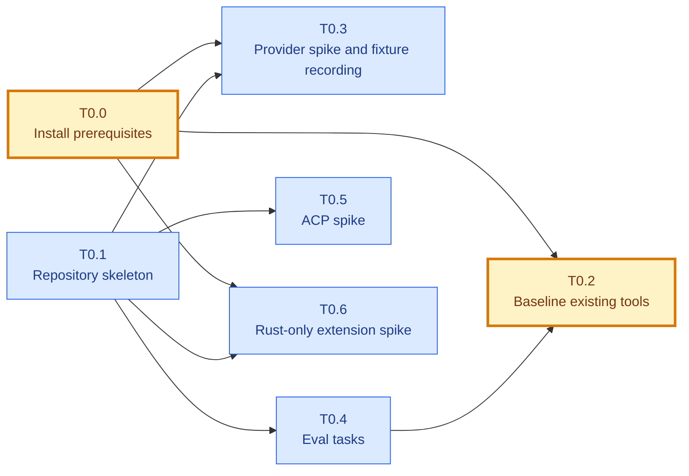
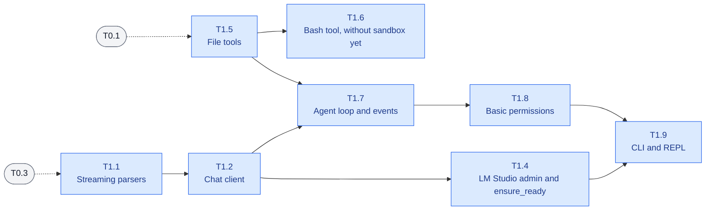
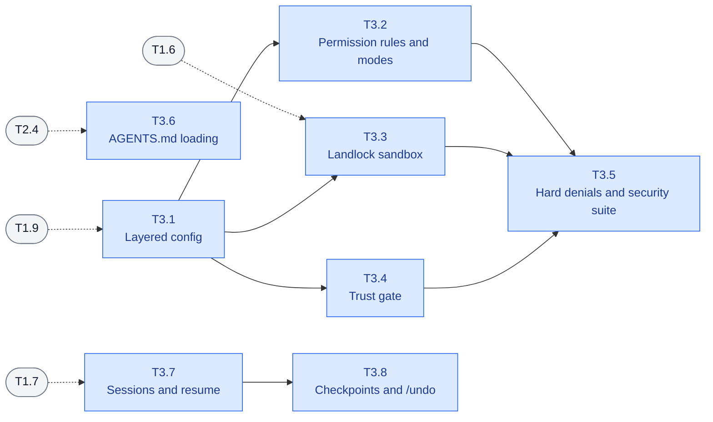
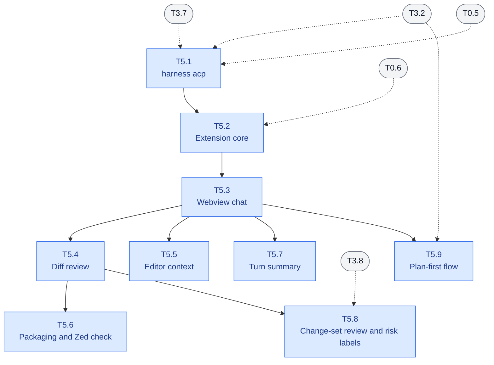
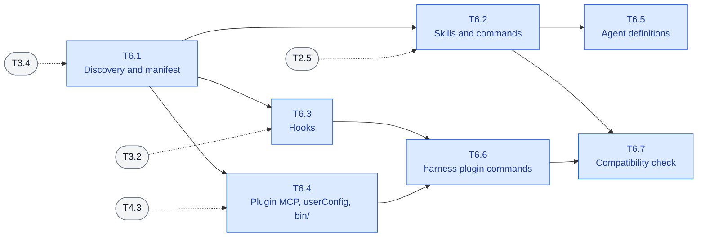
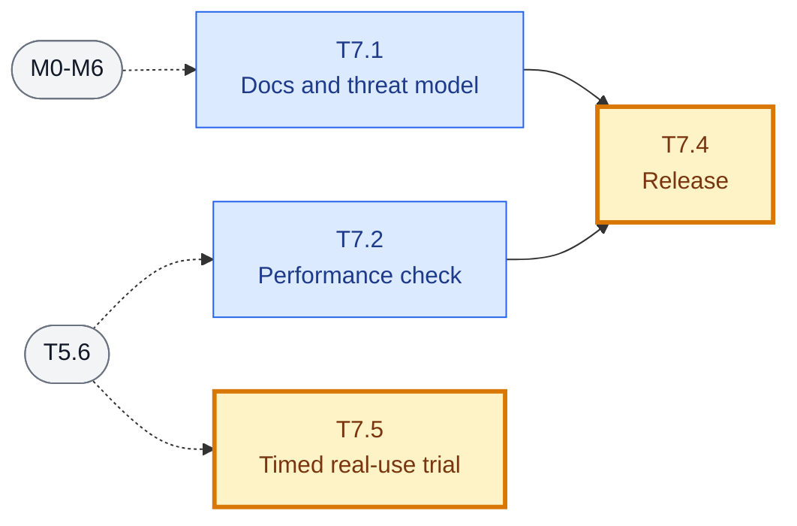
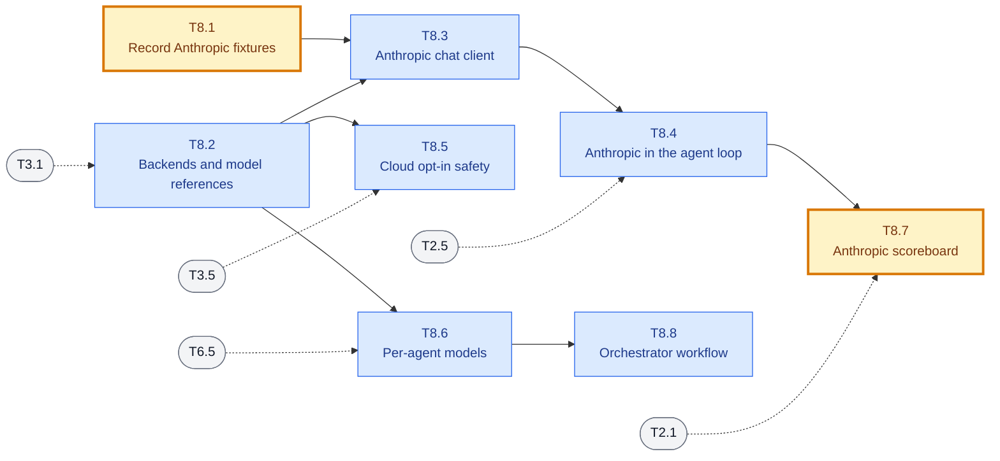

# Tasks

The ordered work list and the source of truth for status. Workflow is in [AGENTS.md](../AGENTS.md); `§` refers to [SPEC.md](SPEC.md).

> [!IMPORTANT]
> Take the first unchecked task whose dependencies are done. Each task is one branch of about 400 lines, merged locally; split it if it grows. "Done when" names the check that proves it, so write that check first. `HUMAN` means stop and get a person's input or decision. Tasks marked *Should* or *Could* can be cut if the owner chooses ([priorities](USER_STORIES.md)); unmarked tasks are Must or enabling work.

| | Milestone | Tasks | Goal |
|---|---|---|---|
| **M0** | [Prove the premise, answer the unknowns](#m0-prove-the-premise-answer-the-unknowns) | 7 | Prove the premise and answer the unknowns before any real code. |
| **M1** | [A working terminal agent](#m1-a-working-terminal-agent) | 8 | A terminal agent that fixes a seeded bug end to end. |
| **M2** | [Reliability on local models](#m2-reliability-on-local-models) | 13 | The core of the project: measurably better results on local models. |
| **M3** | [Config, sessions, safety](#m3-config-sessions-safety) | 8 | A hostile repository can't do anything without approval. |
| **M4** | [MCP client](#m4-mcp-client) | 6 | Real MCP servers work, even on small context windows. |
| **M5** | [VS Code](#m5-vs-code) | 9 | Fix, review and accept without leaving the editor. |
| **M6** | [Plugins](#m6-plugins) | 7 | An unmodified Claude Code plugin works. |
| **M7** | [First release](#m7-first-release) | 5 | Packaged, documented and measured. |
| **M8** | [Anthropic backend and per-agent models](#m8-anthropic-backend-and-per-agent-models) | 8 | A Claude model runs the same loop, and each agent can use its own model. |

71 tasks in total. In the graphs, blue tasks are for agents, amber tasks with a heavy border need a person, and grey dashed links come from other milestones.

---

## M0: Prove the premise, answer the unknowns

> Prove the premise and answer the unknowns before any real code.

- [x] **T0.0 Install prerequisites** `HUMAN`
  - **Do:** `sudo pacman -S rust-wasm wasm-bindgen`; install LM Studio; choose 2-3 tool-capable coding models that fit 16 GB VRAM; start its server.
  - **Done when:** `curl localhost:1234/api/v1/models` lists a model, and `rustc --print target-libdir --target wasm32-unknown-unknown` points at an existing directory.

- [x] **T0.1 Repository skeleton**
  - **Needs:** nothing.
  - **Do:** `git init` with `main`; workspace per §3 with empty crates; shared lints and release profile (§2); `#![forbid(unsafe_code)]`; `.gitignore`; `scripts/verify` (§14).
  - **Done when:** `./scripts/verify` passes on the empty workspace, and fails on a deliberately added lint violation, which is then removed.

- [x] **T0.2 Baseline existing tools** `HUMAN` decides the outcome
  - **Needs:** T0.0, T0.4.
  - **Do:** run OpenCode and Goose on the T0.4 tasks with the chosen model; record outcomes and failure kinds in `docs/baseline.md`.
  - **Done when:** `docs/baseline.md` has results per tool and model, and **the human has decided to build, narrow scope, or contribute upstream**, recorded as an ADR. The rest of this file assumes "build".
  - **Result (2026-11-12):** OpenCode only (Goose not run), one run per task. Owner chose build ([ADR 0006](adr/0006-build-after-baseline.md)).

- [x] **T0.3 Provider spike and fixture recording**
  - **Needs:** T0.0, T0.1.
  - **Do:** script real requests against LM Studio with each model: streaming with tools, context setting, oversized prompts, and repeat requests with a shared prefix. Save raw responses under `crates/harness-core/tests/fixtures/lmstudio/`. Resolve the provider `UNVERIFIED` items in §5.2, including how to observe cache reuse. Measure cache gains.
  - **Done when:** §5.2 has no provider `UNVERIFIED` items left, truncation thresholds are written into §7, and an ADR records the measured cache benefit and which tool-call formats each model emitted.

- [x] **T0.4 Eval tasks**
  - **Needs:** T0.1.
  - **Do:** 10-15 tasks per §14, covering a seeded bug, multi-file rename, adding a test, following `AGENTS.md`, a large file that won't fit in context, and a repo with a prompt-injection comment.
  - **Done when:** each task's `check.sh` fails on the untouched fixture and passes on a hand-applied reference solution.

- [x] **T0.5 ACP spike**
  - **Needs:** T0.1.
  - **Do:** throwaway agent using `agent-client-protocol` 5.x that echoes a prompt and requests one permission. Resolve the `UNVERIFIED` schema items in §11.
  - **Done when:** an in-process client test passes, §11 is updated, and an ADR records keeping ACP or replacing it with our own JSON-RPC.

- [x] **T0.6 Rust-only extension spike**
  - **Needs:** T0.0, T0.1.
  - **Do:** minimal `harness-vscode` exporting `activate` through `wasm-bindgen --target nodejs`; bound `vscode` command, spawn of a child process, and a webview running wasm under the §11 CSP; `cargo xtask vsix`.
  - **Done when:** `code --install-extension` accepts the built file with no npm involved, and a command spawns a process and shows its output in the webview. Update ADR 0001 with what was needed. **If handwritten JS beyond the one permitted file is required, stop and ask.**

---

## M1: A working terminal agent

> A terminal agent that fixes a seeded bug end to end.

- [x] **T1.1 Streaming parsers** (§5)
  - **Needs:** T0.3.
  - **Do:** `provider/stream.rs`: SSE line framing over byte streams, handling chunks split at any byte.
  - **Done when:** tests split recorded fixtures at every byte offset and produce identical results.

- [x] **T1.2 Chat client** (§5.1, §5.2)
  - **Needs:** T1.1.
  - **Do:** `chat` with streamed tool-call assembly by index, `list_models`, typed errors, `.no_proxy()` on loopback, cancellation.
  - **Done when:** `wiremock` tests with fixtures pass for a text reply, tool call, server down, no model loaded and cancel mid-stream.

- [x] **T1.4 LM Studio admin and `ensure_ready`** (§5.2)
  - **Needs:** T1.2.
  - **Do:** model listing, load with `context_length`, ask-or-`auto_load` behaviour.
  - **Done when:** tests cover enough context (no reload), too little context with and without `auto_load`, and a missing model.

- [x] **T1.5 File tools** (§6, §9 confinement)
  - **Needs:** T0.1.
  - **Do:** `Read`, `Write`, `Edit`, `Grep`, `Glob` with registry, schemas, atomic writes, workspace confinement. `Write` and `Edit` results stay short (§6).
  - **Done when:** tests cover each tool's errors; the symlink and `..` escape tests from §10 pass; interrupted writes leave the original intact; and `Edit` refuses a file changed since it was read.

- [x] **T1.6 `Bash` tool, without sandbox yet** (§6)
  - **Needs:** T1.5.
  - **Do:** process-group kill on timeout and cancel, output capture, environment allowlist.
  - **Done when:** a test proves a spawned grandchild dies on timeout, and that secret-named variables are absent.
  - **Note:** unsandboxed until T3.3, so until then every `Bash` call must prompt, with no "always" option. Use it only on fixture repos.

- [x] **T1.7 Agent loop and events** (§4)
  - **Needs:** T1.2, T1.5.
  - **Do:** the loop and event model, sequential tools, `max_turn_requests`, cancellation.
  - **Done when:** scripted fake-server test completes a two-tool turn with the exact event order asserted, cancel mid-tool yields `TurnEnded(Cancelled)`; and the next prompt continues from consistent history.

- [x] **T1.8 Basic permissions** (§9)
  - **Needs:** T1.7.
  - **Do:** `ask` mode defaults, prompt via `PermissionRequest`, once and always replies, deny when no one can answer. Prompts show full parameters (§9).
  - **Done when:** tests prove `Write` doesn't happen on reject, or when non-interactive.

- [x] **T1.9 CLI and REPL** (§11)
  - **Needs:** T1.4, T1.8.
  - **Do:** one-shot and REPL, `harness models`, prompts, Ctrl-C, exit codes, minimal system prompt, `--model`.
  - **Done when:** integration test runs the binary against the fake server, and **a manual run fixes a seeded bug on LM Studio with a real model**. Record the eval baseline in `evals/results/`.

---

## M2: Reliability on local models

> The core of the project: measurably better results on local models.

- [x] **T2.1 Eval runner** (§14)
  - **Needs:** T1.9, T0.4.
  - **Done when:** `cargo xtask eval` runs all tasks on a model and writes the scoreboard JSON with every metric in §14.
  - **Left null, with reasons:** cached and processed prompt tokens (LM Studio reports no cached count), and the comparison with context features off, which T2.6 runs.

- [x] **T2.2 Tool-call recovery** (§5.3)
  - **Needs:** T1.7.
  - **Done when:** tests pass for every malformed fixture from T0.3; and tests confirm invalid calls never execute, text in tool results is never parsed as a call, and 3 repeat failures stop the turn.

- [x] **T2.3 Model profiles** (§5.5)
  - **Needs:** T2.2.
  - **Done when:** layered resolution is tested, and a model with no tool support uses text calling after a warning.

- [x] **T2.4 Token budget and output truncation** (§7)
  - **Needs:** T1.7.
  - **Done when:** tests confirm the category limits hold, calibration converges on fixture usage values, oversized results spool to disk and can be read back, and truncation triggers the warning.

- [x] **T2.5 Stable prefix** (§7)
  - **Needs:** T2.4.
  - **Done when:** a regression test captures consecutive request bodies and asserts each is a byte-prefix extension of the last up to the newly appended messages, apart from recorded compaction boundaries, and cached tokens (or time to first token on later turns, if LM Studio doesn't report them) improve in a real run compared with T1.9.
  - **Result:** T1.9 recorded no time to first token, so the comparison is with the cold first request of the same run. In large-file-catalog on qwen3.5-4b, the first request takes 850 ms and the 13 later ones 175–265 ms while the prompt grows, so the server reuses the prefix.

- [x] **T2.6 Compaction** (§7)
  - **Needs:** T2.5.
  - **Do:** tiered: batched masking first, then a summary if needed, then stubs. Compare `mask_keep_turns` of 5, 10 and 20 with no masking.
  - **Done when:** tests cover the trigger, whole-result masking, recent turns kept, re-fetch placeholders, preserved prefix, failed summary fallback and event order; evals show that history is rewritten rarely; and the "large file" eval passes on a small context.
  - **Result:** no eval task reaches 80% of its context, so the 5/10/20/off boards (2026-11-11) never compacted and differ only by noise. With large-file-catalog cut to 4096 tokens, compaction ran once per run and the task passed both ways: masking then summary with `mask_keep_turns` 10, and stubs with masking off (`evals/results/qwen3.5-4b.large-file-4k.*`). It needed Grep to default to `content` and a new Read range to count as progress in loop detection.

- [x] **T2.7 Loop detection** (§5.4) · *Should*
  - **Needs:** T1.7.
  - **Done when:** tests cover each trigger, including one where legitimately repeated calls with different arguments do not trigger it.

- [x] ~~**T2.8 Repo map**~~ (§7) · *Should* · **Cut (2026-11-12)**
  - **Needs:** T2.4.
  - **Done when:** symbols are extracted for each starting language, `.gitignore` is respected, the budget holds, and eval tokens drop on the rename task without losing success.
  - **Result so far (2026-11-11):** the tool and its tests are on branch `feat/t2-8-repo-map`, unmerged. On both rename tasks, one run each with seed 42, success stayed 4/4 but prompt tokens rose from 124k to 173k (+40%) against main (`evals/results/*.rename-{main,repomap}.json`). The fixture repos have three or four files, so the extra tool schema costs more than a map saves; a larger repo is needed before deciding whether to keep, change or cut the task.
  - **Decision (2026-11-12):** the owner cut it. The branch was deleted; commit `0107b65` holds the code if it's ever revisited.

- [x] **T2.9 M2 checkpoint** `HUMAN` reviews
  - **Needs:** T2.1-T2.6.
  - **Done when:** scoreboard is committed and compared with the T1.9 and T0.2 baselines. **If it doesn't clearly beat them, stop and discuss before M3.**
  - **Result (2026-11-12):** M2 doesn't clearly beat OpenCode on pass rate (4b 6/13 vs 8/13, gemma 10/13 each) but is about 4.5× faster on 4b. Discussed, and the owner accepted M2 as it stands ([ADR 0006](adr/0006-build-after-baseline.md)).

- [ ] **T2.10 Repeat reads and stale files** (§7) · *Should*
  - **Needs:** T2.4.
  - **Done when:** tests cover the stub for an unchanged range, full content once masked or changed, and the notice when a file changes outside the agent; evals show fewer tokens processed without lower success or more turns.

- [x] **T2.11 Output filters** (§7) · *Should*
  - **Needs:** T2.4.
  - **Done when:** fixture outputs keep exit codes, all failing tests and stack traces; full output stays in the spool; evals show no drop in success, or the feature is switched off by default and the result recorded.
  - **Result (2026-11-12):** 4b board, 3 runs × 13 tasks, seed 42: success 56% with filters against 54% without (`qwen3.5-4b.filter-on.json` vs `qwen3.5-4b.t2-13.json`), prompt tokens −20%, turns 16.1 → 13.8, wall time 41 → 35 s. Loop stops rose 6 → 10. Filters are now on by default. **Follow-up (2026-11-12):** the rise is noise, not the filters. A rerun of the 5 looping tasks × 3 found 6 stops with filters on and 10 with them off; 13 of 16 repeated an unfiltered whole-file `Read`, the rest `cargo test`. Runs now record the call that tripped the detector as `loop_call`.

- [x] **T2.12 Constrained retry** (§5.3) · *Should*
  - **Needs:** T2.2, T0.3.
  - **Done when:** if T0.3 confirms support, a malformed call retries under the schema and is still validated; if not, record that in an ADR and close this task.

- [x] **T2.13 System prompt contract** (§11) · *Should*
  - **Needs:** T1.9.
  - **Done when:** the prompt stays within budget and covers each point in §11, with eval success no lower than before.
  - **Result (2026-11-12):** 4b board, 3 runs × 13 tasks, seed 42: success 54% against 46% before (`qwen3.5-4b.m2.json`, 1 run). Mean turns rose 12.3 → 16.1 and wall time 31 → 41 s, mostly from injection-test-data and seeded-bug-duration (`evals/results/qwen3.5-4b.t2-13.json`).

---

## M3: Config, sessions, safety

> A hostile repository can't do anything without approval.

- [x] **T3.1 Layered config** (§8)
  - **Needs:** T1.9.
  - **Done when:** tests cover precedence, list merging, and errors naming file and key for unknown keys or wrong types.

- [x] **T3.2 Permission rules and modes** (§9)
  - **Needs:** T3.1.
  - **Done when:** table-driven tests cover every branch of the decision flow and every mode, and the compound-command list never matches an allow rule, including `git status; curl x | sh`; a command mentioning a hard-denied path never matches one either; and an allow rule can't widen `read-only` mode.

- [x] **T3.3 Landlock sandbox** (§9)
  - **Needs:** T1.6, T3.1.
  - **Do:** `harness sandbox-exec`; `Bash` always uses it.
  - **Done when:** tests prove a sandboxed command can't write outside the workspace, read `~/.ssh` (use a fake home), or open a TCP connection; and that it refuses to run when Landlock is unavailable (simulate through injected ABI check).

- [x] **T3.4 Trust gate** (§8)
  - **Needs:** T3.1.
  - **Done when:** the hostile fixture repo can't activate anything without approval; changing approved content needs re-approval; and project `sandbox.*` and `lmstudio.*` are ignored even after approval.

- [x] **T3.5 Hard denials and security suite** (§10)
  - **Needs:** T3.2, T3.3, T3.4.
  - **Done when:** `tests/security.rs` has a test for every invariant in §10 applicable so far, under every mode. Mark the rest as pending, naming the task that will cover them.

- [x] **T3.6 `AGENTS.md` loading** (§7) · *Should*
  - **Needs:** T2.4.
  - **Done when:** it's loaded within budget, trimmed with a warning when oversized, and can't change permissions.

- [x] **T3.7 Sessions and resume** (§8)
  - **Needs:** T1.7.
  - **Done when:** resume reproduces history; a truncated final line is tolerated; files are `0600`; and a log write failure stops the turn.

- [x] **T3.8 Checkpoints and `/undo`** (§8) · *Should*
  - **Needs:** T3.7.
  - **Done when:** tests restore edited and newly created files after a turn, and the UI text notes that Bash effects aren't undone.

---

## M4: MCP client

> Real MCP servers work, even on small context windows.

- [x] **T4.1 stdio client** (§13)
  - **Needs:** T3.4.
  - **Done when:** tools from a test `rmcp` server are callable through the agent loop, gated by trust, and a slow or failing server doesn't block startup.

- [x] **T4.2 Streamable HTTP and `.mcp.json`** (§8, §13) · *Should*
  - **Needs:** T4.1.
  - **Done when:** both config shapes load, and header values resolve from environment without appearing in logs.

- [x] **T4.3 Permissions, budgets, failures** (§7, §13)
  - **Needs:** T4.1.
  - **Done when:** `mcp__server__tool` rules apply; oversized results truncate; a mid-session crash returns tool errors and reconnects once; `list_changed` doesn't alter the `tools` array.

- [x] **T4.4 Indexed tool mode** (§7)
  - **Needs:** T4.3, T2.5.
  - **Done when:** above the threshold, `tools` holds only built-ins plus `ToolSearch` and `CallTool`; permission and hook checks see the inner name; the T2.5 prefix test passes in this mode.

- [ ] **T4.5 Real server check and resources**
  - **Needs:** T4.4, T4.6.
  - **Done when:** real filesystem, git and browser MCP servers work on a small-window model, with eval scores no worse than without them. Resources and prompts are added.

- [x] **T4.6 Pin MCP tool definitions** (§13)
  - **Needs:** T4.1.
  - **Done when:** a test server that changes a description has that tool hidden until approved again, with the change shown; the description scan warns but never blocks; plugin servers are covered.

---

## M5: VS Code

> Fix, review and accept without leaving the editor.

- [x] **T5.1 `harness acp`** (§11)
  - **Needs:** T3.2, T3.7, T0.5.
  - **Done when:** in-process tests cover the event mapping table, permission round trip, `session/load`, and cancellation ordering; and a test confirms nothing but protocol messages reach stdout.

- [x] **T5.2 Extension core** (§11)
  - **Needs:** T5.1, T0.6.
  - **Do:** bindings, spawn, ACP connection, machine-scoped settings, restart on exit, output channel, untrusted-workspace declaration.
  - **Done when:** native tests cover message mapping; the checklist item "open panel, send prompt, see a response" passes.

- [ ] **T5.3 Webview chat** (§11)
  - **Needs:** T5.2.
  - **Do:** streaming, stop button, status line, collapsed tool output, permissions, safe markdown, CSP, accessibility (§11).
  - **Done when:** native tests confirm `<script>` and `javascript:` links in model text render inert; the checklist's keyboard-only pass succeeds; and the status line shows phase, elapsed time and context used.

- [x] **T5.4 Diff review** (§11)
  - **Needs:** T5.3.
  - **Done when:** checklist confirms a `Write` or `Edit` opens the native diff, accept applies it, reject leaves the file unchanged, and the model is told which.

- [ ] **T5.5 Editor context** (§11) · *Should*
  - **Needs:** T5.3.
  - **Do:** active file and selection, diagnostics, model picker, `fs/read_text_file` for unsaved buffers.
  - **Done when:** a test or checklist item shows `Read` returns unsaved buffer contents.

- [ ] **T5.6 Packaging and Zed check**
  - **Needs:** T5.4.
  - **Done when:** `cargo xtask vsix` output installs on a clean profile with no network; a full fix-review-accept cycle passes offline; and `harness acp` works in Zed with no code changes, if Zed is available. Say so if it wasn't tested.

- [x] **T5.7 Turn summary** (§11) · *Should*
  - **Needs:** T5.3.
  - **Done when:** summaries come from the tool log alone; a test confirms they say so plainly when no tests ran, even if the model claimed otherwise.

- [ ] **T5.8 Change-set review and risk labels** (§9, §11) · *Should*
  - **Needs:** T5.4, T3.8.
  - **Done when:** the checklist covers overview, file and chunk with free navigation, and revert per file; tests confirm risk labels never read as a safety verdict.

- [ ] **T5.9 Plan-first flow** (§11) · *Should*
  - **Needs:** T5.3, T3.2.
  - **Done when:** tests confirm `/plan` can't write or run anything, and carrying out a plan needs a separate action from the developer. It also works in the REPL.

---

## M6: Plugins

> An unmodified Claude Code plugin works.

- [x] **T6.1 Discovery and manifest** (§12)
  - **Needs:** T3.4.
  - **Done when:** path rules are enforced (`..` and missing paths rejected), replace/add/merge behaviour is tested, a plugin with no manifest loads, and unsupported components warn by name.

- [x] **T6.2 Skills and commands** (§12)
  - **Needs:** T6.1, T2.5.
  - **Done when:** index appears in the frozen prefix, `Skill` loads a body by appended message, the prefix test still passes, and `/<plugin>:<name>` runs a command with argument substitution.

- [x] **T6.3 Hooks** (§12)
  - **Needs:** T6.1, T3.2.
  - **Done when:** table tests cover every exit code and output field, matcher forms, exec and shell form, timeout; `updatedInput` is revalidated and re-checked for permission (a hook rewriting a path into `.git/hooks/` is denied); a hook `allow` can't override a deny rule.

- [x] **T6.4 Plugin MCP, `userConfig`, `bin/`** (§12)
  - **Needs:** T6.1, T4.3.
  - **Done when:** `${CLAUDE_PLUGIN_ROOT}` and friends expand in the specified fields, tool names follow the plugin form, sensitive values stay out of logs and config, and `bin/` can't shadow system commands.

- [x] **T6.5 Agent definitions** (§12) · *Should*
  - **Needs:** T6.2.
  - **Done when:** a delegated agent runs sequentially with its own history and tool restrictions, and returns a summary to the parent.

- [x] **T6.6 `harness plugin` commands** (§8, §12)
  - **Needs:** T6.3, T6.4.
  - **Done when:** install from path or git pins a commit, lists what it can run before enabling, and removal cleans up, with data removal confirmed separately.

- [x] **T6.7 Compatibility check**
  - **Needs:** T6.2, T6.6.
  - **Done when:** an unmodified existing Claude Code plugin with a skill, a hook and an MCP server works, recorded in `docs/compat.md`, along with what didn't.

---

## M7: First release

> Packaged, documented and measured.

- [ ] **T7.1 Docs and threat model**
  - **Needs:** M0-M6 (Must tasks are enough).
  - **Do:** README, config reference, tested-models table from the scoreboard, threat model covering unsandboxed hooks and MCP servers, the UDP limit, and approved `Bash` commands being able to write to `.git/hooks`.
  - **Done when:** a fresh user following the README alone reaches a working session; a person or fresh agent confirms this.

- [ ] **T7.2 Performance check** (§2)
  - **Needs:** T5.6.
  - **Done when:** every target is measured and reported. Investigate misses and update the targets with evidence. Don't use `unsafe` to hit them.

- [x] ~~**T7.3 Rich TUI decision**~~ Cut (2026-11-12): the owner chose the REPL; no `ratatui`.

- [ ] **T7.4 Release** `HUMAN` approves
  - **Needs:** T7.1, T7.2.
  - **Done when:** the final name is chosen (rename from `harness`), binaries and `.vsix` are built, and §10 and the eval scoreboard pass on the release build. Publishing happens only with explicit approval.

- [ ] **T7.5 Timed real-use trial** `HUMAN` · *Could*
  - **Needs:** T5.6.
  - **Done when:** real tasks done with and without the harness are timed, and results are recorded along with their small sample size. Perception isn't used as evidence.

---

## M8: Anthropic backend and per-agent models

> A Claude model runs the same loop, and each agent can use its own model ([ADR 0004](adr/0004-anthropic-backend-and-per-agent-models.md)).
>
> **The Anthropic tasks (T8.1, T8.3, T8.4, T8.7) are on hold** by the owner's choice (2026-11-12). T8.6 and T8.8 don't need them.

- [ ] **T8.1 Record Anthropic fixtures** `HUMAN` provides a key (paid) (§5.6) · **On hold** (2026-11-12, owner's call)
  - **Done when:** `crates/harness-core/tests/fixtures/anthropic/` holds recorded streams for a text reply, a reply with two `tool_use` blocks, adaptive thinking, a `max_tokens` stop, an SSE `error` event, a 401 and a 429 or 529, plus one `GET /v1/models/{id}` body. Each `UNVERIFIED` fact in §5.6 is confirmed or corrected.

- [x] **T8.2 Backends and model references** (§5.1, §8)
  - **Needs:** T3.1.
  - **Done when:** tests resolve `lmstudio/x`, `anthropic/x`, bare names and `[models]` aliases; an unknown backend or alias is an error naming the key; and all existing LM Studio tests pass unchanged.

- [ ] **T8.3 Anthropic chat client** (§5.6)
  - **Needs:** T8.1, T8.2.
  - **Done when:** against the T8.1 fixtures, text, thinking and `input_json_delta` pieces become the same `ChatChunk`s the loop already uses; usage fills `cached_tokens`; every recorded error maps to a distinct `ProviderError` with a fix; requests never send sampling fields or forced `tool_choice`; and the key never appears in logs or errors.

- [ ] **T8.4 Anthropic in the agent loop** (§4, §5.6, §7)
  - **Needs:** T8.3, T2.5.
  - **Done when:** a fake-server run fixes the seeded bug on an Anthropic model; text-call parsing and constrained retry stay off while validation stays on; thinking blocks are sent back unchanged; the stable-prefix test passes with `cache_control`; and the first-use notice is emitted once per session. Record whether masking (T2.6) breaks thinking, and choose append-only or dropping thinking in SPEC §7.

- [x] **T8.5 Cloud opt-in safety** (§8, §10)
  - **Needs:** T8.2, T3.5.
  - **Done when:** `tests/security.rs` covers invariant 12. A hostile repo's `anthropic.*`, alias or agent `model` can't enable the backend or change its URL or key variable, and an agent naming a disabled backend fails with a notice instead of switching.

- [ ] **T8.6 Per-agent models** (§12) · *Should*
  - **Needs:** T8.2, T6.5.
  - **Done when:** a delegated agent whose `model` resolves to another backend runs on it with its own history, profile and context budget; one with no `model` uses the session model; and the parent's history is unchanged apart from the returned summary.

- [ ] **T8.7 Anthropic scoreboard** `HUMAN` approves the spend · *Could* · **On hold** with T8.1
  - **Needs:** T8.4, T2.1.
  - **Done when:** `cargo xtask eval --model anthropic/<id>` writes a scoreboard to `evals/results/` with the cost of the run, the task sandbox's only network path is to the Anthropic endpoint, and it is compared with the local models as a reference ceiling.

- [ ] **T8.8 Orchestrator workflow** ([ADR 0005](adr/0005-orchestrator-model-delegates-to-local-workers.md)) · *Should*
  - **Needs:** T8.6.
  - **Done when:** on the fake server, an orchestrator session delegates two steps to a worker on another model, and only the workers' reports enter its history; the same test passes with the orchestrator on `anthropic/` and on `lmstudio/`; a worker can't use a tool the session denies; and an eval run records success, wall time and model swaps for a local orchestrator with a local worker.
