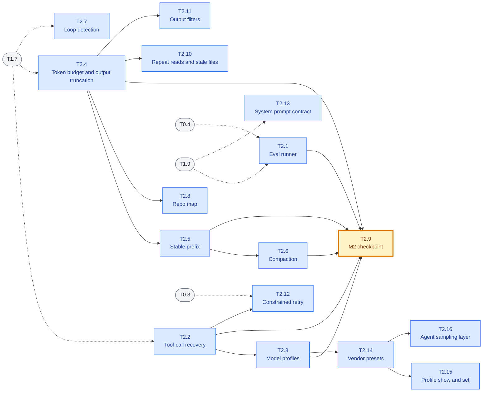
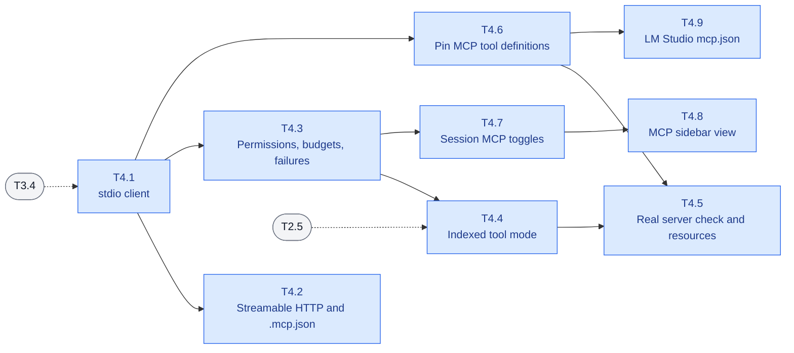
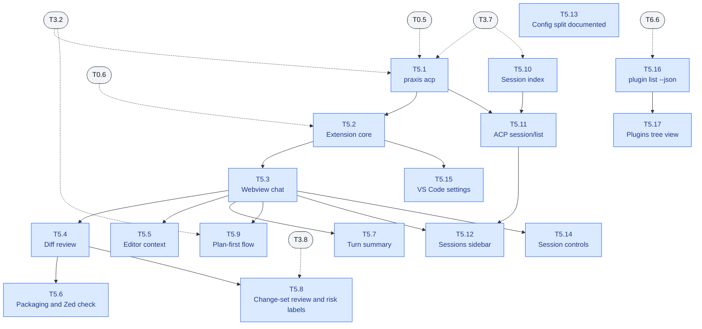
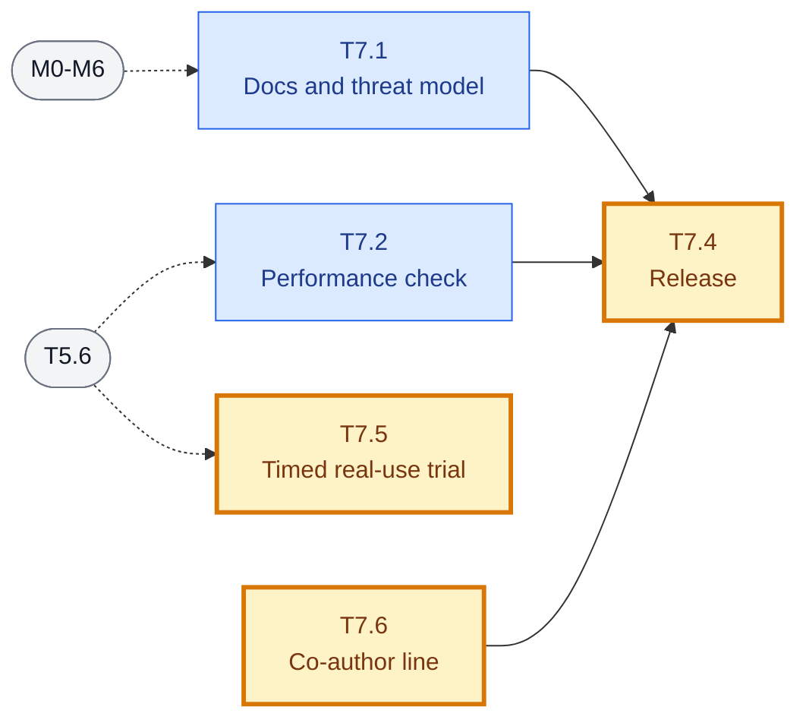
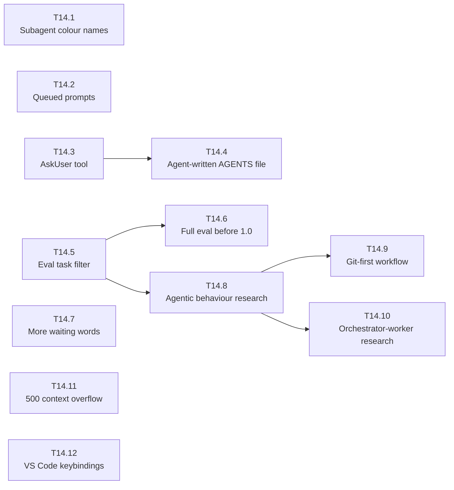

# Tasks

The ordered work list of **open** tasks and the source of truth for status; finished tasks and milestones are in [tasks/DONE.md](tasks/DONE.md). Workflow is in [AGENTS.md](../AGENTS.md); `§` refers to [SPEC.md](SPEC.md).

> [!IMPORTANT]
> Take the first unchecked task whose dependencies are done. Each task is one branch of about 400 lines, merged locally; split it if it grows. "Done when" names the check that proves it, so write that check first. `HUMAN` means stop and get a person's input or decision. Tasks marked *Should* or *Could* can be cut if the owner chooses ([priorities](USER_STORIES.md)); unmarked tasks are Must or enabling work.

| | Milestone | Tasks | Goal |
|---|---|---|---|
| **M0** | [Prove the premise, answer the unknowns](tasks/DONE.md#m0-prove-the-premise-answer-the-unknowns) | 7 | Prove the premise and answer the unknowns before any real code. |
| **M1** | [A working terminal agent](tasks/DONE.md#m1-a-working-terminal-agent) | 8 | A terminal agent that fixes a seeded bug end to end. |
| **M2** | [Reliability on local models](#m2-reliability-on-local-models) | 13 | The core of the project: measurably better results on local models. |
| **M3** | [Config, sessions, safety](tasks/DONE.md#m3-config-sessions-safety) | 8 | A hostile repository can't do anything without approval. |
| **M4** | [MCP client](#m4-mcp-client) | 6 | Real MCP servers work, even on small context windows. |
| **M5** | [VS Code](#m5-vs-code) | 12 | Fix, review and accept without leaving the editor. |
| **M6** | [Plugins](tasks/DONE.md#m6-plugins) | 7 | An unmodified Claude Code plugin works. |
| **M7** | [First release](#m7-first-release) | 6 | Packaged, documented and measured. |
| **M8** | [Anthropic backend and per-agent models](#m8-anthropic-backend-and-per-agent-models) | 8 | A Claude model runs the same loop, and each agent can use its own model. |
| **M9** | [Markdown sources](tasks/DONE.md#m9-markdown-sources) | 8 | A repository set up for Claude Code works unchanged: memory files, rules, skills, commands and agents. |
| **M10** | [Beta 1 feedback](tasks/DONE.md#m10-beta-1-feedback) | 13 | Fix what Beta 1 users hit first: chat history, fewer prompts, plugin commands, subagent activity. |
| **M11** | [Beta 1.3.0: community requests](#m11-beta-130-community-requests) | 8 | Ship the most-wanted features of other agents that fit a local, single-GPU harness. |
| **M13** | [Beta 1.4.0: harness fixes](tasks/DONE.md#m13-beta-140-harness-fixes-from-the-performance-notes) | 12 | Fix the harness faults behind the gap to OpenCode, proven by fake-server tests. |

116 tasks in total. In the graphs, blue tasks are for agents, amber tasks with a heavy border need a person, and grey dashed links come from other milestones.

---
## M2: Reliability on local models

> The core of the project: measurably better results on local models.

- [ ] **T2.16 Agent sampling layer** (§5.5) · *Should*
  - **Needs:** T2.14.
  - **Done when:** a built-in, model-independent sampling override over the vendor preset (for example a temperature cap) is kept only if a targeted 3-run eval (T14.5) on both chosen models, or the 1.0 board, shows higher success with no worse wall time than the vendor preset alone; otherwise the result is recorded and the task closed.

---

## M4: MCP client

> Real MCP servers work, even on small context windows.

- [ ] **T4.5 Real server check and resources**
  - **Needs:** T4.4, T4.6.
  - **Done when:** real filesystem, git and browser MCP servers work on a small-window model, with eval scores no worse than without them. Resources and prompts are added.
  - **Progress (2026-11-13):** real `mcp-server-filesystem`, `mcp-server-git` and `playwright-mcp` (pinned, see docs/MCP_SERVERS.md) pass `tests/mcp_real.rs` (ignored by default). qwen3.5-4b ran a prompt through all three end to end at 32k context. Resources and prompts are exposed as tools. Open: the eval board with and without these servers, which needs MCP wiring in `xtask eval` inside bwrap.
  - **Status:** resources and prompts are done, with fixture tests (`resources_and_prompts_are_tools`). Still open for a human: the real filesystem, git and browser servers (they need npm and network) and the eval comparison on a small-window model. Left unticked until both are done.

- [ ] **T4.8 MCP sidebar view** (§12)
  - **Needs:** T4.7.
  - **Progress (2026-11-15):** the view is in `praxis-vscode` (`mcp.rs` parsing, `praxis.mcp` in package.json, checkbox toggles, refresh on session ready and after a toggle). Parsing and request shapes are unit-tested. Open: not yet run in VS Code, and the server side of T4.7 (`_praxis/mcp_servers` answering `tools` as names or `{name}` objects) is not verified. Left unticked until both are done.
  - **Done when:** VS Code has an "MCP Servers" tree view beside Sessions listing each server with status, source and tool count, with an on/off toggle per server (keyboard reachable) calling `_praxis/set_mcp_enabled`; expanding a server lists its tools. Refreshes when the session changes.

---

## M5: VS Code

> Fix, review and accept without leaving the editor.

- [ ] **T5.3 Webview chat** (§11)
  - **Needs:** T5.2.
  - **Do:** streaming, stop button, status line, collapsed tool output, permissions, safe markdown, CSP, accessibility (§11).
  - **Done when:** native tests confirm `<script>` and `javascript:` links in model text render inert; the checklist's keyboard-only pass succeeds; and the busy indicator shows while a turn runs.

- [ ] **T5.6 Packaging and Zed check**
  - **Needs:** T5.4.
  - **Done when:** `cargo xtask vsix` output installs on a clean profile with no network; a full fix-review-accept cycle passes offline; and `praxis acp` works in Zed with no code changes, if Zed is available. Say so if it wasn't tested.

---

## M7: First release

> Packaged, documented and measured.

- [ ] **T7.1 Docs and threat model**
  - **Needs:** M0-M6 (Must tasks are enough).
  - **Do:** README, config reference, tested-models table from the scoreboard, threat model covering unsandboxed hooks and MCP servers, the UDP limit, and approved `Bash` commands being able to write to `.git/hooks`.
  - **Done when:** a fresh user following the README alone reaches a working session; a person or fresh agent confirms this.

- [ ] **T7.2 Performance check** (§2)
  - **Needs:** T5.6.
  - **Done when:** every target is measured and reported. Investigate misses and update the targets with evidence. Don't use `unsafe` to hit them.
  - **Also measure:** the sessions sidebar's refresh, which starts a fresh `praxis acp` child each time (T5.12). If startup is noticeable, keep one listing child alive and resend `session/list`.

- [ ] **T7.4 Release** `HUMAN` approves
  - **Name:** `praxis` (owner, 2026-11-12; Marx's unity of thought and action). Renamed from `harness` on 2026-11-13.
  - **Needs:** T7.1, T7.2, T7.6.
  - **Done when:** binaries and `.vsix` are built, and §10 and the eval scoreboard pass on the release build. Publishing happens only with explicit approval. The full 3-run eval board on both chosen models is the 1.0 gate (T14.6).

- [ ] **T7.5 Timed real-use trial** `HUMAN` · *Could*
  - **Needs:** T5.6.
  - **Done when:** real tasks done with and without the praxis are timed, and results are recorded along with their small sample size. Perception isn't used as evidence.

- [ ] **T7.6 Co-author line in commits** `HUMAN` picks the identity and mechanism
  - **Why:** commits Praxis makes for a user should say so with a `Co-Authored-By:` trailer (owner, 2026-11-14), held until the first full release.
  - **Needs:** none.
  - **Done when:** a commit the agent makes ends with the agreed trailer, a setting turns it off, and a test checks both.
  - **Decision:** deferred to 1.0; identity picked then (owner, 2026-11-16).

---

## M8: Anthropic backend and per-agent models

> A Claude model runs the same loop, and each agent can use its own model ([ADR 0004](adr/0004-anthropic-backend-and-per-agent-models.md)).
>
> **The Anthropic tasks (T8.1, T8.3, T8.4, T8.7) are on hold** by the owner's choice (2026-11-12). T8.6 and T8.8 don't need them.

- [ ] **T8.1 Record Anthropic fixtures** `HUMAN` provides a key (paid) (§5.6) · **On hold** (2026-11-12, owner's call)
  - **Done when:** `crates/praxis-core/tests/fixtures/anthropic/` holds recorded streams for a text reply, a reply with two `tool_use` blocks, adaptive thinking, a `max_tokens` stop, an SSE `error` event, a 401 and a 429 or 529, plus one `GET /v1/models/{id}` body. Each `UNVERIFIED` fact in §5.6 is confirmed or corrected.

- [ ] **T8.3 Anthropic chat client** (§5.6)
  - **Needs:** T8.1, T8.2.
  - **Done when:** against the T8.1 fixtures, text, thinking and `input_json_delta` pieces become the same `ChatChunk`s the loop already uses; usage fills `cached_tokens`; every recorded error maps to a distinct `ProviderError` with a fix; requests never send sampling fields or forced `tool_choice`; and the key never appears in logs or errors.

- [ ] **T8.4 Anthropic in the agent loop** (§4, §5.6, §7)
  - **Needs:** T8.3, T2.5.
  - **Done when:** a fake-server run fixes the seeded bug on an Anthropic model; text-call parsing and constrained retry stay off while validation stays on; thinking blocks are sent back unchanged; the stable-prefix test passes with `cache_control`; and the first-use notice is emitted once per session. Record whether masking (T2.6) breaks thinking, and choose append-only or dropping thinking in SPEC §7.

- [ ] **T8.7 Anthropic scoreboard** `HUMAN` approves the spend · *Could* · **On hold** with T8.1
  - **Needs:** T8.4, T2.1.
  - **Done when:** `cargo xtask eval --model anthropic/<id>` writes a scoreboard to `evals/results/` with the cost of the run, the task sandbox's only network path is to the Anthropic endpoint, and it is compared with the local models as a reference ceiling.

- [ ] **T8.8 Orchestrator workflow** ([ADR 0005](adr/0005-orchestrator-model-delegates-to-local-workers.md)) · *Should*
  - **Needs:** T8.6.
  - **Done when:** on the fake server, an orchestrator session delegates two steps to a worker on another model, and only the workers' reports enter its history; the same test passes with the orchestrator on `anthropic/` and on `lmstudio/`; a worker can't use a tool the session denies; and an eval run records success, wall time and model swaps for a local orchestrator with a local worker.
  - **Remains:** the `anthropic/` orchestrator run (blocked by T8.3); the built-in orchestrator profile (ADR 0005 consequences); eval runs in orchestrated mode (the runner records `model_swaps`, but no task sets a worker yet) and the live run the owner executes.

---

## M11: Beta 1.3.0: community requests

> The most-reacted open requests in other coding agents' issue trackers (Claude Code, Codex, OpenCode, Cline, Crush, Goose, Aider, Continue), surveyed 2026-11-14, filtered to what fits a local, single-GPU harness. Release `1.3.0-beta` also carries the open M5 task T5.8 (change-set review: Claude Code #33932, Codex #2998).
>
> **Left out:** a model that auto-approves actions (it runs inference on every action), parallel subagents (one GPU), long-running background processes (they conflict with the sandbox's process-group kill), and status lines, voice and PDF input (low value here). Already done elsewhere: AGENTS.md, hooks, the sandbox, chat management.

- [ ] ~~**T11.4 Diagnostics in the terminal**~~ `HUMAN` picks the approach (§3, §6) · *Could*
  - **Needs:** T11.3.
  - **Options:** a language-server client (a new dependency outside SPEC §3, so the owner must approve it); or a check command set in config (for example `cargo check --message-format short`), run through the `Bash` sandbox after edits, with no new dependency; or neither.
  - **Cut from 1.3.0-beta** by the owner (2026-11-14).
  - **Done when:** the chosen option gives CLI `Edit` results the same appended errors as T11.3, with a test on the fake server.

- [ ] **T11.6 Neovim over ACP** (§11) · *Could*
  - **Needs:** T5.6.
  - **Asked for:** Continue #917, Claude Code #1234.
  - **Done when:** `praxis acp` is tried from one Neovim ACP client (such as CodeCompanion) with no code changes, and the README lists the ACP clients actually tested. Say so if it wasn't tested.
  - **Status:** not tested; Neovim isn't installed on the dev machine. Cut from 1.3.0-beta as a *Could* task (2026-11-14).

## M14: Planned: owner TODO of 2026-11-15

> From the owner's `TODO.md`. Each task reuses something that already exists, so none needs a new dependency. Order: T14.1 and T14.2 are small and independent; T14.3 and T14.4 share the prompt round trip that T14.3 builds; T14.5 and T14.6 change only `xtask eval` and the release rule.

- [ ] **T14.2 Queued prompts** · *Should*
  - **Why:** `can_send` blocks input while a turn runs, so the user waits to type the next step.
  - **Needs:** none.
  - **Done when:** in the panel, sending while busy appends to a visible, removable queue; each queued prompt is sent as a normal `session/prompt` when the turn ends with `end_turn`, and the queue pauses (not drops) on cancel, error or a permission denial. The CLI reads queued lines from its existing terminal-reader channel the same way. UI unit tests for queue, remove and pause; no core change.
  - **Status:** panel side done on `feat/t14-2-queued-prompts` (queue in `praxis-vscode-ui/src/queue.rs`, tests pass). CLI part not done: it still needs the terminal-reader queue. Task left unticked until then.

- [ ] **T14.3 AskUser tool** · *Should*
  - **Why:** small models guess at unclear requests; a question with choices is cheaper than a wrong edit.
  - **Needs:** none. Built-in tool names are a compatibility surface, so use Claude Code's `AskUserQuestion` name and input shape (SPEC §6).
  - **Done when:** the tool takes 1–4 questions with 2–4 options, single or multi choice, plus free text; in ACP it reuses the permission-request round trip (spawned, never awaited in the handler, SPEC §11) and the panel shows a floating chooser with the recommended option first; the CLI shows a numbered list; piped runs return "no user available" so the model proceeds. The system prompt gets one line on when to ask. Fake-server tests for each frontend; a targeted eval (T14.5) or the 1.0 board must show no fall in success, since questions end the turn in evals.

- [ ] **T14.4 Agent-written AGENTS file** · *Could* · §10 question decided
  - **Decision:** diff approval on every agent-proposed edit to the user file; `/remember` appends one confirmed line; project files go through the trust store (owner, 2026-11-16).
  - **Why:** the agent should learn how the owner wants it to work and keep that across sessions, like `~/.claude/CLAUDE.md` does for Claude Code.
  - **Needs:** T14.3 (to confirm a rule before saving it).
  - **Done when:** the agent may propose an edit to the user file `~/.config/praxis/AGENTS.md` (already loaded as `Instructions from:`, SPEC §12) only through an approval prompt that shows the diff, never silently; a project file it writes stays unlabelled until approved by the existing trust store (T13.6). A `/remember` command appends one confirmed line. Tests that an unapproved write is refused and an approved one is labelled next session. Stop and ask before any path that lets model output become trusted instructions without a person.

- [ ] **T14.8 Research: agentic behaviour for small models** · research
  - **Why:** M13 showed that most failures came from the harness, not from model ability. We need evidence on which behaviours (plan, then read, then edit, then test; asking when unsure; checking work) small models can be pushed into, and how.
  - **Needs:** T14.5, so each idea can be checked on a targeted task set.
  - **Done when:** `docs/RESEARCH.md` has a section that compares the published methods with what OpenCode and Claude Code do (prompt wording, nudges like T13.7, tool design, recovery), ranks them by expected gain against prefix and cache cost (SPEC §7) and no helper model, and turns the top 3 into tasks with eval hypotheses. No product code.

- [ ] **T14.10 Research: orchestrator and worker communication** · research
  - **Why:** only a worker's final report reaches the orchestrator (ADR 0005, T8.5). We have no evidence on what a brief or a report should hold so that small workers succeed and the orchestrator's context stays small.
  - **Needs:** T14.8 (same method and eval set).
  - **Done when:** a section in `docs/RESEARCH.md` compares the hand-off formats in use (a structured brief with goal, files and done check; a report schema; a worker asking the orchestrator a question; shared scratch files) by success, tokens and model swaps on one GPU, and turns the best one into a task with an eval hypothesis. No product code.

- [ ] **T14.12 VS Code keybindings** · *Could* · later (owner, 2026-11-18)
  - **Why:** `editors/vscode/package.json` contributes no `keybindings`, so Open Chat and New Session need the command palette, and the only way to cancel a turn is the webview's Stop button.
  - **Needs:** none.
  - **Done when:** `package.json` binds `praxis.open` and `praxis.newSession`, and adds a `praxis.cancel` command (with a `when` clause for an active chat) that cancels the running turn like Stop. The chosen keys clash with no default VS Code binding. "Open Chat" keeps opening a new chat each time (owner, 2026-11-18). A manual check is added to `editors/vscode/CHECKLIST.md`.

