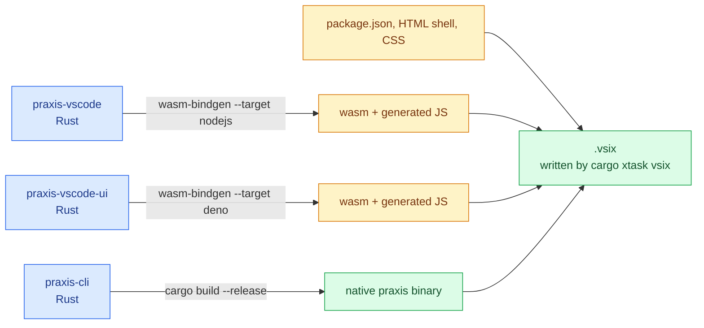

# ADR 0001: Rust only, with minimal VS Code glue

> [!NOTE]
> **Status: accepted, 2026-11-06.** Spike T0.6 proved the wasm entry point with no handwritten JS; see "Spike results".

## Context

The project owner requires the entire praxis to be written in Rust for maximum performance.

The native binary can be entirely Rust. VS Code is the exception: extensions run in a JavaScript extension host, webviews are HTML pages, and an extension needs a `package.json` manifest. A native Rust binary can't be loaded as the extension itself.

Microsoft's WebAssembly Component Model route isn't usable. Its working examples use a TypeScript `activate`, its Rust-authored extension exploration was not continued, and it lacks async support for VS Code's mostly asynchronous API.

## Decision

Compile the extension from Rust to WebAssembly with `wasm-bindgen`, which binds JavaScript APIs including `vscode` and Node's `child_process` directly. Glue JavaScript is generated at build time and exports `activate` and `deactivate`. All agent work stays in the native `praxis` binary, so wasm speed is irrelevant to agent performance.

The packaged extension is built without npm, a bundler or `vsce`: `cargo xtask vsix` writes the zip directly.

### The only permitted non-Rust files

| File | Why it can't be Rust |
|---|---|
| `editors/vscode/package.json` | VS Code requires it. Data, not code |
| Generated `wasm-bindgen` JS glue | Generated from Rust at build time, never committed or edited |
| One webview HTML shell and one CSS file | Webviews must load HTML; styling is CSS |
| `scripts/verify`, CI YAML | Dev tooling, not shipped |

If spike T0.6 shows `activate` can't be exported directly from generated glue, one additional handwritten file is allowed, containing no logic beyond re-exporting from the generated module.

Plugins and MCP servers are separate programs in any language. This rule covers the praxis, not what users choose to run with it.

## Spike results (T0.6, VS Code 1.145.0, wasm-bindgen 0.2.128)

- **Extension host:** `--target nodejs` works as is. The generated CommonJS exports `activate` and resolves `vscode` and `child_process` through `require`. The conditional re-export file was not needed.
- **Webview:** the UI uses `--target deno`, not `web` as first planned. It is the only target that starts the wasm on import with nothing else to call, because the shell can't make an init call:

| Target | Result in the webview |
|---|---|
| `web`, `no-modules` | Needs an init call, so an inline script (banned by the CSP) or handwritten JS |
| `module` | `SyntaxError`: VS Code's Electron rejects `import source` |
| `bundler` | Not run: its output imports the `.wasm` file as an ES module, which needs a bundler |
| `deno` | Works: top-level `fetch` plus `instantiateStreaming`, and it uses no Deno API |

- **CSP:** that `fetch` needs `connect-src ${cspSource}`, which the original policy lacked. The webview can already load the same origin through `script-src`, and `localResourceRoots` still limits local files to the extension. The added reach is `fetch` to `*.vscode-cdn.net`.
- **Profile:** `wasm32` std is `panic=abort`, so the crates build under a `wasm-release` profile instead of `release`.
- **Risk:** the `deno` target is chosen for what its glue does today, so recheck it when bumping `wasm-bindgen`. A failure shows as an empty panel, not a build error.

## Consequences

- Native, wasm and packaging builds are all driven by Cargo. There is no Node toolchain to maintain.
- We give up the npm ecosystem: the `@types/vscode` types, UI toolkits and `@vscode/test-electron`. Bindings for the VS Code API are handwritten and limited to what we call.
- Webview UI runs in wasm, so a slightly larger download and a CSP that includes `wasm-unsafe-eval`.
- Extension tests are limited: logic is tested natively and the integration surface through a manual checklist.
- Marketplace publishing without `vsce` is unresolved. Local `.vsix` install is the supported route for now.
- Expected performance gains are startup time, memory and a single binary. Inference dominates agent wall-clock time, so the biggest latency lever is prompt-cache reuse (SPEC §7), not language choice.

## Evidence

- [VS Code on WebAssembly](https://code.visualstudio.com/blogs/2024/05/08/wasm)
- [Cargo Tools](https://users.rust-lang.org/t/cargo-tools-vscode-open-vsx-extension/141527): an existing extension with its extension layer in Rust via `wasm-bindgen`, with a small TypeScript bridge. It shows the approach is viable, but not that the bridge can be avoided.
