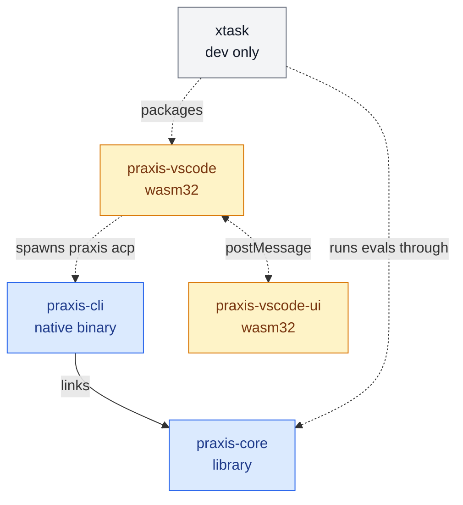

## 3. Workspace

```
Cargo.toml                 workspace, shared lints, release profile
crates/
  praxis-core/            library: everything below except front ends
    src/
      provider/            mod.rs, chat.rs, admin.rs, stream.rs, anthropic.rs (T8.3)
      agent/               loop, events, recovery
      context/             budget, compaction, repo map
      tools/               builtin tools, registry
      permissions/         rules, modes, sandbox policy
      config/              layers, trust
      session/             JSONL log, checkpoints
      mcp/                 rmcp client wrapper
      plugins/             discovery, skills, commands, agents, hooks
  praxis-cli/             binary `praxis`: CLI, REPL, `acp`, `sandbox-exec`
  praxis-vscode/          wasm32 cdylib: extension host side
  praxis-vscode-ui/       wasm32: webview UI
editors/vscode/            package.json, webview HTML shell, CSS
xtask/                     vsix packaging, eval runner
evals/                     task definitions, fixture repos
```

The wasm crates aren't default workspace members, so `cargo test` stays native.



Solid lines are compile-time links. Dashed lines happen at run or build time.

### Allowed dependencies

Verified latest versions on 2026-11-06. Use the current compatible release at T0.1 and commit `Cargo.lock`. Anything else needs human approval.

| Crate | Version | Used for |
|---|---|---|
| `tokio` | 1.54 | Runtime (multi-thread) |
| `tokio-util` | 0.7 | `CancellationToken` |
| `futures` | 0.3 | Stream combinators |
| `reqwest` | 0.13 | HTTP, features `stream`, `json`; rustls TLS |
| `serde`, `serde_json` | 1 | Serialization |
| `toml` | 1.2 | Config |
| `schemars` | 1.2 | Tool schemas from Rust types |
| `jsonschema` | 0.60 | Validating tool arguments |
| `clap` | 4.6 | CLI |
| `tracing`, `tracing-subscriber` | 0.1, 0.3 | Logging to stderr (`tracing-subscriber` version `UNVERIFIED`) |
| `thiserror` / `anyhow` | 2 / 1 | Core errors / CLI top level |
| `rmcp` | 3.9 | MCP client; `default-features = false`, features `client`, `transport-child-process`, `transport-streamable-http-client-reqwest` |
| `agent-client-protocol` | 5.0 | ACP v1, feature `stdio`. Don't enable `unstable_protocol_v2` |
| `ignore`, `globset` | 0.4 | `.gitignore`-aware walking, Glob |
| `grep-searcher`, `grep-regex` | 0.1 | Grep tool |
| `regex` | 1.13 | Hook matchers, permission rules |
| `similar` | 3.2 | Diffs for review |
| `directories` | 6 | XDG paths |
| `sha2` | 0.11 | Trust hashes |
| `landlock` | 0.4 | Sandbox |
| `wasm-bindgen`, `js-sys`, `web-sys`, `wasm-bindgen-futures` | Pin to the installed CLI | Extension |
| `leptos` (CSR) | 0.8 | Webview UI, not yet tried: T0.6 used `web-sys` directly |
| `pulldown-cmark` | 0.13 | Markdown in the webview |
| `zip` | 9.4 | `.vsix` (xtask only) |
| `wiremock` | 0.6 | Dev: fake provider server; also the fake server in `xtask vscode-smoke` |
| `tokio-tungstenite` | 0.30 | `xtask` only: Chrome DevTools websocket for `xtask vscode-smoke` (owner approved 2026-11-18) |

No SSE crate: `eventsource-stream` hasn't been updated since 2022, and line parsing is short. No tokenizer crate: see §7.

