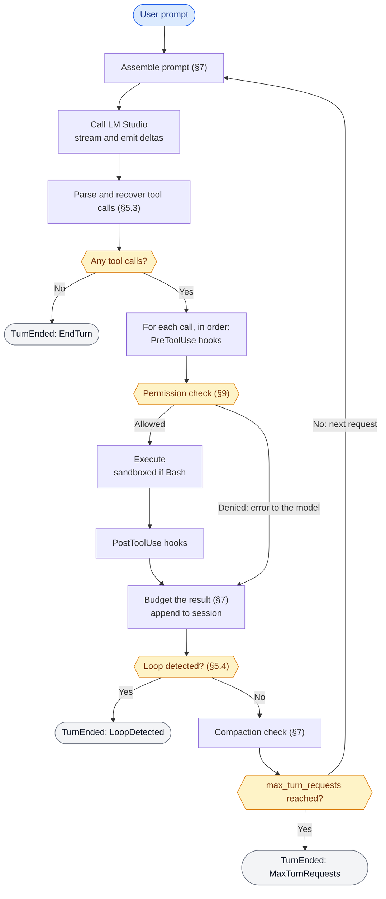

## 4. Core model

Front ends only ever see these events and send these commands. This boundary is what keeps ACP replaceable.

```rust
pub enum AgentEvent {
    TextDelta(String),
    ThinkingDelta(String),
    ToolStarted { id: ToolCallId, name: String, input: serde_json::Value, title: String },
    ToolFinished { id: ToolCallId, outcome: ToolOutcome },
    PermissionRequest { id: ToolCallId, name: String, input: serde_json::Value,
                        can_always: bool, diff: Option<FileDiff>, preview: Option<Preview>, respond: oneshot::Sender<PermissionReply> },
    Usage { prompt_tokens: u32, used_tokens: u32, context_size: u32, cached_tokens: Option<u32> },
    Compaction(CompactionState),
    Notice { severity: Severity, title: String, detail: Option<String> },
    TurnEnded(StopReason),
}

pub enum StopReason { EndTurn, MaxTokens, MaxTurnRequests, Cancelled, LoopDetected, ProviderError }

pub enum PermissionReply { AllowOnce, AllowAlways, RejectOnce, RejectAlways, Cancelled }
```

`ToolOutcome` is `Completed(ToolOutput)` or `Cancelled`. Variants and fields arrive with the task that first produces them: `Compaction` with T2.6, `diff` with T5.4 (the change a `Write` or `Edit` would make, from `tools::proposed_diff`, computed without writing), `preview` with T5.8. `can_always` says whether a front end may offer "always" (§9); core treats a disallowed `AllowAlways` as once. A `ToolStarted` precedes its `PermissionRequest`, and a denied call finishes as an error `ToolFinished`.

The agent loop runs as one Tokio task per session, sends events on an `mpsc` channel, and observes a `CancellationToken`. Handlers must be `Send`, which ACP also requires.

Before a turn may end, a turn that changed files (a successful `Edit` or `Write`) and ran no `Bash` after the last change gets one note, sent as a `MEMORY_MARK` user message, and the model gets another request. A second such note never comes in the same turn (T13.7).

Map to ACP stop reasons (§11): `LoopDetected` becomes `end_turn` plus a warning `notice`, and `ProviderError` becomes a JSON-RPC error on the prompt.

### Loop



A cancel or provider failure can end the turn at any step, giving `TurnEnded(Cancelled)` or `TurnEnded(ProviderError)`.

Tool calls run sequentially, except for one case. Within a round, each run of consecutive read-only calls (built-in `Read`, `Grep` or `Glob`, with no matching `PreToolUse` hook, no MCP name clash, and a permission decision of `Allow` with no prompt) runs concurrently, and the run ends at the first other call. Its outputs are consumed at each call's serial position, so events, loop detection, cancellation and history keep call order, and request bytes match the serial loop. Writes, shell, MCP, subagents and anything that prompts are barriers that run alone, so a read never overtakes a write before it. Local servers process requests serially, and ordering keeps the logs and permission prompts understandable. Cap at `max_turn_requests` (default 50).

