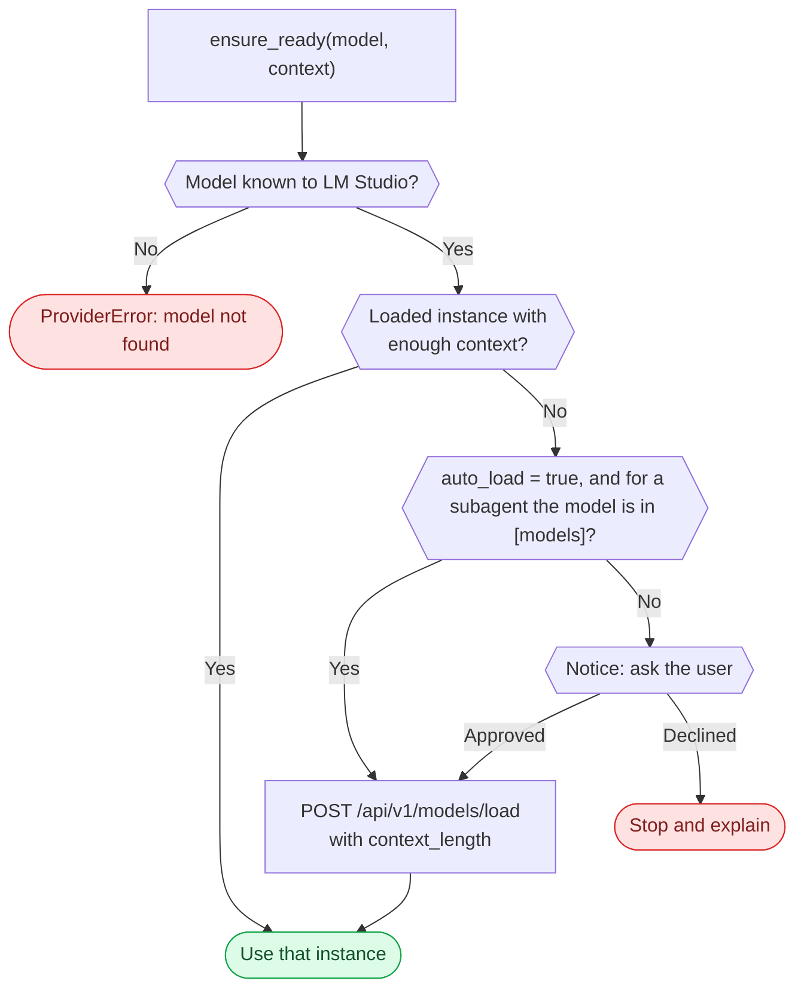
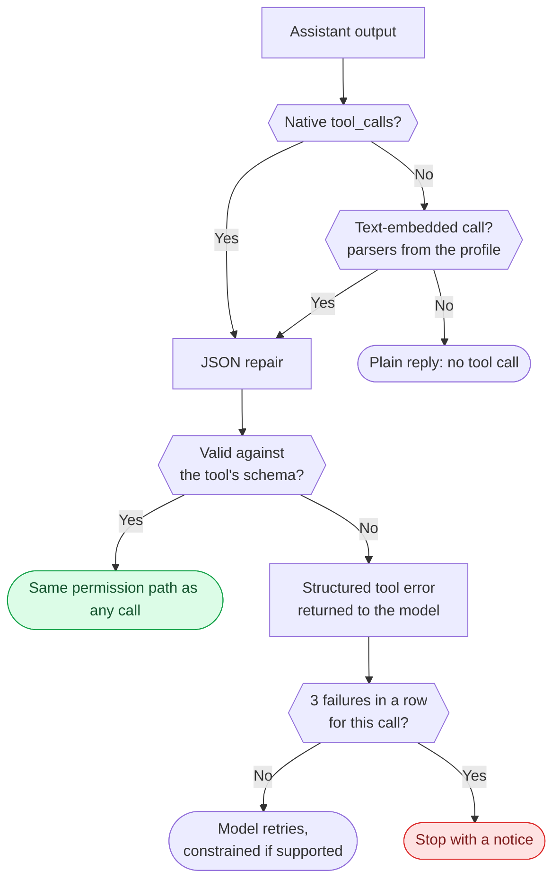

## 5. Provider

### 5.1 Shape

```rust
pub struct Provider { chat: ChatClient, admin: AdminClient }

impl Provider {
    pub async fn chat(&self, req: ChatRequest, cancel: CancellationToken)
        -> Result<impl Stream<Item = Result<ChatChunk, ProviderError>>, ProviderError>;
    pub async fn list_models(&self) -> Result<Vec<ModelInfo>, ProviderError>;
    pub async fn ensure_ready(&self, model: &str, context: u32, policy: LoadPolicy) -> Result<ReadyModel, ProviderError>;
}
```

Two backends ([ADR 0004](../adr/0004-anthropic-backend-and-per-agent-models.md)). LM Studio is the default: chat goes through its OpenAI-compatible route and model management through its native API. Anthropic is opt-in (§5.6). `Provider` holds a closed `enum Backend { LmStudio, Anthropic }`, chosen by the model reference, not a trait: tests go through HTTP against the fake server, so nothing needs a mock. `ensure_ready` and `list_models` load nothing on Anthropic; they read the Models API.

**Model references** are `<backend>/<model>` (`lmstudio/qwen3.5-4b`, `anthropic/claude-sonnet-5-5`) or an alias from `[models]` (§8). A bare name means LM Studio.  Only `lmstudio/` and `anthropic/` are backend prefixes: any other prefix is part of a bare LM Studio key (`google/gemma-4-12b-qat`), so an unknown backend can only be caught in an alias, whose `model` must carry a known prefix and can't name another alias.

- **Base URL:** LM Studio `http://localhost:1234` (seen on the dev machine, T0.3; configurable).
- **Proxies:** call `.no_proxy()` on loopback clients.
- **Remote URLs:** warn when a non-loopback URL uses plain `http://`.
- **Keys:** `api_key_env` in config names an environment variable. Keys are never stored in config or logged.
- **Errors:** connection refused, no model loaded (HTTP 400, `code: null`, message `No models loaded`), unknown model (HTTP 400, `code: model_not_found`), context overflow (see §5.2) and unsupported tools each get a distinct `ProviderError` with a message that tells the user what to do.
- **Retries (T13.2):** a 5xx, a dropped connection or a stream that ends before its first chunk is retried up to 3 times, waiting 1, 2 and 4 seconds, with the same request body so the prompt cache stays warm. Retries stop once output has arrived, so text the user already saw is never repeated. A 4xx and an SSE `event: error` (such as context overflow, §5.2) are never retried. A stream that sends `[DONE]` before any `finish_reason` fails as `ProviderError::Truncated` and its buffered tool calls are dropped, so the caller reports or retries instead of acting on a partial reply.

### 5.2 LM Studio facts

**LM Studio: chat through `/v1/chat/completions`, manage through `/api/v1/*`.** Native `/api/v1/chat` doesn't accept custom tools or client-supplied assistant messages.

| Item | Fact |
|---|---|
| Stream | OpenAI SSE |
| Context | `POST /api/v1/models/load` with `context_length`; with `echo_load_config: true`, the response's `load_config` shows what was applied |
| Model list | `GET /api/v1/models`: `key`, `max_context_length`, `loaded_instances[].{id, config.context_length}`, `capabilities.trained_for_tool_use` |
| Unload | `POST /api/v1/models/unload` |
| Auth | Optional `Authorization: Bearer` |
| Instances | `model` accepts an instance id such as `<key>:2`; use the id from `ensure_ready` |
| Usage | With `stream_options.include_usage`, a final chunk with empty `choices` has `prompt_tokens`, `completion_tokens`, `completion_tokens_details.reasoning_tokens`. No cached-token field |
| Reasoning | Delta field `reasoning_content` |
| Stream errors | **HTTP 200** with SSE `event: error`; the message embeds `exceed_context_size_error`, `n_prompt_tokens`, `n_ctx`. Overflow also arrives as **HTTP 500** `"Context size has been exceeded."` with no token counts (T14.11); both are `ContextOverflow` and neither is retried |

Evidence: [ADR 0002](../adr/0002-lmstudio-provider-findings.md).

**`ensure_ready` behaviour.** A reload would disrupt anything else using the server, so it only happens with consent:



`agent.auto_load` defaults to `true`, so a missing model loads without asking. Set `auto_load = false` to be asked first. For a subagent, auto-load covers only the LM Studio models named in `[models]` (`Config::auto_loadable_models`); any other model is asked for, so a model the agent picks can't evict the GPU. The provider never prompts. `LoadPolicy::Allowed` means the model is auto-loadable or approval already given. `LoadPolicy::AskFirst` fails with `ProviderError::LoadNeedsConsent` instead of loading, so the front end can ask and retry with `Allowed`, or stop and show the error's explanation. A load adds an instance and leaves existing ones in place. If a load applies less context than requested, that is an error.

### 5.3 Tool-call recovery

Weak models are the core problem here.



Stages, in order:

1. **Native** `tool_calls` from the response.
2. **Text-embedded calls**, only in the assistant's own output, using parsers selected by the model profile (`<tool_call>{json}</tool_call>` and the fenced `<tools>`/`<response>` JSON that qwen2.5-coder emits, ADR 0002).
3. **JSON repair:** double-encoded argument strings, trailing commas, code fences, literal newlines in strings, doubled braces, single-quoted strings.
4. **Schema validation** with `jsonschema` against the tool's input schema.
5. **On failure,** return a structured tool error to the model naming the problem and the expected shape. Allow up to 3 failures for the same call in a row, then stop with a notice.
6. **Constrained retry (T2.12).** The retry uses LM Studio's `response_format` JSON schema, which uses grammar sampling on GGUF models. T0.3 found no `tool_calls` come back when it is set, and sending `tools` too fails outright on `qwen3.5-4b`. So omit `tools`, read arguments from `content`, and turn reasoning off or give it enough output budget. This fixes structure only, so validation and permission checks still apply. LM Studio warns that not all models support structured output, especially those under 7B, so if the server rejects the request, the turn warns and falls back to plain retries.

Rules:

- Never parse tool calls out of tool results. Recovered calls go through the same permission path as native ones.
- Never execute a call that failed validation.
- On LM Studio, strip reasoning (`<think>` blocks or a reasoning field) before storing the assistant message, so history stays compact and stable. Still emit it as `ThinkingDelta`.
- Record parse failures for the scoreboard (`Agent::parse_failures`).
- A text format is parsed only when the profile selects it, and only if the reply has no native calls. "The same call" means the same tool name. Stopping uses `StopReason::LoopDetected`.

### 5.4 Loop detection

When one of these happens, the first detection in a turn does not run the call. Its result says "Not run:" with the reason and asks the model to change approach or finish. The next detection stops the turn with `LoopDetected`.

- The same tool and arguments occur 3 times in a row.
- The same tool and arguments occur 5 times within the last 20 calls.
- There are 10 consecutive read-only calls with an empty assistant message and nothing new read. A `Read` with arguments not seen before in the turn (a new file or a new range) counts as new.

A successful `Edit` or `Write` resets all counts, so edit-test cycles and rereads after a change are progress. Changes made by `Bash` do not reset them yet.

### 5.5 Model profiles

Layered: the vendor's preset, then built-in by name pattern, then capabilities reported by LM Studio, then user config. A later layer overrides only the fields it sets.

The vendor preset is the `llm.prediction.*` sampling fields (`temperature`, `topPSampling`, `topKSampling`, `minPSampling`, `repeatPenalty`; a `checked: false` value is off) from `~/.lmstudio/hub/models/<publisher>/<name>/model.yaml`. LM Studio's API doesn't report them. It's read only when the LM Studio URL is loopback and the key is a plain `publisher/name`; anything else, or no file, means no vendor layer. Evals read it on the host and pass it into the sandbox.

```toml
[profiles."qwen3*"]
context = 64000
max_output = 8192
tool_format = "native"        # native | hermes-text | ...; qwen2.5-coder is text-only (ADR 0002)
temperature = 0.2               # also top_p, top_k, min_p, repeat_penalty; unset ones are not sent
stop = []
strip_thinking = true
constrained_retry = true      # on once LM Studio reports the model
```

`max_output` caps `max_tokens` (§7); unset, `max_tokens` is the room left in `C`.

`praxis profile show [model] [--json]` prints each field's effective value and the layer that set it (`default`, `vendor`, `builtin "<pattern>"`, `lmstudio`, `user "<pattern>"`); `praxis profile set <field> <value>` writes the field to the user's `[profiles."<model>"]`, keeping the file's comments. Both start no model; `show` asks LM Studio only for capabilities.

`--model` loads with `lmstudio.context` if set, else the profile's `context`, else 32768. Without `--model`, the loaded instance's context is used. The §7 budget categories are shares of that size, so they follow the model. Evals use each task's own `context_length`.

A model reporting no tool support gets a warning, then text-embedded calling with the format described in the system prompt. Text formats (`hermes-text`, `fenced-json`) send no `tools` array; the system prompt lists the tools instead. A built-in text format is kept, and a user `tool_format` overrides everything and silences the warning.

**Runaway stop (T13.10).** While a reply streams, reasoning and content deltas feed a detector over the last ~400 words (whitespace-split). If the last words repeat one unit of 1 to 50 words 8 times in a row, over at least 64 words (so a short run like eight closing `}` is not a runaway), the stream is closed and the reply is handled as a `finish_reason=length` stop, so the continuation of T13.3 applies and its limit still counts. Only the stream's own text is checked, and a complete tool call already received is still run.

### 5.6 Anthropic facts

Opt-in backend from [ADR 0004](../adr/0004-anthropic-backend-and-per-agent-models.md). Raw HTTP over `reqwest`; there is no official Rust SDK and no new crate. Facts are from Anthropic's docs as of 2026-11-03 and stay `UNVERIFIED` until T8.1 records fixtures.

| Item | Fact |
|---|---|
| Endpoint | `POST https://api.anthropic.com/v1/messages` with `stream: true` |
| Headers | `x-api-key` (from `anthropic.api_key_env`), `anthropic-version: 2026-10-21`, `content-type: application/json` |
| Stream | SSE `message_start`, `content_block_start`/`_delta`/`_stop`, `message_delta` (stop reason, output usage), `message_stop`, `ping`, and `error` (which can arrive after HTTP 200) |
| Tool calls | `tool_use` content blocks; arguments stream as `input_json_delta` pieces, assembled by block index. Results go back as `tool_result` blocks in **one** user message, with `is_error: true` for failures |
| Tools | `input_schema` plus `strict: true`. Forced `tool_choice` (`any`, `tool`) is rejected on current models, so use `auto` |
| Sampling | `temperature`, `top_p`, `top_k` are rejected under this API version. Profiles must not send them |
| Thinking | `thinking: {type: "adaptive"}`, depth through `output_config.effort`. Thinking blocks must be sent back unchanged; editing earlier history can invalidate them |
| Caching | Top-level `cache_control: {type: "ephemeral"}`; `usage.cache_read_input_tokens` and `cache_creation_input_tokens` |
| Context | `GET /v1/models/{id}`: `max_input_tokens` (context) and `max_tokens` (output cap). Never assume it |
| Stop reasons | `end_turn`, `tool_use`, `max_tokens`, `pause_turn`, `refusal` (check before reading content) |
| Errors | 401 bad key, 429 rate limit and 529 overload (retry after `retry-after`, at most twice), 400 `invalid_request_error` |

Mapping rules:

- Text-embedded call parsing (§5.3 stage 2) and constrained retry are off; JSON repair, schema validation and the permission path stay on.
- `refusal` ends the turn as `ProviderError` with the category in the message. `pause_turn` resends the conversation unchanged.
- The first Anthropic request in a session emits a `Notice` naming the backend and model, because content leaves the machine.
- `cached_tokens` in `AgentEvent::Usage` is filled from `cache_read_input_tokens`.
- The profile layer "capabilities reported by LM Studio" (§5.5) comes from the Models API instead.

