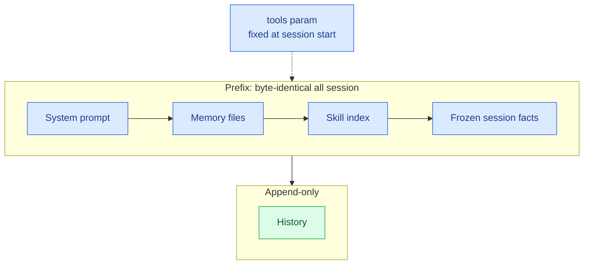
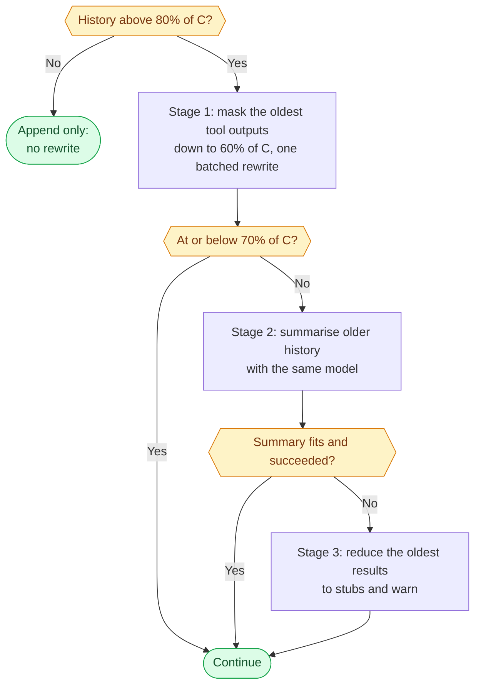

## 7. Context management

### Prompt layout

Everything before the history must stay **byte-identical** for the whole session.

- Date, cwd, branch and OS are captured once at session start. `.git/HEAD` and the gitdir pointer are read up to 64 KiB, since the repository is untrusted. If they change, append a message; never rewrite the prefix.
- Serialize tools and JSON deterministically, with stable key order.
- **Don't change the `tools` array mid-session.** Changing it forces a full reprocess, measured on both tested models (ADR 0002).
- Rewrite old messages only in a compaction pass. Filter and truncate tool output once, when first recorded.
- A fact that changed reaches the model as a note at the start of the next user message, because a separate message would break strict role alternation in some chat templates.
- A constrained retry (§5.3) must omit `tools`, so it and the next normal request each reprocess the whole prompt. History stays append-only across both, and only a failed call pays this.
- LM Studio reports no cached tokens, so log time to first token. A regression test (T2.5) asserts that consecutive request bodies share a prefix.

### Token budget

Default allocation of the context window `C`:

| Category | Limit |
|---|---|
| Reserved for output | `max_tokens` is the room left after the prompt, at least 15% of `C` and at most the profile's `max_output`. A reply cut off at the output limit is continued up to twice with a note, then the turn stops with `max_tokens` |
| System prompt, tools, memory files, skill index | 25% of `C`; warn and trim memory files when over. User files (`~/.claude/CLAUDE.md`, `~/.config/praxis/AGENTS.md`) are kept first; project files are cut first, nearest kept (owner decision, 2026-11-16) |
| One tool result | 10% of `C` |
| History | Whatever remains; compact when the whole prompt passes 80% of `C` |

**Counting:** no tokenizer dependency, because tokenizers vary by model and the server knows the truth. Estimate at `chars / 3.5`, then calibrate per session from the `usage` the server reports. Calibration skips empty prompts and clamps the chars-per-token ratio to [1.0, 8.0]. Compact early when uncertain.

**Oversized tool results:** keep head and tail, write the full text to the session's spool directory, and tell the model the path and how to read more. `Read` and `Grep` respect the budget themselves (§6), so their results are never spooled. The budget reaches the tools as `ToolContext::set_result_chars`, set from `result_limit()` when the agent is built or its model changes. Until sessions exist (§8), the spool is a private per-session temp directory removed at session end. `Read` may read it (outside the workspace, read-only); file names never come from the model. `max_tokens` is set to the output reservation.

**Truncation detection:** T0.3 saw no silent truncation: over `C`, LM Studio returns `exceed_context_size_error` (§5.2), which forces compaction. Before each request, check the estimate against `C`. As a guard against other versions, a reported prompt size below 50% of the calibrated estimate also warns and forces compaction; 50% is a judgement, not a measurement, since estimates were within 2% in T0.3.

### Compaction

Every rewrite of history discards the server's cache from that point on, so compaction is rare, batched and tiered, with the cheapest stage first. Evidence and the conflict behind this design are in [RESEARCH.md](../RESEARCH.md#the-conflict).

**Masking rules:**
- Mask whole tool results, never individual tokens or lines. Assistant text and tool calls stay.
- Always keep the most recent `mask_keep_turns` turns (default 10), or as many as fit. A turn starts at an assistant message. Never mask a result the model hasn't had a turn to use. Results already masked are skipped, and a result is spooled only when its placeholder is shorter.
- The placeholder names the tool, its arguments and how to get the output again, such as `[Output removed to save space: Read src/a.rs lines 1-200. Call it again if needed.]`. Repeating a call with side effects isn't a safe re-fetch, so output from anything but `Read`, `Grep` and `Glob` is spooled when masked and the placeholder gives that path.
- The window size needs tuning, so evals compare 5, 10 and 20 against no masking. Small models may be more sensitive.

**Summaries** use a structured template: goal, decisions, files changed, current state, next step. New history is `[summary] + [last N turns]`. It is one user message, labelled as model-written, and ends with the latest request verbatim so a summary can't lose it. A context overflow or a suspiciously small reported prompt forces compaction; an overflow retries the request once.

Every stage leaves the prefix before history untouched, emits `Compaction` events and records the boundary in the session log (until sessions exist, in `tracing` logs only). The full log stays on disk.

### Reducing tool output

Applied once, when a result is first recorded, so they never rewrite history. These are Should tasks and stay only if evals show no drop in success.

**Output filters (T2.11)** are rule-based. The complete output always stays in the spool directory, and they can be turned off with `filter_output = false`.

| Removed | Always kept |
|---|---|
| ANSI codes, progress bars, carriage-return overwrites | Exit codes |
| Consecutive repeated lines, replaced by a count | Every failing test, with its full output |
| Per-test pass lines, when the run has a summary | Errors, warnings and stack traces |
| `make` enter and leave directory lines | Anything from `Read`, which is never filtered |

**Cut (2026-11-13):** T2.10 cut 46% success against 64% without it, for 4% fewer prompt tokens (`evals/results/qwen3.5-4b.t2-10*.json`). Repeat reads return the full content again, and no outside-change notice is added.

### Tools at scale

MCP servers can exceed a small window on tool schemas alone. Decide once, at session start:

- Total schema size ≤ 10% of `C`: **direct** mode, with each tool in `tools`.
- Otherwise: **indexed** mode. `tools` holds only the built-ins plus `ToolSearch` (returns matching schemas as text) and `CallTool` (`{name, arguments}`), and the prompt lists names with one-line descriptions.

In indexed mode, permissions, hooks and logs act on the **inner** tool name, never `CallTool`, and arguments are validated against the inner schema.

### Repo map

Tree-sitter extracts symbols (file, signature, line). Respect `.gitignore`, cache by mtime, and fit a byte budget, preferring files near recent edits. It's exposed as a tool so the prefix stays stable. Start with Rust, Python, TypeScript, Go and C/C++.

**Cut (2026-11-12):** T2.8 added 40% more prompt tokens with no gain in success, so it isn't built. `tree-sitter` stays out of the dependencies.

