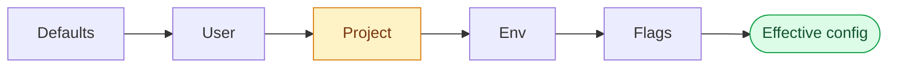
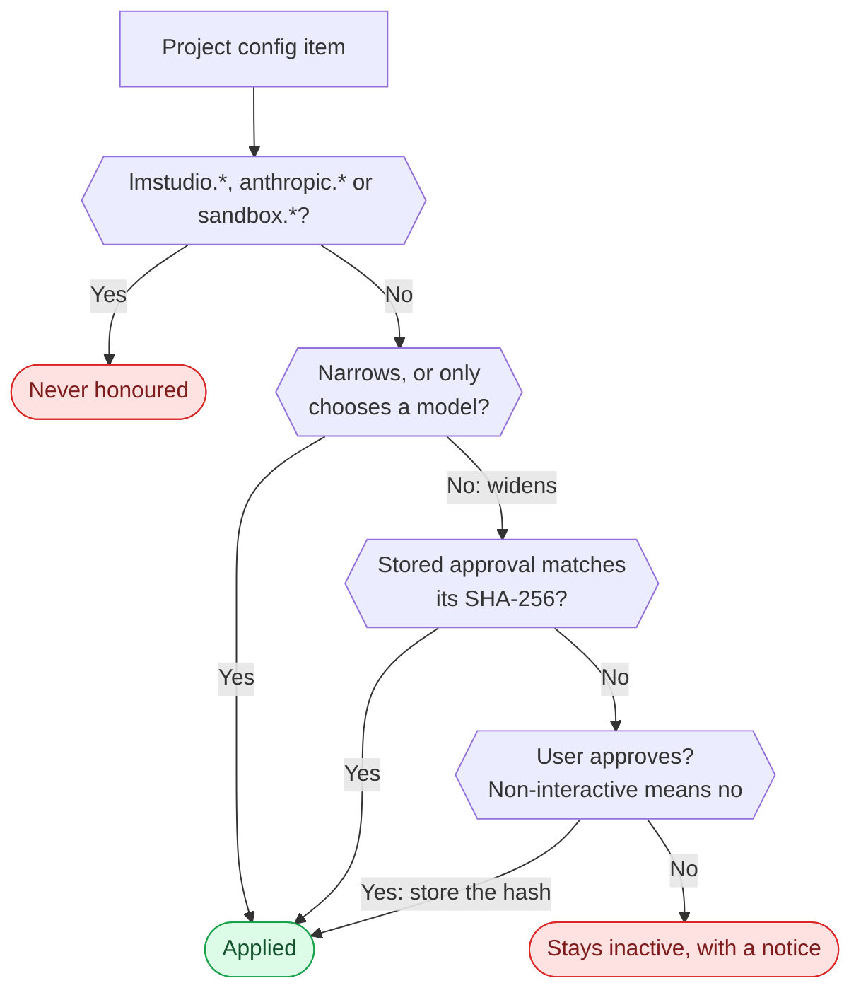

## 8. Config, trust and sessions

### Layers



Layers: built-in defaults, user `~/.config/praxis/config.toml`, project `.praxis/config.toml`, environment `PRAXIS_*`, CLI flags. Later layers win. Lists of permission rules merge; scalars replace. Errors name the file, key and problem. Unknown keys are errors, so only keys something reads exist: each task adds its own. The project layer is untrusted and passes through the trust gate below.

Variables and flags use dotted keys: `PRAXIS_AGENT__MAX_TURN_REQUESTS=20` (double underscore for a dot) and `--config-override agent.max_turn_requests=20`. A value is read as TOML if it parses, else as a string, so `default_model=qwen3.5-4b` works. Keys holding a dot, such as a profile pattern `qwen3.5*`, can only be set in a file. `PRAXIS_LOG_CONTENT` is not a config key.

```toml
default_model = "your-model"

[lmstudio]
base_url = "http://localhost:1234"
api_key_env = "LM_API_TOKEN"      # optional; names the variable holding the token
context = 32768                   # optional; context to load a model with, over the profile's

[anthropic]                       # opt-in, user config or flags only (§10)
enabled = false
api_key_env = "ANTHROPIC_API_KEY"
effort = "medium"

[models.sonnet]                   # aliases for --model and agents' `model:`
model = "anthropic/claude-sonnet-5-5"
[models.local]
model = "lmstudio/qwen3.5-4b"

[agent]
max_turn_requests = 50
auto_load = true

[context]
mask_keep_turns = 10
filter_output = true                 # on since the T2.11 eval (no drop in success)

[permissions]
mode = "ask"                      # read-only | ask | auto-edit | full-access (user config only)
allow = ["Bash(cargo test*)"]
deny = ["Read(**/.env*)"]

[sandbox]
mode = "on"                       # on | off
network = false
extra_write = []
extra_read = []

[mcp.filesystem]
command = "mcp-server-filesystem"
args = ["."]
```

Project MCP servers may also come from `.mcp.json` in Claude Code's shape, with or without the `mcpServers` wrapper. LM Studio's `~/.lmstudio/mcp.json` (`mcpServers` shape, `$HOME`) is a user-level source. It is the user's own file, so its servers load without a trust prompt (owner decision 2026-11-19); the MCP view's checkboxes turn them on and off. A name already in Praxis config wins, and a missing file is silent; a malformed one gives a notice.

### Trust

> [!WARNING]
> A cloned repository is hostile until approved. **Project config can always narrow, but needs approval to widen.**



| Project config item | Without approval |
|---|---|
| `deny` rules, model choice (within backends the user enabled), stricter mode | Applied |
| `allow` rules, wider mode | Ignored with a notice |
| MCP servers, hooks, plugins | Not started |
| `lmstudio.*`, `anthropic.*`, `sandbox.*` | **Never honoured from project config**, even when approved |
| Project `AGENTS.md`, `CLAUDE.md`, `CLAUDE.local.md` (§12) | Loaded as context, unlabelled; labelled `Instructions from:` once approved (T13.6) |
| Rules, skills, commands, agents (§12) | Loaded as context; they can't grant anything |

Approval stores the SHA-256 of the widening content in `~/.local/share/praxis/trust.json` (or under `$XDG_DATA_HOME`), keyed by the project config's path. Any change requires re-approval. In non-interactive mode, unapproved items stay inactive. A project MCP server that the block approval doesn't cover is listed as waiting and approved one server at a time (§13): its approval is stored under `server:<config path>#<name>` as the hash of its own TOML, so approving one never approves its siblings. A refusal isn't stored, so the next interactive run asks again, and a store that can't be parsed is a config error, never an empty store.

Project memory files use the same store (decided by the owner, 2026-11-14). Each file's expanded text (after comments are stripped and imports expanded) is hashed and keyed by the file's path. A file whose hash is stored, or that a person approves at a terminal, is labelled `Instructions from:` (§12). Any other file stays unlabelled context. ACP and piped runs have no terminal, so they only honour stored approvals. ACP can approve MCP servers, through the MCP view's Approve action (§13), but never memory files. An unreadable store leaves memory files unlabelled with a warning; it never approves anything.

The widening items so far are `permissions.allow`, `agent.auto_load = true` and a `permissions.mode` wider than the user's. A project's `permissions.mode = "full-access"` is refused outright, never offered for approval (T10.7). They are approved or refused together: the prompt shows them as TOML, and the hash covers exactly that text. Claude Code's `~/.claude/settings.json` is the user's own file, so its `permissions.allow`, `permissions.deny` and `hooks` apply without a trust prompt: approved by the project owner on 2026-11-12. Project `.claude/settings.json` and `settings.local.json` widen through this gate like `.praxis/config.toml`, with `hooks` added to the approved TOML (§12, T9.8). MCP servers and plugins join this list in their own tasks. The hostile fixture in `crates/praxis-core/tests/fixtures/hostile-repo` sets every item, and each task that adds one extends it.

### Sessions

- `~/.local/share/praxis/sessions/<id>.jsonl`: a header line, then one JSON record per line, append-only, mode `0600`. The header is `{"session":{"workspace":"<canonical path>","started":<Unix seconds, UTC>}}`. Tolerate a truncated last line on load, since a crash can cause one. A subagent's assistant and tool records carry `subagent_of: "<Agent call id>"`, which is absent on the parent's own lines (older logs have none). Resume keeps those lines out of the model's history; replay nests them under the `Agent` call (T10.11).
- Session index: listing a workspace's sessions reads each log's header, its mtime (last activity, since logs only grow) and its first user line (the title, trimmed), newest first. Logs with no readable header, or a truncated one, are skipped and belong to no workspace.
- Folders (T10.5): `<dir>/folders.json` maps session id to folder name, a JSON object beside the logs; the logs never change. A session in no folder has no entry. Names are trimmed, at most 64 characters, with no control characters; an empty name removes the entry. A missing or corrupt file reads as no folders. Writes go through a temp file and a rename. Deleting a session removes its entry. The listing carries `folder` (null when unfiled).
- Resume (`--resume=<id>`) rebuilds history from the log; `--resume` with no ID picks the newest session of the current workspace. The system prefix is rebuilt fresh, not logged. A failed log write stops the turn (`LogFailed`) before another request or tool runs.
- Before any `Write` or `Edit`, save the original in `<id>/checkpoints/`. `/undo` restores the last turn's files. Copies are kept for the last 20 turns; older turns and their copies are deleted when a new turn begins (`CHECKPOINT_TURNS`). Undo history is not persisted, so a resumed session deletes the copies left by earlier runs when it starts. Session logs are kept until the user removes them. Bash side effects can't be undone, and the UI must say so. Rewind (`/rewind <n>`, `Agent::rewind_to_turn`) restores files and history to before user turn `n`: it works on the same copies, so it can't reach turns from an earlier run or past the window. The log gets a `{"rewind":{"turn":n}}` line, and replay drops turn `n` and later entries. Rewinding stops once a summary has replaced older history.
- Sessions contain source code and tool output. They never leave the machine.

