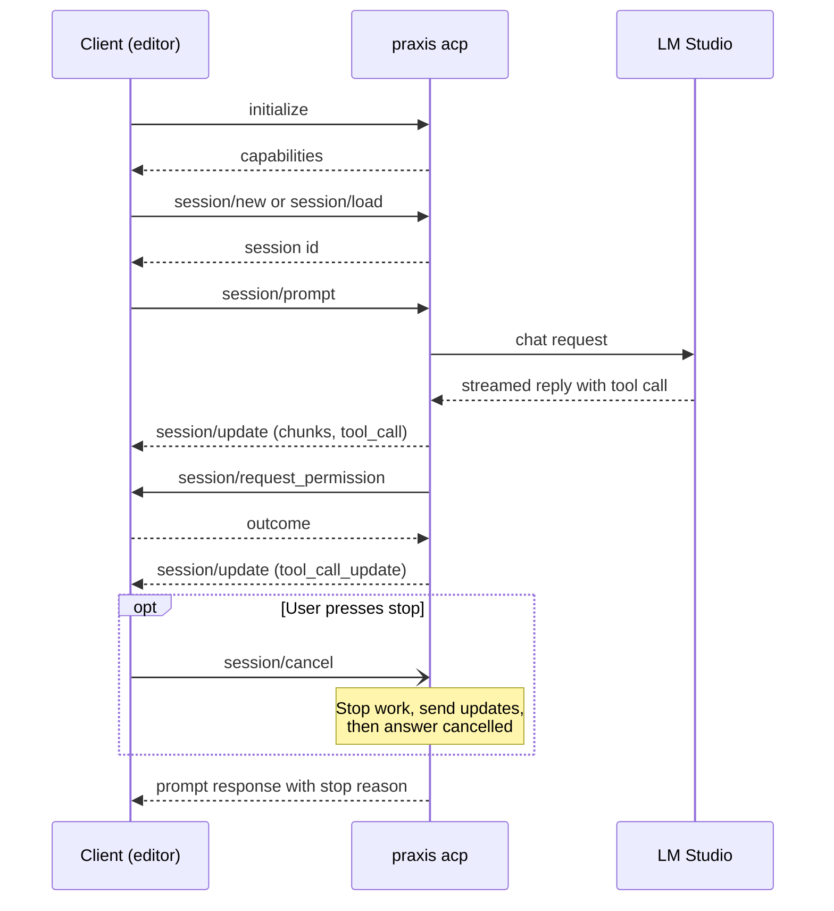
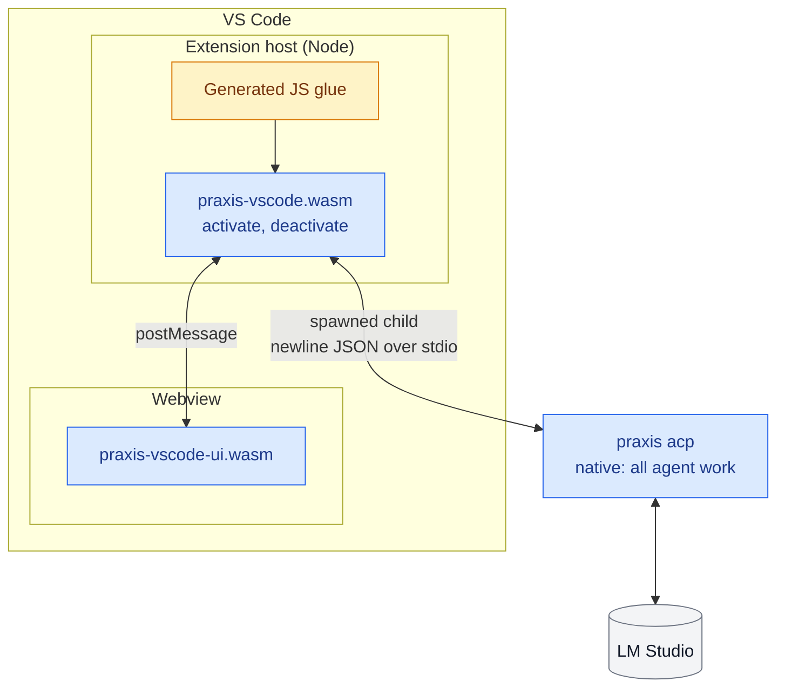

## 11. Front ends

### CLI

```
praxis [PROMPT]             one-shot if PROMPT or stdin is given; otherwise REPL
praxis --resume[=ID]        resume a session; the ID needs `=`, bare `--resume` takes the newest
praxis models               list models and effective context
praxis acp                  ACP agent over stdio
praxis plugin <install|list|enable|disable|remove>
praxis sessions [--json]    list this workspace's sessions; starts no model or MCP server
praxis sessions --folder <ID> <NAME>    move a session into a folder; an empty NAME removes it from its folder
praxis sandbox-exec         hidden helper
```

Flags: `--model`, `--mode`, `--config-override KEY=VALUE`. So far only `--model` and `--config-override` exist.

REPL commands: `/undo`, `/exit`, and plan-first (T5.9). `/plan <task>` runs the task under read-only mode, so `Write`, `Edit`, `Bash` and MCP tools are refused whatever the rules or the model say, and the prompt shows `(plan)` until `/execute`. `/execute` switches back to the configured mode and asks the model to carry out the plan. Only the developer's commands change the mode; no tool can. `/execute` with no plan is refused, and an unknown `/command` is reported and never sent to the model. Without `--model`, the first loaded model is used. Piped stdin can't answer prompts: only a terminal can approve, so non-interactive runs deny. Exit codes: 0 success, 1 runtime or provider error, 2 usage or config error, 130 cancelled. ACP and REPL mode race their work against SIGTERM, so returning drops the agent and its MCP children and tool process groups are cleaned up.

After a turn that called any tool, the CLI prints a turn summary to stderr (`praxis_core::summary`, T5.7): files changed by successful `Write`/`Edit` calls, Bash commands with exit codes, and whether a test command ran and passed. It reads only the tool log, so it says "No tests ran this turn" even when the model claimed otherwise. Commands that never finished show `not finished`. Test commands are matched by name (`cargo test`, `pytest`, `npm test`, `scripts/verify`, ...).

Ctrl-C cancels the turn once and exits the second time. When stdout isn't a terminal, output plain text.

### ACP mode

Transport is stdio only: newline-delimited JSON-RPC, one message per line. stdout is protocol only, stderr is logs.

Start from `Agent.v1()` with a `Stdio` transport and `Builder` handlers. Handlers, transports and connection futures must be `Send`. The crate has no worked agent example on its docs.rs front page, so read its `concepts` module and `examples/simple_agent.rs`.



| Direction | Methods |
|---|---|
| Implement | `initialize`, `authenticate` (no-op: no auth methods), `session/new`, `session/load`, `session/list`, `session/prompt`, `session/cancel`, `session/set_mode` |
| Send | `session/update`, `session/request_permission` |
| Use if advertised | `fs/read_text_file` (so `Read` sees unsaved editor buffers) |
| Use if advertised in `_meta.praxis.diagnostics` | `_praxis/diagnostics` after a `Write` or `Edit`: the client answers `{problems}`, and the error lines of the file are appended to the tool result (T11.3) |

| `AgentEvent` | `session/update` variant |
|---|---|
| `TextDelta` | `agent_message_chunk` |
| `ThinkingDelta` | `agent_thought_chunk` |
| `ToolStarted` | `tool_call` (`toolCallId`, `title`, `kind`, `status`) |
| `ToolFinished` | `tool_call_update` (`status`, `content`) |
| `Usage` | `usage_update` (`used`, `size`) |
| Commands | `available_commands_update` after `session/new` and `session/load`: each user-invocable command as `name` (`<plugin>:<name>`), `description`, `_meta.source` (plugin, or the directory of a standalone skill). Sent only when the list is non-empty. The panel's `/` autocomplete filters it. |
| `Notice` | `notice`, if the client has `session.notices`; otherwise a message chunk |
| `Compaction` | `compaction_update`, if the client has `session.compaction` |
| `Subagent` (T10.8) | its `TextDelta` becomes `tool_call_update` content on the `Agent` call, sent per completed line as only the new lines with `_meta.praxis.append: true` (the panel appends them; the final reply replaces them); its `ToolStarted`, `ToolFinished` and `PermissionRequest` go out as above with `_meta.praxis.parentToolCallId` naming that call; a permission title is `<subagent type>: <tool title>` |

`_meta.praxis` carries the praxis-specific fields a plain client ignores: `subagent` (the subagent's type) on an `Agent` `tool_call`, and `parentToolCallId` on a subagent's tool call or update. A `Write` or `Edit` call also carries `filePath` (its `file_path` input), so the panel can list the files a subagent changed on its `Agent` call (T10.12): the completed ones, deduplicated, each opening as the file's Git diff, or the file where git has none. Paths outside the workspace aren't opened. On `session/load`, a logged subagent record replays with the same `parentToolCallId`, so a reload nests its calls as a live turn does. `subagentUsage` `{promptTokens, contextLength}` rides on a `tool_call_update` of the `Agent` call (no status, no content) with the subagent's prompt size; the parent's `usage_update` never carries it. Plain ACP clients see a flat list, with the subagent's text only on its `Agent` call; a client that replaces content on each update shows only the latest lines until the reply lands.

Stop reasons: `end_turn`, `max_tokens`, `max_turn_requests`, `refusal`, `cancelled`.

**Cancellation:** on `session/cancel`, stop model requests and tools at once, send final updates *before* answering the prompt, and respond with `cancelled`. Treat aborted-operation errors as cancellation rather than failures.

**Stopping one subagent (T10.12):** the extension notification `_praxis/cancel_subagent` with params `{sessionId, toolCallId}` cancels the subagent running under that `Agent` call and nothing else. Each subagent runs under its own child of the turn's token, so the `Agent` call completes with the text `The user stopped this subagent.` (not an error) and the turn goes on to its end. Unknown ids and finished subagents are ignored. Other extension notifications are ignored too.

**MCP servers (T4.7):** `_praxis/mcp_servers` with `{sessionId}` answers `{servers: [{name, source, status, tools, enabled}]}`, where `source` is `user`, `project`, `plugin` or `lmstudio`, `status` is `connected`, `failed` or `needs_approval`, and `tools` is the list of tool names without the `mcp__server__` prefix. `_praxis/set_mcp_enabled` with `{sessionId, name, enabled}` answers `{name, enabled}`. Both are session-only and nothing is persisted. A change applies from the session's next turn. A `needs_approval` row also carries `command`, the command line or URL its approval would run. `_praxis/approve_mcp_server` with `{sessionId, name}` approves that server (§13) and answers `{name, notices}`, or an error when no such server is waiting.

**Rewinding to a turn (T11.5):** the extension request `_praxis/rewind` with params `{sessionId, turn}` runs `Agent::rewind_to_turn` (SPEC §8) and answers `{turn}`. An out-of-window turn, or a turn still running, is an error reply and changes nothing. The panel's "Rewind to here" button on a user message sends it, and on success cuts the chat back to that message.

Checked against `v1::schema` in schema crate 1.15.1 (T0.5, [ADR 0003](../adr/0003-keep-acp-for-the-front-end-protocol.md)):

- **Permission option kinds:** `allow_once`, `allow_always`, `reject_once`, `reject_always`. The answer's `outcome` is `selected` with an `optionId`, or `cancelled`. After `session/cancel`, the client must answer pending requests with `cancelled`.
- **Tool `kind`:** `read`, `edit`, `delete`, `move`, `search`, `execute`, `think`, `fetch`, `switch_mode`, `other`. `other` is the default, and unknown values parse as `other`.
- **Diff content:** a `content` item on a tool call or its update, `{"type": "diff", "path", "oldText", "newText"}`. `path` is absolute, and `oldText` is omitted or `null` for new files. A permission request can carry it, which edit review needs. `Write` and `Edit` permission requests carry one (T5.4), and the extension opens it in VS Code's diff editor. Both sides are untitled documents, so the review never writes the file; the answer still decides.
- **`mcpServers`:** required on `session/new` and `session/load`. It may be empty or `null`, but omitting it is a parse error. Agents must support stdio servers; `http` and `sse` servers are only allowed if the agent advertises them in `mcpCapabilities`. If `session/new` passes MCP servers, treat them as user-approved, since they come from the user's editor.

Handlers run inside the connection's dispatch loop, and awaiting a client response in one deadlocks. The `session/prompt` handler spawns its work and keeps the responder.

So far (T5.1): `session/set_mode` isn't implemented, sessions run in the launch directory whatever `cwd` says, `mcpServers` from the client are ignored, only text prompt blocks reach the model, `notice` always falls back to a message chunk and compaction isn't shown. `session/load` replays user and assistant text, and each tool call with its result, in order. `session/list` (T5.11) needs a `cwd` and returns only that workspace's sessions, with the first prompt as `title` and the log's mtime as ISO 8601 `updatedAt`; it advertises `sessionCapabilities.list`, uses the stable v1 schema (no unstable feature), and does no pagination (`nextCursor` is always null). The VS Code sessions view (T5.12) lists through `praxis sessions --json` run in the workspace, the same way the Plugins view runs `praxis plugin list --json`, so a refresh starts no model or MCP server. It opens a session in a new panel through `session/load`. Turns that end in a provider or log failure, or a detected loop, answer with a JSON-RPC error rather than a stop reason.

### Developer experience requirements

These apply to every front end where they fit. Evidence is in [RESEARCH.md](../RESEARCH.md#developers-in-the-ide).

| Requirement | Rule | Tasks |
|---|---|---|
| **Status** | Always show the phase (loading model, processing prompt, generating, running tool), elapsed time and context used. `/v1` has no prompt-progress events, so show elapsed time rather than a made-up progress bar | T5.3 |
| **Layered detail** | One line per tool call, with output on expansion. Never stream raw output into the main view | T5.3 |
| **Steering** | Stop works at any moment, and the next prompt continues from consistent history, with interrupted calls marked as cancelled | T1.7 |
| **Plan first** | `/plan` runs a turn in read-only mode and asks for a plan with assumptions. Carrying it out is a separate action by the developer | T5.9 |
| **Turn summary** | Built from the tool log, never the model's claims: files changed, commands run, exit codes, and a plain statement if no tests ran | T5.7 |
| **Change-set review** | In the chat, each `Write` or `Edit` call has "Open diff" (native diff) and "Revert file" (restores the file from checkpoints to before the change set). The separate review panel and risk labels were removed as noise | T5.8 |
| **No false assurance** | Never show a score, tick or wording implying that code is correct or secure unless a tool actually verified it | All |
| **No constant suggestions** | Inference only runs when the developer asks for it | All |

**System prompt contract (T2.13).** Keep it short, since it sits in the prefix. Ask the model to state assumptions, say when it's unsure, disagree when a request looks wrong, make small steps, and report only what it has verified. Models won't always comply, so the turn summary doesn't depend on it.

### VS Code extension

See [ADR 0001](../adr/0001-rust-only-with-minimal-vscode-glue.md).



Build:

- Extension crate: `wasm32-unknown-unknown`, `wasm-bindgen --target nodejs`, and `main` in `package.json` points at the generated JS.
- UI crate: `wasm-bindgen --target deno`, loaded by the HTML shell. It starts on import; `web` would need an init script (ADR 0001).
- Bindings: `#[wasm_bindgen(module = "vscode")]` and `module = "child_process"`, only for what's called.
- ACP types: try the `agent-client-protocol` crate on wasm through its `Channel` or `ByteStreams` transport, keeping `JsValue` out of the connection (`JsValue` isn't `Send`). If this is too heavy, use only its schema types and frame lines by hand.
- `cargo xtask vsix` zips `extension.vsixmanifest`, `[Content_Types].xml` and `extension/**`. Linux x64 first, with the native binary at `extension/bin/`.

Features:

| Feature | Mechanism |
|---|---|
| Chat panel | Webview view with streaming output and a stop button |
| Edit review | On a permission request for `Write` or `Edit`, open the native diff editor via `vscode.diff`, with accept and reject |
| Other permissions | Prompt in the panel, including "always" |
| Tool activity | Collapsible items with status |
| Model picker | Backed by `models` data and config |
| Model settings | A gear beside the picker opens a popover that lists the selected model's profile fields with their source; saves run `praxis profile set` one at a time and apply from the next chat |
| Context | Active file and selection attached as prompt resources; diagnostics on request |
| Output channel | Praxis stderr |

Security and accessibility requirements:

- `capabilities.untrustedWorkspaces.supported = false`.
- `praxis.binaryPath` must have **`"scope": "machine"`**, so a repository's `.vscode/settings.json` can't point it at a malicious binary. The same applies to any setting that affects execution.
- Webview CSP: `default-src 'none'; script-src ${cspSource} 'wasm-unsafe-eval'; style-src ${cspSource}; connect-src ${cspSource}; base-uri 'none'; form-action 'none'` (`connect-src` is how the glue fetches the wasm, ADR 0001). No inline scripts; `localResourceRoots` limited to the extension directory.
- Render model text through `pulldown-cmark` with **raw HTML escaped**, not passed through. Only allow `http`, `https` and `vscode` link schemes, opened with the editor's confirmation.
- Validate every message between webview and extension against typed enums.
- All controls keyboard reachable and labelled; streaming region uses `aria-live="polite"`; use VS Code theme CSS variables. Respect reduced motion.

If the child exits, show the error and last stderr lines, with a restart button.

So far (T5.3): the panel is an editor-tab webview opened by `praxis.open`, not a webview view. ACP lines are framed by hand with `serde_json` (`praxis-vscode/src/protocol.rs`), not the `agent-client-protocol` crate, and become typed panel messages (`text`, `tool`, `permission`, `usage`, `done`, `notice`). Model text renders through `pulldown-cmark` with raw HTML escaped, links outside `http`, `https` and `vscode` dropped, and images reduced to alt text. Tool calls are collapsed `<details>`. Permission prompts are panel buttons; answers are checked against the open request and its offered options, and Stop sends `session/cancel` then answers open prompts `cancelled`. There is no status line: a busy indicator (pac-man with a cycling word, from `update_working`) shows while a turn runs, and "loading model" never shows because ACP sends no such event. On exit the panel shows the code, stderr is in the output channel, and an error notification offers Restart. Prompts sent while a turn runs join a queue above the input (`praxis-vscode-ui/src/queue.rs`), each removable; an `end_turn` sends the next as a normal `session/prompt`, and a cancel, error, refusal or rejected permission pauses the queue until Resume (T14.2; the CLI has no queue yet). Each subagent is shown with a name from a fixed list (Blinky, Pinky, Inky, Clyde, then colours) in order of first arrival, wrapping; the name lives in the panel only, so the prompt prefix is unchanged (T14.1).

### Configuration surfaces

Config reaches the user through three surfaces. Each key lives in one of them:

| Surface | Keys | Scope |
|---|---|---|
| Chat panel | `model`, `agent`, permission `mode` | Session only. Never written to a file; a new session falls back to config. |
| VS Code settings | `praxis.binaryPath` (machine scope), `praxis.defaultModel`, `praxis.lmstudio.baseUrl`, `praxis.agent.maxTurnRequests`, `praxis.context.maskKeepTurns`, `praxis.context.filterOutput`, `praxis.permissions.mode` (machine scope, T10.7) | Forwarded to the CLI as `--config-override` only when the user set them; they apply to new chats, since nothing watches configuration at runtime. Each open chat's agent is killed on deactivate. |
| File only (`config.toml`) | `mcp`, `hooks`, `sandbox.*`, `permissions.allow`, `permissions.deny`, `anthropic.*`, `profiles.*`, `plugins` | Read from the user and project layers. |

Rule: security-relevant keys are never workspace-settable VS Code settings. Workspace settings (`.vscode/settings.json`) come from the repository, so exposing permissions, sandbox, hooks or the binary path there would let a repository bypass the trust gate (§8) and the invariants in §10. `praxis.binaryPath` and `praxis.permissions.mode` are machine-scoped for the same reason; the mode is the only permission key exposed, and only so the user can choose `full-access` (T10.7).

Precedence: an extension-supplied `--config-override` is a CLI flag, so it beats env and file layers, as §8 says. An unset VS Code setting adds no override, so the file and env values apply.

